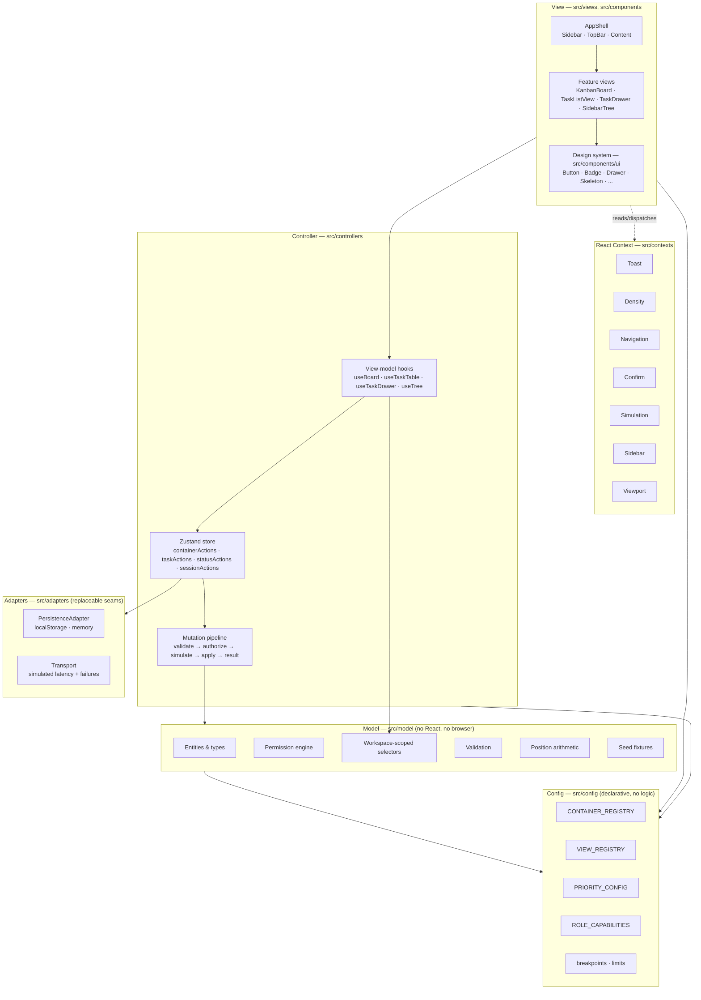
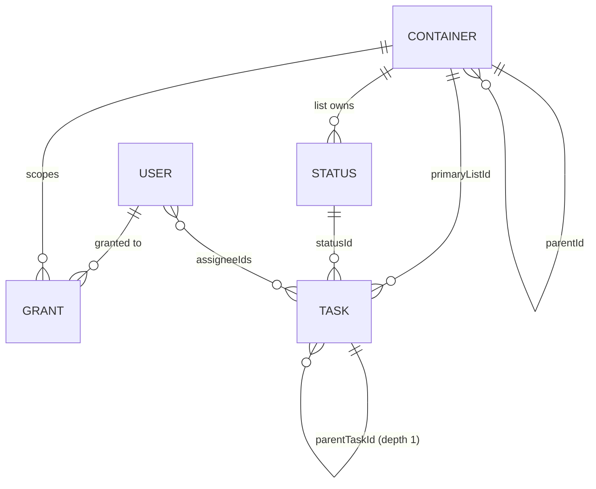

# Flowboard — Design

## Overview

Flowboard is a single-page React application with no backend. A typed, normalized in-memory store seeded from deterministic fixtures replaces the API and database, wrapped in a transport shim that adds latency and injectable failures so the UI exercises real loading, error and rollback paths.

The codebase is organized as an explicit **MVC** separation:

- **Model** — pure TypeScript. Entities, validation, permission resolution, position arithmetic, selectors, seed fixtures. No React, no Zustand.
- **Controller** — the Zustand store, mutation actions, permission enforcement, optimistic apply/rollback, latency/failure simulation, and the view-model hooks that adapt Model data into View props.
- **View** — presentational React components. Props in, callbacks out. No store imports below the view-model boundary.

React Context carries cross-cutting _presentation_ concerns (toasts, density, navigation, confirmation, simulation settings, sidebar chrome). The Zustand store remains the single source of truth for _domain_ state. This split is deliberate and enforced by lint.

### Why these choices

| Decision                                           | Rationale                                                                                                                                                                                                                                                                                                                                                                                                                                                                                                                                                                                                                                                                  |
| -------------------------------------------------- | -------------------------------------------------------------------------------------------------------------------------------------------------------------------------------------------------------------------------------------------------------------------------------------------------------------------------------------------------------------------------------------------------------------------------------------------------------------------------------------------------------------------------------------------------------------------------------------------------------------------------------------------------------------------------- |
| Zustand over Redux                                 | Mutations are simple and local; Zustand's single-file store keeps the Controller layer compact and avoids action/reducer ceremony. `getState()` outside React also makes Controller logic directly unit-testable without rendering.                                                                                                                                                                                                                                                                                                                                                                                                                                        |
| dnd-kit over react-beautiful-dnd                   | Headless, actively maintained, keyboard sensor and live-region announcements built in, and it lets us render our own drag overlay rather than accepting a library-styled one.                                                                                                                                                                                                                                                                                                                                                                                                                                                                                              |
| `@dnd-kit/react` over the legacy `@dnd-kit/core` 6 | The project started on the 6.x line and moved to the current packages (`@dnd-kit/react`, `@dnd-kit/dom`, `@dnd-kit/abstract`, `@dnd-kit/helpers`). 6.x recomputed a transform in React on every pointer event, and would only open a gap in a destination column for a card that had been re-parented into its `SortableContext` — so a cross-column drag cost React state per frame. The current packages are signal-based and write transforms to the DOM directly. The cost is that they are pre-1.0 (0.5.1), so the API may still shift. See "Drag and drop" for the one rule the migration imposes.                                                                   |
| Headless UI                                        | Unstyled and Tailwind-native. Gives correct focus trapping, Escape handling, focus restore and ARIA wiring for Dialog/Menu/Listbox without fighting a styled component kit.                                                                                                                                                                                                                                                                                                                                                                                                                                                                                                |
| `@rehookify/datepicker` over `<input type="date">` | The native input was the one control that ignored the token system — it is barely styleable, renders differently in every browser, and cannot show which day is today or which are out of range. This library is headless in the same sense as Headless UI: calendar arithmetic and `Intl` formatting, no styles, no DOM, no dependencies of its own. It supplies `aria-selected` and a roving `tabIndex` but **no** key handling, so the grid navigation is ours.                                                                                                                                                                                                         |
| Calendar-only selection, no typed entry            | A text field admits half-written values, locale-ambiguous ones (`03/04`), and month-end rollover (`2026-02-31` silently becoming 3 March) — a validation surface that exists only because the field accepts prose. Removing it deletes the entire class. The cost is keyboard reach, paid for by making the grid fully navigable rather than arrows-only: focus lands on a day as the panel opens, Home/End move within the week, PageUp/PageDown change month, and Shift turns those into year jumps. Without the year jump a date two years out would have been twenty-four keystrokes, which is the point at which "calendar-only" would have become a real regression. |
| Tailwind v4 with `@theme`                          | v4's engine reads tokens from CSS. One token file, zero config file, and tokens become first-class utilities (`bg-priority-urgent`).                                                                                                                                                                                                                                                                                                                                                                                                                                                                                                                                       |
| Fractional positions                               | Reordering writes one row instead of renumbering every sibling, and the arithmetic is trivial to unit test.                                                                                                                                                                                                                                                                                                                                                                                                                                                                                                                                                                |
| Hard delete for tasks, archive for containers      | The brief requires soft-delete/archive for containers only. Tasks get a confirm-then-delete to keep the Model from accumulating tombstones that complicate every selector. Documented as the chosen trade-off.                                                                                                                                                                                                                                                                                                                                                                                                                                                             |
| Mobile-first                                       | Building the constrained layout first forces the information hierarchy to be decided rather than inherited from available space. Widening a working small layout is additive; narrowing a desktop layout means deciding what to delete under pressure. Tailwind's unprefixed-is-smallest model makes this the grain of the tool rather than a fight with it.                                                                                                                                                                                                                                                                                                               |
| `rem` everywhere                                   | A user who sets a 20px root font size should get a 25% larger app, not a larger font inside fixed boxes. Tailwind's default scales are already `rem`, so the rule is mostly about refusing `px` in arbitrary values.                                                                                                                                                                                                                                                                                                                                                                                                                                                       |
| Configuration registries over conditionals         | The hierarchy, view set, priority set and capability set are all closed enums today and all plausibly open tomorrow. Expressing each as one data structure means extending them is an edit to a single declaration instead of a hunt through `switch` statements.                                                                                                                                                                                                                                                                                                                                                                                                          |
| Adapter interfaces for persistence and transport   | These are the two seams most likely to be replaced — `localStorage` to a server, simulated latency to real HTTP. Putting an interface at each keeps the replacement a new file rather than a diff across the Controller.                                                                                                                                                                                                                                                                                                                                                                                                                                                   |

### Scope today vs. shape for tomorrow

The brief scopes one workspace. That is a scope decision, not a modeling decision, and the two are kept separate throughout:

| Narrow today                            | Shaped for                | Mechanism                                                                                              |
| --------------------------------------- | ------------------------- | ------------------------------------------------------------------------------------------------------ |
| Per-user access lists                   | Team access lists         | `ContainerAccess` ⇄ `Grant[]` behind one rule table; a save preserves non-user subjects                |
| One workspace                           | Many                      | `workspaceId` on every entity, workspace-scoped selectors, `Membership` instead of a global role field |
| Four container levels                   | More or different levels  | `CONTAINER_REGISTRY` drives permitted children, icons, labels and capabilities                         |
| Board and list views                    | Calendar, timeline, table | `VIEW_REGISTRY` keyed by view id                                                                       |
| Five priorities, four status categories | Any set                   | One configuration map each, carrying label, token and rank                                             |
| Two roles                               | Role hierarchy            | `ROLE_CAPABILITIES: Record<Role, Set<Capability>>`                                                     |
| Per-user grants                         | Team grants               | A single `resolveGrant` seam                                                                           |
| Subtask depth 1                         | Depth N                   | `MAX_TASK_DEPTH` constant plus a depth function                                                        |
| `localStorage`                          | IndexedDB, server         | `PersistenceAdapter` interface                                                                         |
| Simulated transport                     | Real HTTP                 | `Transport` interface                                                                                  |

---

## Architecture



The two lower boxes are what the extensibility requirement adds to an otherwise conventional MVC stack. `src/config` holds every closed set in the app as a declaration, so extending the hierarchy, the view set, the priority set or the role policy is an edit to one data structure rather than a hunt through conditionals. `src/adapters` holds the two seams most likely to be replaced — persistence and transport — behind interfaces, injected into the store rather than imported inside it.

**Data flow is one-directional.** A View calls a callback from a view-model hook → the hook calls a store action → the action runs the mutation pipeline against the Model → the store publishes new state → selectors recompute → the View re-renders. Views never reach into the Model and never call `setState` on the store.

### Mutation pipeline

Every write takes the same path, which is the single place permission and validation are enforced:

```
action(input)
  ├─ 1. validate(input)            → VALIDATION error, no mutation
  ├─ 2. authorize(currentUser, …)  → FORBIDDEN error, no mutation
  ├─ 3. snapshot affected slice    (optimistic mutations only)
  ├─ 4. apply to Model             (immer draft)
  ├─ 5. await transport.simulate() → NETWORK error → restore snapshot
  └─ 6. return Result<T>
```

Non-optimistic mutations await step 5 _before_ step 4, so the UI shows a pending state and then the result. Optimistic mutations (drag and drop only) apply first and roll back on failure. That asymmetry is intentional: drags must feel instant, form submits can afford 200ms.

### Directory structure

```
src/
├── config/                       # Layer 0 — declarative registries, no logic
│   ├── containers.ts             # CONTAINER_REGISTRY: permitted children, icon, labels
│   ├── views.ts                  # VIEW_REGISTRY: id → label, icon (no component)
│   ├── priorities.ts             # PRIORITY_CONFIG: label, token, rank
│   ├── statusCategories.ts       # STATUS_CATEGORY_CONFIG + DEFAULT_STATUS_TEMPLATE
│   ├── capabilities.ts           # ROLE_CAPABILITIES: Record<Role, Set<Capability>>
│   ├── breakpoints.ts            # rem breakpoint tokens, shared with Storybook
│   └── limits.ts                 # MAX_TASK_DEPTH, MAX_TITLE_LEN, PAGE_SIZE, …
│
├── model/                        # Layer 1 — pure TS, no React
│   ├── types.ts                  # Entity interfaces and unions
│   ├── result.ts                 # Result, AppError, ErrorCode, ok/err/unwrap
│   ├── state.ts                  # FlowboardState shape, empty state factory
│   ├── seed.ts                   # Deterministic fixtures
│   ├── permissions.ts            # roleOf / resolveGrant / canView / canReach / can
│   ├── access.ts                 # ContainerAccess ⇄ Grant[], one rule table
│   ├── selectors.ts              # Pure (state, scope, args) => data
│   ├── validation.ts             # Registry-driven field, parent and depth rules
│   ├── position.ts               # Fractional index arithmetic + rebalance
│   └── hierarchy.ts              # ancestorChain, depthOf, registry lookups
│
├── adapters/                     # Replaceable seams
│   ├── persistence/
│   │   ├── types.ts              # PersistenceAdapter interface
│   │   ├── localStorage.ts       # Conformant implementation
│   │   └── memory.ts             # Used by tests
│   └── transport/
│       ├── types.ts              # Transport interface
│       └── simulated.ts          # Latency + failure injection
│
├── controllers/                  # Layer 2 — store + actions + view-models
│   ├── store.ts                  # Zustand store, slices composed, adapters injected
│   ├── pipeline.ts               # validate → authorize → apply → result
│   ├── slices/
│   │   ├── sessionSlice.ts       # currentUserId, loading flags
│   │   ├── containerSlice.ts     # container CRUD, reorder, move, archive
│   │   ├── taskSlice.ts          # task CRUD, move, status, reorder, subtasks
│   │   └── statusSlice.ts        # per-list status set operations
│   └── hooks/
│       ├── useSession.ts
│       ├── useVisibleTree.ts
│       ├── useBoard.ts
│       ├── useTaskTable.ts
│       ├── useTaskDrawer.ts
│       ├── useContainerActions.ts
│       ├── useContainerAccess.ts  # access + member rows for the share dialog
│       ├── usePermissions.ts
│       ├── useAction.ts           # the single error-surfacing path
│       ├── usePendingAction.ts    # useAction + in-flight keys, for 14.7
│       └── useTaskSearch.ts       # grouped, scoped search hits
│
├── contexts/                     # Layer 2.5 — presentation concerns
│   ├── AppProviders.tsx
│   ├── ToastContext.tsx
│   ├── DensityContext.tsx
│   ├── NavigationContext.tsx
│   ├── ConfirmContext.tsx
│   ├── SimulationContext.tsx
│   └── SidebarContext.tsx
│
├── views/                        # Layer 3 — feature composition
│   ├── AppShell.tsx
│   ├── sidebar/                  # SidebarTree, TreeItem, ContainerFormDialog,
│   │                             # AccessFields, ...
│   ├── topbar/                   # TopBar, Breadcrumbs, UserSwitcher, ...
│   ├── board/                    # KanbanBoard, KanbanColumn, TaskCard, ...
│   ├── list/                     # TaskListView, TaskTable, TaskRow, ...
│   ├── drawer/                   # TaskDrawer and its field sections
│   ├── search/                   # TaskSearch — the ⌘K palette
│   └── states/                   # PermissionDenied, NoListSelected,
│                                  # ReadOnlyNotice
│
├── components/ui/                # Design system — pure primitives + stories
├── lib/                          # cn(), date utils, useLatched,
│                                  # useDebouncedValue, tooltipPlacement
├── test/                         # setup, fixture builders, render helpers
├── index.css                     # ONLY stylesheet: @import + @theme
└── main.tsx
```

---

## Data model



### Entities

```ts
export type ContainerType = "workspace" | "space" | "folder" | "list";
export type Visibility = "public" | "private";
export type StatusCategory = "todo" | "active" | "done";
export type Priority = "urgent" | "high" | "normal" | "low" | "none";
export type Role = "admin" | "member";

/**
 * Any node in the hierarchy, including the workspace itself.
 * Permitted parent/child pairs come from CONTAINER_REGISTRY, not from this type.
 */
export interface Container {
  id: string;
  workspaceId: string; // denormalized for O(1) scoping; self-referential on a workspace node
  name: string; // required, trimmed, <= MAX_NAME_LEN
  type: ContainerType;
  parentId: string | null; // null only for a workspace node
  position: number; // fractional, orders siblings
  visibility: Visibility;
  archivedAt: string | null; // soft delete
  createdAt: string;
  updatedAt: string;
}

export interface Status {
  id: string;
  workspaceId: string;
  listId: string; // statuses are owned per list
  name: string;
  category: StatusCategory;
  color: StatusColorToken; // token key, never a hex literal
  position: number;
}

export interface Task {
  id: string;
  workspaceId: string;
  primaryListId: string;
  parentTaskId: string | null; // depth governed by MAX_TASK_DEPTH, not by this field alone
  title: string; // required, <= MAX_TITLE_LEN
  description: string | null;
  statusId: string; // must belong to primaryListId
  priority: Priority;
  assigneeIds: string[];
  dueDate: string | null; // ISO datetime
  position: number; // fractional, order within status column
  createdAt: string;
  updatedAt: string;
}

/** Workspace-independent. Role lives on Membership, never here. */
export interface User {
  id: string;
  name: string;
  email: string;
  avatarToken: AvatarColorToken; // deterministic initials-avatar color
}

/** Role is per workspace, so one user can be admin in one and member in another. */
export interface Membership {
  workspaceId: string;
  userId: string;
  role: Role;
}

export interface Grant {
  workspaceId: string;
  resourceId: string; // a container id
  subjectId: string; // a user id today; a team id once teams exist
  subjectType: "user"; // widening this union is the team-grant extension point
  mode: "allow" | "deny";
}
```

Three details here exist purely for forward-compatibility, and each costs close to nothing today:

- **`workspaceId` on every entity.** Scope could be derived by walking `parentId` to the root, but that is O(depth) on every selector and it bakes in the assumption that there is one root worth finding. Denormalizing makes workspace scoping an O(1) filter and makes a second workspace a data change.
- **`Membership` instead of `User.role`.** A global role field is the single most common thing that blocks multi-tenancy later, because it gets read from dozens of call sites. Resolving role through `roleOf(state, workspaceId, userId)` from the start confines the multi-workspace change to the seed.
- **`subjectId` + `subjectType` on `Grant`.** Calling the field `userId` would force a rename across the resolver, seed and tests when team grants arrive. A discriminated subject means adding `'team'` is additive, and the exhaustive-switch rule (21.15) makes the compiler point at every site that must then handle it.

### Normalized state

```ts
export interface FlowboardState {
  version: 1;
  /** Which workspace the UI is currently scoped to. A list, not a constant. */
  activeWorkspaceId: string;
  /** Workspace nodes live in `containers` with type 'workspace'; this indexes them. */
  workspaceIds: string[];
  containers: Record<string, Container>;
  tasks: Record<string, Task>;
  statuses: Record<string, Status>;
  users: Record<string, User>;
  memberships: Membership[];
  grants: Grant[]; // small; indexed lazily by (workspaceId, resourceId)
}
```

Normalized maps keep every mutation an O(1) write. Ordering is never stored as an array — it is always derived by sorting on `position`, which means a reorder touches exactly one entity. Derived indexes (children by `parentId`, tasks by `primaryListId`, statuses by `listId`, grants by `resourceId`, containers by `workspaceId`) are built in memoized selectors, not persisted.

Note what the state shape deliberately does _not_ say: there is no `workspaceId: string` singleton naming "the" workspace. `activeWorkspaceId` is a cursor into a set, and every collection selector takes a workspace scope:

```ts
selectVisibleTree(state, { workspaceId, userId });
selectTasksForList(state, { workspaceId, listId });
```

Passing the scope explicitly feels mildly redundant with one workspace. It is the thing that makes the second one a seed change rather than a signature change across thirty call sites (21.1, 21.2), and 18.10 asserts it with a two-workspace fixture so the assumption cannot quietly return.

### Fractional positions

```ts
const GAP = 1024;
const MIN_GAP = 0.0001;

// Insert between two neighbours; either may be undefined at an edge.
position(prev, next) =
  prev == null && next == null
    ? GAP
    : prev == null
      ? next - GAP
      : next == null
        ? prev + GAP
        : (prev + next) / 2;
```

When `next - prev < MIN_GAP`, the affected sibling group is rebalanced to clean multiples of `GAP` in a single pass. Seed data is spaced at `GAP` intervals so rebalancing is rare in practice but still covered by tests.

### Archive semantics

Containers soft-delete via `archivedAt`. Archiving cascades down the container subtree, and the tasks of an archived list become unreachable because every task selector resolves through its list. Nothing is physically removed, so `unarchive` restores the subtree. All default selectors filter `archivedAt === null`.

Tasks hard-delete after confirmation. Deleting a parent task cascades to its subtasks, and the confirm dialog states the subtask count.

### Seed fixtures

Deterministic IDs (`u-alice`, `sp-eng`, `li-backlog`, `t-001`…) and dates derived from a fixed `SEED_NOW` reference, so snapshots and assertions are stable.

```
Workspace "Acme"                                       public
├── Space "Engineering"                                public
│   ├── Folder "Q2 Launch"                             public
│   │   ├── List "Backlog"      to do·in progress·done           6 tasks
│   │   └── List "Sprint 14"    to do·in progress·in review·done  6 tasks
│   └── Folder "Platform"                              public
│       └── List "Infra"        to do·in progress·done           5 tasks
└── Space "Marketing"                                  PRIVATE
```

17 tasks total, spread across every status, including one overdue, one due today, one with no due date, one with two assignees, one unassigned, one urgent, and one parent with two subtasks.

Memberships, which is where role lives:

| Workspace | User      | Role   |
| --------- | --------- | ------ |
| `ws-acme` | `u-alice` | admin  |
| `ws-acme` | `u-bob`   | member |
| `ws-acme` | `u-carol` | member |

The test fixtures additionally build a second workspace, `ws-other`, containing one space and two tasks that no `ws-acme` selector may ever return. It exists only in tests, never in the app seed, and it is what keeps workspace scoping honest (18.10).

Grants, chosen specifically to make the permission demo immediate:

| Resource                 | User      | Mode  | Effect                                                             |
| ------------------------ | --------- | ----- | ------------------------------------------------------------------ |
| `sp-marketing` (private) | `u-carol` | allow | Carol sees Marketing; Bob does not                                 |
| `li-infra`               | `u-bob`   | deny  | Bob cannot see the Infra list even though its ancestors are public |

Resulting visible trees — these are the exact assertions in the permission tests:

- **Alice** (admin): everything, bypassing all checks.
- **Bob**: Engineering → Q2 Launch → Backlog, Sprint 14; Platform renders with a "no visible lists" hint; Marketing absent.
- **Carol**: everything Bob sees, plus Infra, plus Marketing.

---

## Permission engine

`src/model/permissions.ts` is pure and synchronous. It is the only place visibility is decided.

### Visibility resolution

Walk the ancestor chain from the workspace down to the target node, carrying a single boolean. The **nearest grant wins** because later iterations overwrite earlier ones.

```ts
/** Role is resolved per workspace via Membership — never read off the user. */
export function roleOf(
  state: FlowboardState,
  workspaceId: string,
  userId: string,
): Role | null {
  return (
    state.memberships.find(
      (m) => m.workspaceId === workspaceId && m.userId === userId,
    )?.role ?? null
  );
}

/**
 * The single grant-resolution seam. Today it matches a user subject.
 * Team grants widen `subjectsOf` and nothing else (21.8).
 */
export function resolveGrant(
  state: FlowboardState,
  resourceId: string,
  userId: string,
): Grant | undefined {
  const subjects = subjectsOf(state, userId); // today: [userId]
  const matches = state.grants.filter(
    (g) => g.resourceId === resourceId && subjects.includes(g.subjectId),
  );
  // deny wins ties at the same node; this stays correct once a user can match
  // several subjects through team membership.
  return matches.find((g) => g.mode === "deny") ?? matches[0];
}

export function canView(
  state: FlowboardState,
  scope: { workspaceId: string; userId: string },
  nodeId: string,
): boolean {
  const role = roleOf(state, scope.workspaceId, scope.userId);
  if (role === null) return false; // not a member of this workspace
  if (ROLE_CAPABILITIES[role].has("workspace:bypass")) return true; // 8.6 admin bypass

  const chain = ancestorChain(state, nodeId); // [workspace, …, node]
  if (chain.length === 0) return false; // NOT_FOUND / orphan
  if (chain[0].workspaceId !== scope.workspaceId) return false; // cross-workspace leak guard

  let visible = true; // members see the workspace
  for (const node of chain) {
    if (node.archivedAt !== null) return false;
    if (node.visibility === "private") visible = false; // private resets to denied
    const grant = resolveGrant(state, node.id, scope.userId);
    if (grant) visible = grant.mode === "allow"; // nearest explicit grant overrides
  }
  return visible;
}
```

The admin bypass is expressed as a capability lookup rather than `role === 'admin'` so that adding an `owner` role, or demoting what admins may bypass, is a table edit (21.7). The cross-workspace guard is the kind of check that is trivial to add now and awkward to retrofit after a second workspace exists.

**Ordering matters, and getting it wrong is subtle.** An earlier draft had the admin bypass as step 1, returning `true` before any structural check. That let an admin "view" a node that did not exist, a node that was archived, and — the serious one — a node in another workspace, which would have quietly defeated the entire multi-workspace guarantee. Structural checks therefore run first, and only the _grant and visibility_ decision is bypassed.

The workspace check also has to cover every node in the chain rather than just its root. `workspaceId` is denormalized, so checking only the root lets a node whose own `workspaceId` disagrees with its parent chain slip through — precisely the corruption the denormalization risks.

Properties this gives us, each with a test:

| Scenario                                       | Result                                       |
| ---------------------------------------------- | -------------------------------------------- |
| Not a member of the workspace                  | deny                                         |
| Missing, orphaned or cyclic chain              | deny, for every role                         |
| Any chain node in another workspace            | deny, for every role                         |
| Archived anywhere in the chain                 | deny, for every role                         |
| Admin, otherwise                               | allow (grant walk skipped)                   |
| Public chain, no grants                        | allow                                        |
| `private` node, no grant                       | deny                                         |
| `private` node, `allow` grant on it            | allow, and inherited by its subtree          |
| `deny` on an ancestor                          | deny for the whole subtree                   |
| `deny` on an ancestor, `allow` on a descendant | allow at the descendant — nearest grant wins |

Tasks are not granted individually: `canViewTask(task) === canView(task.primaryListId)`.

### Viewing is not the same as reaching

`canView` answers "may this user see this node", and `selectVisibleTree` builds each level from the one above. Those two facts do not compose the way they look like they should, and the gap is a direct consequence of nearest-grant-wins: an `allow` on a list overrides a denied ancestor **for that list**, so `canView(list)` is `true` while the tree still stops at the ancestor and the list is never built.

So `canReach` exists alongside `canView`:

```ts
export const canReach = (state, scope, nodeId) =>
  ancestorChain(state, nodeId).every((node) => canView(state, scope, node.id));
```

Nothing enforces with it. Enforcement stays on `canView`, because a node a user holds an explicit grant on is a node they were deliberately given — denying it would make the grant a lie. What needs `canReach` is the access dialog, which would otherwise tell an admin that Bob has access to a list Bob cannot find. The dialog says so per member and leaves the fix — share the parent too, or don't — to the admin, because which of the two is correct is not something the Controller can know (8.16.6).

### Access is a decision, and it is made once

Storage says `visibility` plus a flat `Grant[]`. That is the right shape for the walk above and the wrong shape to put in front of a person: nobody wants to reason about "public with a deny row" when the question is "can Bob see this". `src/model/access.ts` is the translation, and it is deliberately **one** translation used in both directions:

```
state  →  accessForContainer   →  ContainerAccess   (what the dialog shows)
          grantRowsForAccess   →  Grant[]           (what a save stores)
```

```ts
export interface ContainerAccess {
  readonly visibility: Visibility;
  /** Members with access by this container's own rule. Never a bypassing role. */
  readonly memberIds: readonly string[];
}
```

Both functions read one table, which is the whole reason they cannot drift:

```ts
const ACCESS_RULE: Record<Visibility, AccessRule> = {
  private: { grantMode: "allow", grantMeansAccess: true },
  public: { grantMode: "deny", grantMeansAccess: false },
};
```

`private` grants access explicitly, so carrying a row **means** access. `public` grants it by default, so carrying a row means the opposite. One boolean therefore drives the read (`flagged === grantMeansAccess`) and the write (`chosen === grantMeansAccess`), and `access.test.ts` asserts the round trip over every mode and selection rather than asserting the two mappings separately — two independent assertions both pass while disagreeing with each other, which is exactly the bug a permissions mapping cannot afford.

Being a `Record<Visibility, …>` also means a third visibility is a compile error at that declaration rather than a silent fall-through to the `public` branch.

Bypassing roles are excluded from `memberIds` and from every written row. An admin's visibility does not come from this list, so including her would imply a control that does not exist — and the dialog shows her row ticked, disabled and captioned instead, because an admin _missing_ from a list headed "who can access this" reads as an omission rather than as a bypass (8.16.5).

#### The creation default is the behaviour change

`containerSlice.create` used to end its `apply` with `visibility: input.visibility ?? "public"`, and no caller ever passed the argument. Every space, folder and list therefore arrived visible to the entire workspace, which meant "who can see this" was a question the product never asked and the answer was always "everyone". It is now:

```ts
const access = input.access ?? defaultAccessFor(input.type);
```

`defaultAccessFor` reads the registry's `grantable` flag and fails **closed** for anything that can carry a grant — admins only, until someone widens it. Three things about that are load-bearing:

- **Fails closed, and only where it can be reopened.** A level that cannot carry a grant has no route back from `private`, so `defaultAccessFor` leaves those open. Resolving it from `grantable` rather than `type !== "workspace"` is the same reasoning as `holdsTasks` over `type === "list"` (21.4) — and it is the first consumer of a registry flag that had been declared and unused since Phase 0.
- **Same mutation as the container and its statuses.** A follow-up write is a second chance to fail, and with failure injection armed it is a realistic one; failing it leaves a container whose access nobody chose, which is the state this change exists to remove. `containerSlice.test.ts` asserts a refused create against `domainSnapshot` — a follow-up write would satisfy every other assertion in that file and fail only that one.
- **The fallback is not the UI's path.** The create form always sends an explicit value. The fallback exists so that a programmatic caller which forgets cannot publish a container to the whole workspace by omission.

#### One list, one meaning

`AccessFields` is a member list where every row means "has access", with **Everyone in the workspace** as the select-all at the top of it. Ticking it fills the list; clearing it empties the list; a partial selection reports `mixed`, so the next click reads as "include everyone" rather than as a toggle from a state it does not describe.

The first version made Everyone a two-option segmented control above the list, and that was wrong in a specific way worth recording. A mode control put the same list into two states that looked identical and behaved differently: a ticked row meant an explicit `allow` under one and nothing at all under the other, so the rows on screen did not determine what would be saved. It also needed an asymmetric rule to stay safe — switching to Everyone had to tick every member, because an unticked member in that mode is an _explicit deny_, and carrying a sparse selection across the switch would have converted "not granted yet" into "actively blocked". A select-all checkbox has none of that: one list, one meaning, no hidden state, and the only rule it needs is the one everybody already knows a select-all to have.

`visibility` is therefore derived rather than chosen:

```ts
const everyone = hasGoverned && memberIds.length === governed.length;

onChange({ visibility: everyone ? "public" : "private", memberIds });
```

That mapping is the honest one rather than a convenience. `public` is also what admits members added to the workspace _later_ — which is exactly what "Everyone" claims and what a list of three names does not. It is the one consequence the checkboxes cannot show, so the summary line says it in words.

The derivation deliberately does **not** normalise on open. A container stored as `public` with a deny row — the seed's Infra list — renders correctly and, left untouched, saves back exactly what it read. Only an actual interaction re-derives. Without that, opening the dialog and clicking Save would silently rewrite `public` + deny into `private` + allows: identical access for every current member, different for the next person hired, and caused by an admin who changed nothing.

The Controller still expresses `public` + `deny` in full — `grantRowsForAccess` writes those rows, the seed uses them, and `containerSlice.test.ts` covers them. It is the UI that no longer produces that representation from scratch, which narrows the control surface rather than the model.

The three-state alternative — allow / inherit / deny per member — was never built. It exposes the storage model rather than the question being asked, and an admin would have to know the ancestor walk to predict what "inherit" does on any given row.

Edits are a local draft committed on save, not a write per checkbox. Per-toggle writes would make a half-made decision live — Bob sees the list before the admin has finished deciding — and would pay the simulated latency three times for one thought.

A save replaces only the user-subject rows for that one resource. Narrowing it twice is not defensiveness: dropping other resources' rows would rewrite the workspace's permissions from a dialog about one list, and dropping other subject types would mean that adding team grants makes every access save quietly delete them (21.8).

### Capability model

```ts
export type Capability =
  | "task:create"
  | "task:update"
  | "task:delete"
  | "task:reorder"
  | "container:create"
  | "container:update"
  | "container:archive"
  | "container:reorder"
  | "container:share"
  | "status:update"
  | "workspace:bypass";

/** src/config/capabilities.ts — the whole authorization policy, as data. */
export const ROLE_CAPABILITIES: Record<Role, ReadonlySet<Capability>> = {
  admin: new Set(["workspace:bypass"]), // bypass implies everything
  member: new Set([
    "task:create",
    "task:update",
    "task:delete",
    "task:reorder",
  ]),
};

export function can(
  state: FlowboardState,
  scope: { workspaceId: string; userId: string },
  capability: Capability,
  resourceId: string,
): boolean {
  const role = roleOf(state, scope.workspaceId, scope.userId);
  if (role === null) return false;
  const granted = ROLE_CAPABILITIES[role];
  if (granted.has("workspace:bypass")) return true;
  if (!canView(state, scope, resourceId)) return false;
  return granted.has(capability);
}
```

A member can do anything to tasks in a list they can see, and nothing to the structure. This makes the Alice-vs-Bob demo crisp: Bob sees fewer lists _and_ his sidebar context menus are disabled.

`container:share` is deliberately its own entry rather than folded into `container:update`. Renaming a list and deciding who can see it are different powers, and the second is the one that can hand a person the contents of someone else's space. Keeping them separable is what makes "a lead who may create and rename lists but may not re-share them" a table edit instead of a new branch — which is the claim 21.7 makes and this is the first capability added since, so it is also the test of it.

The policy lives entirely in `ROLE_CAPABILITIES`, so `can()` has no role-specific branches (21.7). Adding a `guest` role that may view but not edit, or a `lead` that may create lists but not archive spaces, is one entry in that table and zero changes to control flow. Tests assert against the table rather than hard-coding "members can't archive" (18.9).

### Enforcement points

1. **Selectors** filter invisible nodes and tasks, so denied data never reaches the View.
2. **The pipeline's authorize step** blocks every mutation and returns `FORBIDDEN` before touching the Model.
3. **`usePermissions()`** exposes results to the View purely so it can disable and hide affordances — never as the only gate.

A `FORBIDDEN` result includes the capability name, producing messages like _"Bob can't archive lists — admin role required."_

### Documented extension path (README §permissions)

Every extension below is a change to data or to one function body. None of them touch a call site:

- **Team grants** — add `Team` and `TeamMembership`; widen `Grant.subjectType` to `'user' | 'team'` and `subjectsOf(state, userId)` to return `[userId, ...teamIdsOf(userId)]`. `resolveGrant` already prefers `deny` among multiple matches, which is exactly the tie-break teams need. Two things in `access.ts` are already waiting for this: a save only ever replaces user-subject rows, so team rows survive it, and `isUserSubject` reads a `Record<GrantSubjectType, boolean>` rather than comparing against `"user"` — so widening the union is a missing key and a compile error there, instead of a filter that silently starts deleting team grants.
- **Role hierarchy** — add entries to `ROLE_CAPABILITIES`. `guest` becomes `new Set([])`, `owner` becomes `new Set(['workspace:bypass', 'workspace:delete'])`. No new control flow, because there is none to add to.
- **Field-level permissions** — widen `Capability` to include `'task:update:assignees'` and have `can()` fall back from specific to general. The drawer already renders field by field, so it can disable individual controls without restructuring.
- **Multiple workspaces** — `canView` and `can` already take a `{ workspaceId, userId }` scope and already reject cross-workspace nodes. Adding a workspace means seeding a second workspace container, its memberships and a workspace switcher in the chrome.
- **Server parity** — the engine is pure, synchronous and free of React, Zustand, browser and storage dependencies (21.12), so the same module could run unchanged in a Node API over a real dataset. That is the real reason for keeping the Model React-free, beyond tidiness.

---

## Extensibility architecture

The requirement is that the code be extensible "at every possible hierarchy". Concretely that means no closed set in this app may be expressed as a chain of conditionals. Each one becomes a single declaration in `src/config`, and the logic that consumes it reads the declaration rather than restating it.

### Container hierarchy as configuration

The naive version of this app hard-codes `workspace → space → folder → list` into validation, the sidebar renderer, the create menu and the move handler. Four places, each of which must be found and edited to add a level.

```ts
// src/config/containers.ts
export interface ContainerTypeConfig {
  type: ContainerType;
  label: string;
  labelPlural: string;
  icon: LucideIcon;
  /** Types that may be created directly inside this one. Empty = leaf. */
  childTypes: readonly ContainerType[];
  /** Does this type hold tasks rather than containers? */
  holdsTasks: boolean;
  /** Can an explicit grant be attached here? */
  grantable: boolean;
}

export const CONTAINER_REGISTRY: Record<ContainerType, ContainerTypeConfig> = {
  workspace: {
    type: "workspace",
    label: "Workspace",
    labelPlural: "Workspaces",
    icon: Building2,
    childTypes: ["space"],
    holdsTasks: false,
    grantable: false,
  },
  space: {
    type: "space",
    label: "Space",
    labelPlural: "Spaces",
    icon: LayoutGrid,
    childTypes: ["folder"],
    holdsTasks: false,
    grantable: true,
  },
  folder: {
    type: "folder",
    label: "Folder",
    labelPlural: "Folders",
    icon: Folder,
    childTypes: ["list"],
    holdsTasks: false,
    grantable: true,
  },
  list: {
    type: "list",
    label: "List",
    labelPlural: "Lists",
    icon: List,
    childTypes: [],
    holdsTasks: true,
    grantable: true,
  },
};

export const canContain = (parent: ContainerType, child: ContainerType) =>
  CONTAINER_REGISTRY[parent].childTypes.includes(child);
```

Everything downstream reads from this: `validation.ts` calls `canContain` instead of matching on type pairs, the sidebar's create menu maps over `childTypes`, `TreeItem` takes its icon and label from the registry, and the drag-and-drop handler asks `canContain` whether a drop target is legal. Adding a `subfolder` level between folder and list is one registry entry plus two `childTypes` edits — and because 18.9 drives the validation and reorder tests through a synthetic fixture type, the claim that this works is tested rather than hoped for.

### View registry

```ts
// src/config/views.ts — description only, no component reference
export interface ViewMeta {
  id: ViewId;
  label: string;
  icon: LucideIcon;
  /** Smallest viewport at which this view is offered, in rem. */
  minViewportRem?: number;
}

export const VIEW_REGISTRY: Record<ViewId, ViewMeta> = {
  board: { id: "board", label: "Board", icon: Columns3 },
  list: { id: "list", label: "List", icon: Rows3 },
};

// src/views/viewComponents.ts — the component half, keyed by the same ViewId
export const VIEW_COMPONENTS: Record<ViewId, ComponentType<ViewProps>> = {
  board: KanbanBoard,
  list: TaskListView,
};
```

The registry is split in two on purpose. Holding the component in `src/config` would make a config module import the View layer — which the boundary lint rejects, and which would invert the dependency direction. Keeping the description in config and the component mapping in the View layer preserves both the single enumeration and the layering.

`ViewSwitcher` maps over `VIEW_REGISTRY`, `NavigationContext` stores a `ViewId`, and the content region looks up `VIEW_COMPONENTS[view]`. A calendar view is one entry in each — no switch statement anywhere gains a case.

### Enumerations as configuration

```ts
// src/config/priorities.ts
export const PRIORITY_CONFIG: Record<
  Priority,
  { label: string; token: string; icon: LucideIcon; rank: number }
> = {
  urgent: {
    label: "Urgent",
    token: "priority-urgent",
    icon: ChevronsUp,
    rank: 0,
  },
  high: { label: "High", token: "priority-high", icon: ChevronUp, rank: 1 },
  normal: { label: "Normal", token: "priority-normal", icon: Minus, rank: 2 },
  low: { label: "Low", token: "priority-low", icon: ChevronDown, rank: 3 },
  none: { label: "None", token: "priority-none", icon: CircleDashed, rank: 4 },
};
```

`rank` is what the list view's comparator sorts on, which is why 5.3's semantic ordering needs no bespoke comparator and adding a priority cannot produce an inconsistent sort. `token` is what `PriorityBadge` and `TaskRow` both read, which is how 13.6's "identical across surfaces" is guaranteed structurally instead of by review. `STATUS_CATEGORY_CONFIG` follows the same shape, and carries one extra field for the same reason:

```ts
// src/config/statusCategories.ts — the default set, derived not restated
export const DEFAULT_STATUS_TEMPLATE: readonly DefaultStatusTemplate[] =
  STATUS_CATEGORIES.map((category) => ({
    category,
    name: STATUS_CATEGORY_CONFIG[category].defaultStatusName,
    color: STATUS_CATEGORY_CONFIG[category].defaultToken,
  }));
```

`defaultStatusName` is deliberately a second field rather than a reuse of `label`. The label names the _category_ in UI that groups by it — "Not started" — while this names the _status_ a list actually receives, "To do". Collapsing them puts "Not started" on a kanban column header.

Deriving the set from `STATUS_CATEGORIES` rather than writing out three objects is what makes 3.3's minimum structural: a list cannot be short a category because the template is generated from the category table, and adding a fourth category gives every new list a column for it with no second edit. Both the seed fixtures and `containerSlice.create` read this one declaration, so "the default set" has exactly one definition — the alternative, which is what shipped first, had the three statuses written out once in `seed.ts` and nowhere else, and therefore no definition at all for a list created at runtime.

### A container is created with its access, in one mutation

Same argument as the status set below, and the same `apply`. `containerSlice.create` writes the container, its statuses when the registry says the type `holdsTasks`, and its grant rows when the registry says the type is `grantable` — all three inside one recipe, so the pipeline's snapshot/restore covers them together and a refused create leaves none of them.

The failure this prevents is quieter than the missing-statuses one and worse. A second mutation for access would, on failure, leave a container that exists, appears in the sidebar, works perfectly — and is visible to a set of people nobody chose. There is no error state to notice and no board empty state to hint at it; the only symptom is someone eventually seeing something they should not. `containerSlice.test.ts` asserts a refused create against `domainSnapshot` for exactly this reason: a follow-up write passes every other assertion in that file and fails only that one.

### A list is created with its statuses, in one mutation

`containerSlice.create` writes the `Container` and, when the registry says the created type `holdsTasks`, one `Status` per template entry — inside the same `apply`, at clean multiples of `POSITION_GAP`.

The original version wrote only the container, and the failure was quiet in the worst way. Nothing errored: `selectStatusesForList` returned `[]`, `selectBoardColumns` mapped over nothing, and the board fell through to its "This list has no statuses" empty state — a message describing a condition the app had just created and offered no way out of, since `taskSlice.create` refuses with `CONFLICT` when there is no status to file a task under and there is no status editor. The list appeared in the sidebar, selected fine, and did nothing.

Two details are load-bearing:

- **Same mutation, not a follow-up.** A second call is a second chance to fail, and under simulated latency with failure injection armed it is a realistic one. Writing both in one `apply` means the pipeline's snapshot/restore covers them together, so a refused create leaves neither — asserted directly, because a follow-up write would satisfy every other assertion in that test and fail only this one.
- **`holdsTasks(type)`, not `type === "list"`.** Same reason `validateListHoldsTasks` and `taskHoldingType` are written that way: moving tasks to a different hierarchy level stays a registry edit (21.4).

The board's empty state stays. It is no longer reachable through creation, but it is the honest rendering of a list whose statuses are missing for some other reason — a hand-edited `localStorage` payload, or a status editor that one day allows removal — and the `CONFLICT` guard in `taskSlice.create` stays with it. Defensive code whose guard has been moved upstream is worth keeping when the alternative failure is silent.

### Adapter seams

```ts
export interface PersistenceAdapter {
  load(): Promise<PersistedPayload | null>;
  save(payload: PersistedPayload): Promise<void>;
  clear(): Promise<void>;
}

export interface Transport {
  run<T>(operation: () => T): Promise<Result<T>>;
}
```

`localStorageAdapter` and `memoryAdapter` both satisfy the first; `simulatedTransport` satisfies the second. Both are injected into the store at creation rather than imported inside it, which is what lets tests construct a store with in-memory persistence and zero-latency transport (18.11) and what makes "replace `localStorage` with a real API" a new file rather than a diff through the Controller (21.10, 21.11).

The async signatures are deliberate even though `localStorage` is synchronous. An interface that returns `T` cannot later return `Promise<T>` without changing every caller.

### Depth as a constant

```ts
export const MAX_TASK_DEPTH = 1; // 0 = no subtasks, 1 = one level, n = n levels

export const taskDepth = (state: FlowboardState, taskId: string): number =>
  state.tasks[taskId]?.parentTaskId
    ? 1 + taskDepth(state, state.tasks[taskId].parentTaskId!)
    : 0;
```

Validation asks `taskDepth(parent) + 1 <= MAX_TASK_DEPTH` rather than `parent.parentTaskId === null`. Identical behaviour today, and raising the limit is a one-line change instead of rewriting a check that only ever understood two levels.

### Code conventions

These are the rules lint and review enforce, aimed at the "readable and maintainable" half of the requirement:

| Rule                                                                                | Why                                                                                                                                                     |
| ----------------------------------------------------------------------------------- | ------------------------------------------------------------------------------------------------------------------------------------------------------- |
| Named exports only, no `export default`                                             | Every symbol has one searchable name, and renames are mechanical (21.13)                                                                                |
| Early returns over nested conditionals; no nested ternaries                         | The permission walk above is the pattern — linear and readable top to bottom (21.14)                                                                    |
| Exhaustive `switch` with a `never` default                                          | Extending a union becomes a compile error at every site that must handle it, which is the mechanism most of this extensibility story depends on (21.15) |
| `strict` TypeScript, no `any`, justified assertions                                 | A type system that is lied to stops being load-bearing (21.16)                                                                                          |
| One vocabulary across layers                                                        | `container`, `space`, `folder`, `list`, `task`, `subtask`, `status`, `grant`, `capability`, `membership` mean one thing each, with no synonyms (21.17)  |
| Variants and config as data, never inline conditional strings                       | The valid set is enumerable by reading one declaration (21.18)                                                                                          |
| Doc comments on reusable boundaries; inline comments explain _why_                  | Model exports, design-system props, Context hooks and adapter interfaces carry a contract statement (21.19)                                             |
| Lint fails on circular imports, unused exports and disallowed dependency directions | Architectural drift breaks the build instead of accumulating (21.20)                                                                                    |
| Tests target public module surfaces                                                 | Refactoring internals does not mean rewriting tests (21.22)                                                                                             |

`ARCHITECTURE.md` documents each extension point with the concrete steps to extend it, including a worked example of what a second workspace and a new view type would touch, so the extensibility claim is checkable rather than asserted (21.21, 19.12).

---

## Responsive strategy

Mobile-first, and mobile-first in the strict sense: unprefixed utilities describe the phone layout and breakpoint prefixes add to it. No `max-*` variants, because a max-width utility is a desktop layout being walked backwards, which is the thing this approach is meant to avoid.

### Breakpoints

Declared once, in `rem`, matching Tailwind v4's defaults so the framework and the app agree:

| Token | Width    | Target      | Layout shape                                             |
| ----- | -------- | ----------- | -------------------------------------------------------- |
| base  | `<40rem` | Phone       | Single pane, off-canvas nav, one kanban column at a time |
| `sm`  | `40rem`  | Large phone | Same shape, roomier spacing                              |
| `md`  | `48rem`  | Tablet      | Multi-column board, real table, side drawer              |
| `lg`  | `64rem`  | Laptop      | Persistent sidebar, full top bar                         |
| `xl`  | `80rem`  | Desktop     | Wider drawer, more columns visible                       |

Because they are `rem`, a user at a 150% root font size receives the tablet layout on a desktop-width screen. That is correct behaviour, not a bug — their effective reading width genuinely is smaller (20.11, 22.6).

### Per-surface adaptation

| Surface        | Base                                                                          | `md`                                  | `lg`                            |
| -------------- | ----------------------------------------------------------------------------- | ------------------------------------- | ------------------------------- |
| Sidebar        | Off-canvas slide-over via `Dialog`, closes on select/Escape/overlay           | Off-canvas                            | Persistent, collapsible to rail |
| Top bar        | Menu, list name, search icon, avatar; view switcher and dev panel in overflow | Adds inline view switcher             | Full row, `h-14`                |
| Breadcrumbs    | Current list only                                                             | Last two segments                     | Full path                       |
| Board          | One column at ~`min(88vw, 22rem)`, `snap-x snap-mandatory`, position dots     | `18.75rem` columns, horizontal scroll | Same                            |
| List view      | Stacked cards, sort in a dropdown                                             | Table with sticky header              | Same                            |
| Drawer         | Full-height bottom sheet, `max-h-[92dvh]`                                     | Right panel, `32.5rem`                | `36rem`                         |
| Create task    | Floating action button                                                        | Inline column affordance              | Inline                          |
| Density toggle | Not shipped — see "Density has a mechanism and no control"                    | Not shipped                           | Not shipped                     |

The board's mobile form is worth noting: scroll-snap gives column-paging that feels native and costs two utility classes, where a tab bar over columns would need its own state and would fight the horizontal drag gesture.

### Touch

```ts
/* Module scope: a fresh array would re-register every sensor on each render. */
const SENSORS = [
  PointerSensor.configure({
    activationConstraints: (event) =>
      event.pointerType === "touch"
        ? [
            new PointerActivationConstraints.Delay({
              value: 200,
              tolerance: 10,
            }),
          ]
        : [new PointerActivationConstraints.Distance({ value: 8 })],
  }),
  KeyboardSensor.configure({
    keyboardCodes: {
      start: ["Space"],
      cancel: ["Escape"],
      end: ["Space"],
      up: ["ArrowUp"],
      down: ["ArrowDown"],
      left: ["ArrowLeft"],
      right: ["ArrowRight"],
    },
  }),
];
```

One `PointerSensor` covers mouse, pen and touch — there is no separate `TouchSensor` in the current packages — but not with the same threshold, which is why the constraint is resolved per event rather than configured once. The touch delay is what separates "long-press to drag" from "scroll the board", and without it the mobile board is unusable: a drag fires on every swipe. Resolving from `event.pointerType` rather than from viewport width is deliberate for the same reason the density clamp is pointer-based — a tablet is wide and still coarse.

Enter is dropped from dnd-kit's default `start`/`end` codes so it keeps a single meaning on a card: open the drawer. The default includes it in both, which would make one key do two things (4.11).

The `200`, `10` and `8` are device-pixel movement thresholds rather than rendered dimensions, which is why they are a documented `px` exception (22.4).

Touch drag is good but never the only path. Status change and reorder are both reachable from the card quick-action menu and the drawer (20.8), which also covers keyboard users and anyone for whom dragging is difficult.

### No hover dependence

```css
@custom-variant can-hover (@media (hover: hover) and (pointer: fine));
```

Card affordances use `can-hover:opacity-0 can-hover:group-hover:opacity-100` rather than `opacity-0 group-hover:opacity-100`. On a touch device the first class never applies, so the controls are simply visible — the correct behaviour, reached by not asserting a hover state that does not exist (20.10, 15.1).

### Viewport units

The shell is `h-dvh`, not `h-screen`. On mobile Safari and Chrome, `100vh` includes browser chrome that is actually covering content, so a `100vh` app with a bottom-anchored element puts that element under the URL bar. `dvh` tracks the visible viewport (20.13). Fixed bottom affordances add `pb-[env(safe-area-inset-bottom)]` for notched devices (20.12).

---

## Controller layer

### Store composition

```ts
/*
 * Action groups nest under one `actions` key. Spreading them onto the root as
 * `containers`/`tasks`/`statuses` — as an earlier draft of this design did —
 * collides head-on with the entity maps of the same name in FlowboardState.
 * Nesting keeps both, and keeps `useStore(s => s.tasks)` meaning the data.
 */
export interface StoreActions {
  session: SessionActions;
  container: ContainerActions;
  task: TaskActions;
  status: StatusActions;
}

export type StoreState = FlowboardState &
  SessionState & { actions: StoreActions };

/**
 * Adapters are injected, not imported inside the slices, so tests can build a
 * store on memory persistence and zero-latency transport (21.10, 21.11, 18.11).
 */
export const createFlowboardStore = (options: {
  persistence?: PersistenceAdapter;
  transport?: Transport;
  initialState?: FlowboardState;
  autoPersist?: boolean;
}) => {
  const deps = {
    persistence: options.persistence ?? createLocalStorageAdapter(),
    transport: options.transport ?? simulatedTransport,
  };

  const store = create<StoreState>()((set, get) => {
    const context = { deps, getState: get, setState: /* immer recipe */ ... };

    return {
      ...(options.initialState ?? createSeedState()),
      currentUserId: /* first admin member */ ...,
      isHydrating: false,
      loadingListId: null,
      actions: {
        session: createSessionSlice(context),
        container: createContainerSlice(context),
        task: createTaskSlice(context),
        status: createStatusSlice(context),
      },
    };
  });

  // Save on domain change only; a session-only change writes nothing.
  store.subscribe(/* reference-compare the top-level maps */);

  return store;
};
```

**Zustand's `persist` middleware is deliberately not used.** Its storage contract is string-shaped (`getItem`/`setItem`), whereas `PersistenceAdapter` is async and owns payload validation and version fallback. Wrapping the adapter in middleware that wants something narrower would make the middleware the seam instead of the adapter. Explicit `hydrate()` plus a save subscription keeps the interface in charge, and is what lets `persistence.test.ts` assert hydration, the stale-current-user fallback and the no-write-on-user-switch behaviour directly.

The save subscription compares the top-level maps by reference rather than deep-comparing. Immer replaces a map only when its contents change, so this skips a write for a pure session change like switching user — which is both correct and the cheapest possible check. `src/model/persistence.ts` owns serialization, shape validation and the version guard; the adapter only moves strings (9.11).

### Transport adapter

`adapters/transport/simulated.ts` implements the `Transport` interface. Controller actions call `transport.run(...)` and never reference latency or failure rates themselves, so swapping in an HTTP client is a one-line change at store construction (21.11).

```ts
export interface SimulationSettings {
  minLatencyMs: number; // default 120
  maxLatencyMs: number; // default 380
  failureRate: number; // default 0 — normal use is never randomly broken
  failNext: boolean; // one-shot trigger from the dev panel
}

export async function simulate(
  settings: SimulationSettings,
): Promise<Result<void>> {
  await delay(jitter(settings.minLatencyMs, settings.maxLatencyMs));
  if (settings.failNext || Math.random() < settings.failureRate) {
    clearFailNext();
    return err("NETWORK", "Network request failed. Please try again.");
  }
  return ok(undefined);
}
```

Tests set `minLatencyMs = maxLatencyMs = 0`, keeping the suite fast and deterministic (18.8). The dev panel in the top bar drives these settings through `SimulationContext`, which makes every error, toast and rollback path demonstrable on demand (9.8).

### Result type

```ts
export type ErrorCode =
  | "VALIDATION"
  | "FORBIDDEN"
  | "NOT_FOUND"
  | "CONFLICT"
  | "NETWORK";

export interface AppError {
  code: ErrorCode;
  message: string;
  field?: string;
}

export type Result<T> = { ok: true; data: T } | { ok: false; error: AppError };
```

One shape for every action. `field` lets the drawer attach a validation message to the exact input that caused it.

### Optimistic drag and drop

```ts
async function moveTask(
  scope: Scope,
  input: MoveTaskInput,
): Promise<Result<Task>> {
  const guard =
    validate(input) ?? authorize(get(), scope, "task:update", input.taskId);
  if (guard) return guard;

  const snapshot = snapshotTasksForLists(get(), [
    input.fromListId,
    input.toListId,
  ]);
  set((draft) => applyMove(draft, input)); // instant UI

  const net = await deps.transport.run(() => undefined); // no transport specifics here
  if (!net.ok) {
    set((draft) => restoreTasks(draft, snapshot)); // exact rollback
    return net;
  }
  return ok(get().tasks[input.taskId]);
}
```

The snapshot is a structural clone of only the affected task slices, so rollback restores byte-identical ordering (9.10, 18.6) without cloning the whole store.

### View-model hooks

Each hook is the seam between Controller and View. It selects with `useShallow`, folds in permissions and density, and returns plain data plus callbacks — no store objects leak through.

```ts
/** Resolves { workspaceId, userId } once, from the store, for every other hook. */
export function useScope(): Scope {
  // → { workspaceId: activeWorkspaceId, userId: currentUserId }
}

export function useBoard(listId: string | null): BoardViewModel {
  // → { columns: BoardColumn[], isLoading, canEdit, onMoveTask, onQuickUpdate, onCreateTask }
}
export function useTaskTable(
  listId: string | null,
  sort: SortState,
  page: number,
): TableViewModel {
  // → { rows: TaskRowVM[], total, hasMore, isLoading, onSortChange, onLoadMore }
}
export function useTaskDrawer(taskId: string | null): DrawerViewModel {
  // → { task, list, statuses, assignees, breadcrumb, fieldState, canEdit, onFieldSave, onMoveToList, onDelete }
}
export function useVisibleTree(): TreeViewModel {
  // → { nodes: TreeNodeVM[], isLoading }  — already permission-filtered
}
```

`useScope()` is the only place `activeWorkspaceId` is read. Every other hook composes it, so a workspace switcher is a single `setActiveWorkspace` action and nothing else changes (21.2).

Every hook funnels failed results into `ToastContext`, so error surfacing is consistent and no component repeats it.

### Layer enforcement

`eslint.config.js` adds `no-restricted-imports` zones (10.5):

- `src/model/**` may not import `react`, `zustand`, `src/controllers/**`, `src/views/**`, `src/components/**`.
- `src/components/ui/**` may not import `src/controllers/**` or `src/model/**` state.
- `src/views/**` and `src/components/**` may not import `controllers/store` — only `controllers/hooks/**`.

The rule turns the architecture from a convention into a build failure.

---

## Context layer

| Context             | State                                                    | Consumers                                       |
| ------------------- | -------------------------------------------------------- | ----------------------------------------------- |
| `ToastContext`      | `toasts[]`, `push`, `dismiss`                            | every view-model hook, every mutation site      |
| `DensityContext`    | `'comfortable' \| 'compact'`, `setDensity`               | TaskCard, TaskRow, TreeItem, drawer sections    |
| `NavigationContext` | `selectedListId`, `view`, `openTaskId`, setters          | AppShell, Sidebar, TopBar, board, table, drawer |
| `ConfirmContext`    | `confirm(opts): Promise<boolean>`                        | archive and delete call sites                   |
| `SimulationContext` | `SimulationSettings`, setters, `failNext()`              | DevPanel; read by `transport`                   |
| `SidebarContext`    | `collapsed`, `width`, `expandedIds`, `isModal`, togglers | Sidebar, SidebarTree, TreeItem                  |

Rules applied to all six (12.3–12.6): a typed `useX()` hook that throws outside its provider, a `useMemo`-wrapped value, composition in one `AppProviders`, and no domain entities — `NavigationContext` holds the _selected id_, never the selected list object.

### Why there is no ViewportContext

An earlier draft of this design had one, justified by three adaptations being "structural rather than cosmetic": the board swapping snap-paging for multi-column, the list view swapping cards for a table, the drawer swapping sheet for panel. Working through each, that was wrong — Tailwind handles all three:

- **Board** — both forms render the same column elements. `snap-x snap-mandatory md:snap-none` on the track, `w-column-mobile snap-center md:w-column` on each column. The position indicator needs the _active_ column, which is scroll position, not viewport width.
- **Drawer** — the same `Dialog` panel, repositioned: `inset-x-0 bottom-0 max-h-[92dvh] rounded-t-xl md:inset-y-0 md:right-0 md:w-drawer md:max-h-none md:rounded-none`.
- **List view** — a genuine DOM difference, but `hidden md:block` / `md:hidden` covers it. `display: none` removes the hidden form from the accessibility tree and the tab order, so duplicating markup costs render work and nothing else. One view-model hook feeds both presentational components, so no logic is duplicated.
- **dnd-kit sensors** — `DragDropProvider` registers the pointer and keyboard sensors simultaneously and selects by event type, and the pointer sensor resolves its own activation threshold from `event.pointerType`. Touch is a pointer-capability concern, not a width one.
- **Calendar days are not instants.** A due date is stored as an instant (09:00 UTC), but what a user picks is a calendar day, and `@rehookify/datepicker` — like most calendar libraries — represents a day as _local midnight_. Reading one of its dates with `getUTC*` yields the previous day for anyone east of Greenwich, which is precisely the bug that shipped for one commit: a cell labelled "November 4" carried the key `2026-11-03`. The conversion surface is four functions in `src/lib/date.ts` (`toDayKey`, `fromDayKey`, `toDueDateIso`, `dueDateToDayKey`) and nothing crosses between the two representations without passing through them. The rule: **stored instants are read in UTC, calendar-library dates are read locally.** `src/lib/date.test.ts` pins this, and the test suite runs under `TZ=Asia/Kolkata` so a UTC-only runner cannot make those assertions pass vacuously — the half-hour offset also catches the assumption that offsets are whole hours.
- **Tooltips, density, hover affordances** — `can-hover`, `coarse-pointer`, `density-compact`, `hidden md:flex`. All CSS.

Exactly one case survives: the **sidebar**. Below `lg` it is a focus-trapping, scroll-locking Headless UI `Dialog`; at `lg` it is a static `aside`. That difference is _behaviour_, and behaviour cannot be expressed in a media query. Rendering both forms would leave a mounted `Dialog` that still traps focus if a user opens the sheet at phone width and then widens the window. So `SidebarContext` owns an `isModal` flag backed by a single `matchMedia('(min-width: 64rem)')` subscription, and closes the sheet when that boundary is crossed.

That one case is the entire justification for `src/config/breakpoints.ts`. It holds the breakpoint numbers, `minWidthQuery`, and the name of that boundary — nothing else. Because those numbers duplicate the `--breakpoint-*` tokens, `scripts/check-units.mjs` parses both files and fails the lint step when they drift in either direction, or when a breakpoint is declared in `px`. Duplication with an enforced check is defensible; duplication with a comment asserting the two "cannot disagree" is not.

All six are produced by one `createSafeContext(name)` factory, so the "throws outside its provider" rule of 12.3 is structural rather than restated six times. Durable preferences — density, the sidebar's collapsed state, the active view — go through `lib/uiStorage`, kept separate from `PersistenceAdapter` because losing a preference is an annoyance rather than data loss, and every failure path there degrades silently.

A `sidebarWidth` preference used to sit alongside them, feeding a drag-to-resize handle. Both are gone: the sidebar has two fixed widths, `--spacing-sidebar` expanded and `--spacing-sidebar-rail` collapsed, so `collapsed` is the whole of its sizing state and the width itself never leaves CSS. What the handle actually cost was a pointer-event state loop at 60Hz, a clamp duplicated between two CSS tokens and two JavaScript constants, and the only inline `style=` on a static layout element — against a per-user preference nobody had asked for. Orphaned `flowboard:ui:sidebarWidth` entries are left in place rather than migrated; `readPreference` ignores keys nothing reads.

### Density has a mechanism and no control

The segmented Comfortable/Compact toggle that lived in the sidebar footer has been removed. The mechanism it drove is untouched and is the part worth keeping: `DensityProvider` holds the value, `AppShell` writes it to `data-density` on the shell root, and the `density-compact` variant — wrapped in `@media (pointer: fine)` so it can never shrink a touch target — is read by five utilities across `Card`, `Skeleton`, `TreeItem` and `TaskTable`.

Two consequences are worth naming rather than discovering later. `setDensity` and `toggleDensity` now have no caller in application code, so the context is a provider plus a reader. And a user whose stored preference is already `compact` has no in-app route back to comfortable, because the only control that could set it is gone. Storybook's density toolbar global is what still exercises the variant, which is why the five utilities are not dead code.

`ToastContext` is outermost in `AppProviders`, since the view-model hooks surface every failed mutation through it and anything that can fail must sit inside it. The rest are order-independent.

### Deriving collections from the store

Every hook that returns a derived collection subscribes to the **whole** store and derives in `useMemo`, rather than mapping inside a `useShallow` selector:

```ts
// Loops forever. useShallow compares one level deep, and every element is a
// freshly built object, so the snapshot is "new" on every render.
const nodes = useStore(
  useShallow((s) => selectVisibleTree(s, scope).map(toRow)),
);

// Correct. The store object's identity changes only when a mutation lands.
const state = useStore();
const nodes = useMemo(
  () => selectVisibleTree(state, scope).map(toRow),
  [state, scope],
);
```

The first form took down `useVisibleTree`, `useSelectedList`, `useBoard`, `useTaskTable`, `useSession` and `useTaskDrawer` simultaneously. The symptom is `Maximum update depth exceeded` thrown from React's `forceStoreRerender`, which points at React rather than at the selector that caused it — and none of the 280 Model and Controller tests touched it, because it only appears once a component subscribes.

The cost of subscribing broadly is that any mutation re-derives every view-model. At this scale that is immaterial, and the alternative — hand-picking stable slices per hook — trades a loop that is caught immediately for staleness bugs that are not.

`ConfirmContext` and `ToastContext` are **headless**: they own the promise and the queue, and the components that render them are design-system work in Phase 4. That split means the behavioural contract — a second confirm cancelling the first, a retry offered only for retryable errors, the polite live region — is testable before any styling exists. 27 tests cover it.

`ConfirmContext` exposing a promise is what keeps destructive flows readable at the call site:

```ts
if (
  !(await confirm({
    title: 'Archive "Sprint 14"?',
    body: "12 tasks will be hidden.",
    tone: "danger",
  }))
)
  return;
```

`SimulationContext` is read by the transport through a subscription rather than a hook, since the transport is not a React module.

---

## Design system

Location `src/components/ui`. Every primitive is pure, typed, accepts a last-merged `className`, and forwards refs where the DOM element needs one (11.3). Variants are typed lookup records, never inline conditionals (11.9):

#### Class order inside `cn()` is load-bearing

`cn()` resolves conflicts through tailwind-merge, which keeps the **last** of two conflicting classes and deletes the earlier one. Crucially, a broad class deletes a narrower one it supersedes:

```ts
cn("pl-8", "px-3"); // → "px-3"       the pl-8 is gone
cn("px-3", "pl-9"); // → "px-3 pl-9"  both kept, pl wins in the stylesheet
```

`Input` shipped with the first form: its size record contributed `px-3` _after_ the conditional `pl-8` for a leading icon, so the icon padding never reached the DOM and the icon overlapped the text. Nothing in the source looked wrong, and there was no error — the class was silently dropped.

The rule for every primitive: **a conditional override must appear after the base class it overrides**, and a size record must not mix a broad property with a directional override of the same property. `Input` keeps `padX` and `padLeading` as separate fields in its `SIZE` entry for exactly this reason, and `Input.test.tsx` asserts the resolved `className` so a reordering cannot regress it unnoticed.

Verified against the built stylesheet: `px-*` emits `padding-inline` and `pl-*` emits `padding-left`, with the directional rule ordered later, so equal specificity resolves in its favour.

```ts
const BUTTON_VARIANT: Record<ButtonVariant, string> = {
  primary: "bg-brand-600 text-white hover:bg-brand-700 active:bg-brand-800",
  secondary:
    "bg-surface-raised text-ink-900 ring-1 ring-border hover:bg-surface-hover",
  ghost: "text-ink-600 hover:bg-surface-hover hover:text-ink-900",
  danger: "bg-danger-600 text-white hover:bg-danger-700",
};
```

### Primitives and props

| Component          | Props                                                                                                                                                                                                                       |
| ------------------ | --------------------------------------------------------------------------------------------------------------------------------------------------------------------------------------------------------------------------- |
| `Button`           | `variant: 'primary'\|'secondary'\|'ghost'\|'danger'`, `size: 'sm'\|'md'`, `icon?: LucideIcon`, `iconPosition?: 'leading'\|'trailing'`, `loading?`, `disabled?`, `fullWidth?`, `type?`, `onClick?`, `children`, `className?` |
| `IconButton`       | `icon: LucideIcon`, `label: string` (required accessible name), `size: 'xs'\|'sm'\|'md'`, `variant`, `loading?`, `disabled?`, `tooltip?`, `onClick?`                                                                        |
| `Input`            | `value`, `onChange`, `label?`, `placeholder?`, `error?`, `hint?`, `maxLength?`, `leadingIcon?`, `trailingSlot?`, `size`, `disabled?`, `autoFocus?`                                                                          |
| `Textarea`         | `value`, `onChange`, `label?`, `rows?`, `autoGrow?`, `maxLength?`, `showCount?`, `error?`, `onCommit?`, `onCancel?`                                                                                                         |
| `Select`           | `options: SelectOption<T>[]`, `value: T`, `onChange`, `renderOption?`, `renderValue?`, `placeholder?`, `disabled?`, `size` — Headless UI `Listbox`                                                                          |
| `Menu`             | `trigger: ReactNode`, `items: MenuItem[]` (`{ id, label, icon?, tone?, disabled?, disabledReason?, onSelect, separatorBefore? }`), `align`, `side` — Headless UI `Menu`                                                     |
| `Dialog`           | `open`, `onClose`, `title`, `description?`, `size: 'sm'\|'md'\|'lg'`, `footer?`, `children`                                                                                                                                 |
| `ConfirmDialog`    | `open`, `title`, `body?`, `confirmLabel?`, `cancelLabel?`, `tone: 'danger'\|'default'`, `loading?`, `onConfirm`, `onCancel`                                                                                                 |
| `Drawer`           | `open`, `onClose`, `side: 'right'`, `width?`, `header?`, `footer?`, `children`, `initialFocusRef?`                                                                                                                          |
| `Tooltip`          | `content`, `side`, `children` — `side` is a **preference**; the tooltip flips and shifts to stay in the viewport and reports where it landed as `data-side` (13.4.1.1)                                                      |
| `Badge`            | `tone: 'neutral'\|'brand'\|'success'\|'warning'\|'danger'\|'info'`, `variant: 'solid'\|'soft'\|'outline'`, `size`, `icon?`, `children`                                                                                      |
| `StatusPill`       | `status: { name, category, color }`, `variant: 'pill'\|'dot'\|'dot-label'`, `size`                                                                                                                                          |
| `PriorityBadge`    | `priority: Priority`, `variant: 'flag'\|'pill'\|'dot'`, `size`, `showLabel?`                                                                                                                                                |
| `DueDateChip`      | `date: string \| null`, `now?: string`, `variant: 'chip'\|'inline'`, `size` — resolves overdue/today/upcoming tone internally                                                                                               |
| `Avatar`           | `user: Pick<User,'id'\|'name'\|'avatarToken'>`, `size: 'xs'\|'sm'\|'md'\|'lg'`, `showTooltip?`                                                                                                                              |
| `AvatarGroup`      | `users[]`, `max?`, `size`, `showTooltip?` — overflow renders `+n`                                                                                                                                                           |
| `Checkbox`         | `checked`, `onChange`, `label?`, `indeterminate?`, `disabled?`, `size`                                                                                                                                                      |
| `SegmentedControl` | `options: { value, label, icon? }[]`, `value`, `onChange`, `size`, `ariaLabel`                                                                                                                                              |
| `Skeleton`         | `variant: 'text'\|'card'\|'row'\|'tree'\|'column'`, `lines?`, `className?`                                                                                                                                                  |
| `EmptyState`       | `icon: LucideIcon`, `title`, `description?`, `action?: ReactNode`, `size: 'sm'\|'md'`, `isDropTarget?`                                                                                                                      |
| `Toast`            | `tone: 'success'\|'error'\|'warning'\|'info'`, `title`, `description?`, `action?: { label, onClick }`, `onDismiss`                                                                                                          |
| `Spinner`          | `size: 'xs'\|'sm'\|'md'`, `label?`                                                                                                                                                                                          |
| `Card`             | `interactive?`, `elevated?`, `selected?`, `dragging?`, `padding: 'sm'\|'md'`, `children`                                                                                                                                    |
| `Kbd`              | `keys: string[]`                                                                                                                                                                                                            |
| `Separator`        | `orientation`, `spacing`                                                                                                                                                                                                    |
| `ScrollShadow`     | `orientation`, `children` — edge fades on scrollable regions                                                                                                                                                                |

### Feature components and props

| Component               | Props                                                                                                                                                                                                                                                                                                                                                                  |
| ----------------------- | ---------------------------------------------------------------------------------------------------------------------------------------------------------------------------------------------------------------------------------------------------------------------------------------------------------------------------------------------------------------------- |
| `AppShell`              | `children`                                                                                                                                                                                                                                                                                                                                                             |
| `TopBar`                | — reads `NavigationContext`, `useSession`                                                                                                                                                                                                                                                                                                                              |
| `Breadcrumbs`           | `path: { id, name, type }[]`, `onNavigate`                                                                                                                                                                                                                                                                                                                             |
| `UserSwitcher`          | `users: UserVM[]`, `currentUserId`, `onSwitch`                                                                                                                                                                                                                                                                                                                         |
| `ViewSwitcher`          | `view: 'board'\|'list'`, `onChange`                                                                                                                                                                                                                                                                                                                                    |
| `DevPanel`              | — reads `SimulationContext`                                                                                                                                                                                                                                                                                                                                            |
| `SearchCommand`         | `open`, `onClose`, `results`, `query`, `onQueryChange`, `onSelect`                                                                                                                                                                                                                                                                                                     |
| `SidebarTree`           | `nodes: TreeNodeVM[]`, `selectedId`, `expandedIds`, `onSelect`, `onToggle`, `onReorder`, `onAction`                                                                                                                                                                                                                                                                    |
| `TreeItem`              | `node`, `depth`, `isExpanded`, `isSelected`, `hasChildren`, `canEdit`, `onToggle`, `onSelect`, `onAction`                                                                                                                                                                                                                                                              |
| `KanbanBoard`           | `columns: BoardColumn[]`, `canEdit`, `onMoveTask`, `onOpenTask`, `onQuickUpdate`, `onCreateTask`, `isLoading`                                                                                                                                                                                                                                                          |
| `KanbanColumn`          | `status`, `tasks: TaskCardVM[]`, `canEdit`, `isDragOver`, `isPending`, `expandedIds`, `onToggleExpand`, `onCreateTask`, `onOpenTask`, `onQuickUpdate` — `isDragOver` is resolved by the board, deliberately **not** the column's own `useDroppable().isDropTarget`, which is false whenever one of its cards wins the collision and so lit up only empty columns (4.6) |
| `TaskCard`              | `task: TaskCardVM`, `columnId`, `index`, `columnLength`, `canEdit`, `isOverlay?`, `isPending: (taskId) => boolean`, `expandedIds`, `onToggleExpand`, `onOpen`, `onQuickUpdate`, `onToggleComplete`, `onDelete` — `isPending` is a predicate, not a boolean, because the card renders its subtasks and each dims independently                                          |
| `TaskTable`             | `rows: TaskRowVM[]`, `sort`, `canEdit`, `expandedIds`, `onSortChange`, `onOpenTask`, `onToggleExpand`, `isLoading`                                                                                                                                                                                                                                                     |
| `TaskRow`               | `row`, `depth`, `canEdit`, `density`, `onOpen`, `onQuickUpdate`, `onToggleComplete`                                                                                                                                                                                                                                                                                    |
| `TaskDrawer`            | `open`, `vm: DrawerViewModel`, `onClose`, `onPrev?`, `onNext?`                                                                                                                                                                                                                                                                                                         |
| `PropertyRow`           | `label`, `icon?`, `children`, `pending?`                                                                                                                                                                                                                                                                                                                               |
| `AssigneePicker`        | `users[]`, `selectedIds`, `onChange`, `disabled?`                                                                                                                                                                                                                                                                                                                      |
| `PriorityPicker`        | `value`, `onChange`, `disabled?`                                                                                                                                                                                                                                                                                                                                       |
| `StatusPicker`          | `statuses[]`, `value`, `onChange`, `disabled?`                                                                                                                                                                                                                                                                                                                         |
| `DueDatePicker`         | `value`, `onChange`, `disabled?`                                                                                                                                                                                                                                                                                                                                       |
| `SubtaskList`           | `subtasks[]`, `canEdit`, `isPending`, `onToggle`, `onCreate`, `onOpen`, `onDelete` — deliberately narrower than a board subtask card: full field editing for a subtask is its _own_ drawer, reached via `onOpen`, not a second field set nested in its parent's panel (15.10.1)                                                                                        |
| `PermissionDeniedState` | `resourceName?`, `suggestions: { id, name }[]`, `onNavigate`                                                                                                                                                                                                                                                                                                           |

### Storybook

`storybook` + `@storybook/react-vite`, reusing the app's Vite config so the `@tailwindcss/vite` plugin and `src/index.css` are active in stories — stories render with real tokens, not approximations (11.6). Every primitive gets a story covering variants, sizes and disabled/loading/error states (11.7), plus fixture-driven stories for `TaskCard`, `KanbanColumn`, `SidebarTree`, `TaskDrawer` and `EmptyState` (11.8). Composite stories wrap in `AppProviders` with a seeded store so they work without the full shell.

---

## Visual system

### Token classes must be written out in full

The design originally had components compose classes from a token, as `bg-${status.color}`. **That generates no CSS.** Tailwind resolves classes by scanning source text, so an interpolated name is never seen and the utility is never emitted — verified against the built stylesheet during Phase 4, where the interpolated form produced no rule at all while the literal beside it worked.

This is the worst possible failure mode: no build error, no type error, just unstyled badges at runtime. So the complete class strings live in the config beside the token:

```ts
// src/config/priorities.ts
classes: {
  text: "text-priority-urgent",
  soft: "bg-danger-50 text-priority-urgent ring-priority-urgent/20",
  dot:  "bg-priority-urgent",
}
```

`PRIORITY_CONFIG[p].classes`, `STATUS_TOKEN_CLASSES[token]` and `AVATAR_TOKEN_CLASSES[token]` are each read by every surface that renders that concept, so Requirement 13.6's "identical across kanban cards, list rows and the drawer" is structural rather than a convention — and still a single source of truth, since the classes sit in the same declaration as the semantics.

### Tokens — `src/index.css`

The only stylesheet in the project. Tailwind v4 reads tokens from `@theme` and emits utilities for each one, so `--color-priority-urgent` becomes `bg-priority-urgent` / `text-priority-urgent`.

```css
@import "tailwindcss";

@theme {
  /* neutrals — surfaces and ink */
  --color-surface: #ffffff;
  --color-surface-sunken: #f7f8fa;
  --color-surface-raised: #ffffff;
  --color-surface-hover: #f1f3f7;
  --color-border: #e4e7ec;
  --color-border-strong: #cfd4dc;
  --color-ink-900: #101828;
  --color-ink-600: #475467;
  --color-ink-400: #98a2b3;

  /* brand */
  --color-brand-50: #eef4ff;
  --color-brand-600: #4f6ef7;
  --color-brand-700: #3f58d6;
  --color-brand-800: #3348b0;

  /* semantic */
  --color-success-600: #0f9d58;
  --color-warning-600: #d98a00;
  --color-danger-600: #d64545;
  --color-info-600: #2d7ff9;

  /* priority — one source of truth for cards, rows and drawer */
  --color-priority-urgent: #d64545;
  --color-priority-high: #e8820c;
  --color-priority-normal: #2d7ff9;
  --color-priority-low: #667085;
  --color-priority-none: #cfd4dc;

  /* status categories */
  --color-status-todo: #98a2b3;
  --color-status-active: #2d7ff9;
  --color-status-review: #8b5cf6;
  --color-status-done: #0f9d58;

  --font-sans: "Inter var", ui-sans-serif, system-ui, sans-serif;
  --font-mono: ui-monospace, "SF Mono", Menlo, monospace;

  --radius-sm: 0.375rem;
  --radius-md: 0.5rem;
  --radius-lg: 0.75rem;
  --radius-xl: 1rem;

  /* breakpoints in rem, so a larger root font size changes which layout you get */
  --breakpoint-sm: 40rem;
  --breakpoint-md: 48rem;
  --breakpoint-lg: 64rem;
  --breakpoint-xl: 80rem;

  /*
   * Named dimensions, so no component carries a magic arbitrary value.
   *
   * Declared in the `--spacing-*` namespace deliberately: that is the namespace
   * Tailwind v4 maps onto width, height, padding, margin and gap, so each token
   * becomes `w-*`, `h-*`, `min-h-*` and `size-*`. A `--size-*` namespace emits
   * the custom property but generates no utility — a silent failure. Verified
   * against the built CSS during Phase 0.
   */
  --spacing-sidebar: 16rem;
  --spacing-sidebar-rail: 3.5rem;

  --spacing-topbar: 3.5rem;
  --spacing-column: 18.75rem;
  --spacing-column-mobile: 22rem;
  --spacing-drawer: 32.5rem;
  --spacing-drawer-xl: 36rem;
  --spacing-touch: 2.75rem;
  --spacing-icon-sm: 0.875rem;
  --spacing-icon-md: 1rem;
  --spacing-icon-lg: 1.25rem;

  /* shadow offsets stay in px — cosmetic depth, not layout; see 22.4 */
  --shadow-card: 0 1px 2px rgb(16 24 40 / 0.06), 0 1px 3px rgb(16 24 40 / 0.1);
  --shadow-card-hover:
    0 4px 8px rgb(16 24 40 / 0.08), 0 2px 4px rgb(16 24 40 / 0.06);
  --shadow-drag: 0 12px 24px rgb(16 24 40 / 0.18);
  --shadow-overlay: 0 24px 48px rgb(16 24 40 / 0.22);
}

@custom-variant density-compact (:where([data-density="compact"]) &);
@custom-variant can-hover (@media (hover: hover) and (pointer: fine));
```

`src/App.css` is deleted and the boilerplate in `index.css` replaced (13.3). No other stylesheet exists (13.2).

Two things in this block are deliberate. **Every dimension is `rem`** — the named group exists so that no component ships an arbitrary value like `w-[300px]`; they become `w-column`, `h-topbar`, `w-drawer`, `min-h-touch` utilities, which is both the `rem` rule (22.1) and the "no magic numbers" half of maintainability (21.18). **Breakpoints are `rem`** so the responsive system participates in root-font-size scaling (22.6). `src/config/breakpoints.ts` mirrors these values for the sidebar's single `matchMedia` subscription, and `scripts/check-units.mjs` fails the lint step if the two ever disagree.

The only `px` here is in `box-shadow` offsets, which is one of the four exceptions in 22.4. A shadow is cosmetic depth; growing its blur radius with the user's font size would look wrong, not accessible.

### Spacing contract

A single `0.25rem` scale — Tailwind's default, where `p-3` is `0.75rem` and `h-11` is `2.75rem` — with padding fixed **per surface type** and applied through the primitives rather than per instance. That is what keeps spacing consistent instead of merely intending to be (13.8).

| Surface        | Mobile base                    | Comfortable (`md`+)                                    | Compact                     |
| -------------- | ------------------------------ | ------------------------------------------------------ | --------------------------- |
| Page region    | `p-3`                          | `p-6`                                                  | `p-4`                       |
| Top bar        | `h-topbar px-3`                | `h-topbar px-4`                                        | `h-topbar px-4`             |
| Card           | `p-3`, `gap-2`                 | `p-3`, `gap-2`                                         | `p-2`, `gap-1.5`            |
| Table row      | n/a — stacked cards below `md` | `h-11 px-3`                                            | `h-9 px-2`                  |
| Tree item      | `h-11 px-3` (touch target)     | `h-8 px-2`                                             | `h-7 px-2`                  |
| Drawer section | `px-4 py-3`, `gap-3`           | `px-5 py-4`, `gap-3`                                   | `px-4 py-3`, `gap-2`        |
| Menu item      | `h-11 px-3` (touch target)     | `h-8 px-2.5`                                           | `h-8 px-2.5`                |
| Column gutter  | `gap-3`                        | `gap-4`                                                | `gap-3`                     |
| Stack rhythm   | `space-y-2` / `space-y-4`      | `space-y-2` within a group, `space-y-6` between groups | `space-y-1.5` / `space-y-4` |

Note the mobile column: tree items and menu items grow to `h-11`, which is `2.75rem` — exactly the minimum touch target from 20.9. Density is clamped to comfortable below `md` for the same reason, which is why the toggle is hidden there rather than available and harmful (16.3).

Density flips via `data-density` on the shell, read through the `density-compact` variant, so a single attribute retunes the whole app (16.3).

### Typography roles

Five roles only (13.9), each a fixed triple:

| Role          | Classes                                             |
| ------------- | --------------------------------------------------- |
| Page title    | `text-lg font-semibold text-ink-900 tracking-tight` |
| Section title | `text-sm font-semibold text-ink-900`                |
| Body          | `text-sm text-ink-900`                              |
| Secondary     | `text-sm text-ink-600`                              |
| Caption       | `text-xs font-medium text-ink-400`                  |

### Icons

`lucide-react` at stroke width 1.75 and three sizes only — `0.875rem`, `1rem`, `1.25rem`, exposed as the `--spacing-icon-*` tokens (13.11, 22.1). `aria-hidden` when decorative; `IconButton` requires a `label`, making an unlabeled icon-only control a type error.

### Layout — mobile base (`<40rem`)

Designed first, which is what forces the hierarchy decisions that the desktop layout then inherits.

```
┌──────────────────────────────────┐
│ ☰  Sprint 14        ⌕   (AB)    │  h-topbar, overflow menu holds
├──────────────────────────────────┤  view switcher + dev panel
│ ● ○ ○ ○     In progress (4)      │  column pager + current column
├──────────────────────────────────┤
│ ┌──────────────────────────────┐ │
│ │ ☑ Wire up auth guard     ⋯  │ │  affordances always visible —
│ │   ▌Urgent   ⚑2              │ │  no hover to reveal them
│ │   ◷ Oct 12        (AB)(CD)  │ │
│ └──────────────────────────────┘ │
│ ┌──────────────────────────────┐ │
│ │ ☐ Add redirect handling  ⋯  │ │
│ └──────────────────────────────┘ │
│        ↕ scroll                  │
│   ←  snap-x column paging  →     │
│                          ┌─────┐ │
│                          │  +  │ │  FAB, above safe-area inset
└──────────────────────────┴─────┴─┘
   Sidebar = off-canvas slide-over
   Drawer  = bottom sheet, max-h-[92dvh]
```

### Layout — `lg` and above (`≥64rem`)

```
┌──────────────────────────────────────────────────────────────────────────┐
│ TopBar h-topbar Breadcrumbs │ Board/List │ Search │ DevPanel │ UserSwitch│
├────────────┬─────────────────────────────────────────────────────────────┤
│ Sidebar    │ Content                                                     │
│ w-sidebar  │ ┌─────────┬─────────┬─────────┐    ┌──────── Drawer ──────┐ │
│ fixed width│ │ To do   │ In prog │ Done    │    │ Title                │ │
│ collapsible│ │ ┌─────┐ │ ┌─────┐ │ ┌─────┐ │    │ Status   · Priority  │ │
│ ▸ Space    │ │ │Card │ │ │Card │ │ │Card │ │    │ Assignees· Due       │ │
│   ▾ Folder │ │ └─────┘ │ └─────┘ │ └─────┘ │    │ Description          │ │
│     • List │ │  scroll │  scroll │  scroll │    │ Subtasks             │ │
│ ─────────  │ └─────────┴─────────┴─────────┘    └──────────────────────┘ │
│ (collapse) │          ← horizontal scroll →          w-drawer            │
└────────────┴─────────────────────────────────────────────────────────────┘
```

`h-dvh` shell with `overflow-hidden`; three independent `overflow-y-auto` regions. The page never scrolls (16.1). Columns are `w-column-mobile snap-center shrink-0 md:w-column` — `22rem` paged on mobile, `18.75rem` multi-column from `md` (16.5, 20.5). Truncation everywhere a name can be long, with tooltips carrying the full value on fine pointers and the drawer carrying it everywhere (16.6). The table gives flexible width to the title column and content width to the rest (16.7).

---

## Interaction design

### Card interactions

The card is a `group` whose secondary affordances are revealed by hover or focus-within **where a hover state exists**, so the resting state stays scannable on a desktop without hiding functionality on a phone (15.1, 20.10):

```
┌─────────────────────────────────────┐
│ ☑  Wire up auth guard          ⋯   │   can-hover:opacity-0
│    ▌urgent   ▸⚑1/2                  │   can-hover:group-hover:opacity-100
│    ◷ Oct 12 (overdue)      (AB)(CD) │   can-hover:group-focus-within:opacity-100
└─────────────────────────────────────┘   coarse pointer → always opacity-100
    │ expanded ▾
    ├─┬───────────────────────────────┐
    │ │ ☑ Define the guard contract ⋯ │   same controls, denser padding
    │ │   ▌normal  ◷ —        (AB)    │
    │ └───────────────────────────────┘
    └─┬───────────────────────────────┐
      │ ☐ Add redirect handling     ⋯ │
      └───────────────────────────────┘
```

- Body click opens the drawer; interactive children call `stopPropagation` so they do not double-fire (15.4).
- Overflow menu carries the full quick-action set — open, status, priority, assign, due date, move, duplicate, delete — all applied inline without the drawer, all permission-checked identically (15.2, 15.3).
- Keyboard reachable: `tabIndex=0`, Enter opens, the menu is in the tab order (15.5).
- Drag: `DragOverlay` renders a `rotate-2 shadow-drag` clone while the source slot keeps a `opacity-40 border-dashed` placeholder of identical dimensions, so column height never jumps (15.6).
- Checkbox moves the task to its list's `done`-category status (15.7).
- `DueDateChip` resolves overdue → `danger`, today → `warning`, else neutral (15.8).
- Title clamps with `line-clamp-2` plus a tooltip (15.9).
- The subtask count is the disclosure, and the revealed children carry the parent's own controls (4.13) — see below.
- Every hover-revealed action also exists in the drawer — no hover-only functionality (15.10).

### Subtasks on a card, and the three-element split

The board used to show `⚑ 2` and stop there. `buildTaskCard` reduced a task's children to two numbers, so the card could name something it gave no route to and the drawer was the only way to see or change a subtask — while the list view's table had nested and edited them in place from the start. The two surfaces now agree (4.13, 5.7).

`TaskCardViewModel` therefore carries `subtasks: readonly TaskCardViewModel[]`, built recursively, with `subtaskCount` and `completedSubtaskCount` **derived from that array** rather than re-computed from `statuses`. The badge and the rows it summarises read the same `isComplete` the child card renders, so "1 of 2" cannot disagree with the ticks beneath it. Recursion terminates on its own because the Model caps nesting at `MAX_TASK_DEPTH` — a subtask has no children one level down — and an explicit depth guard is kept anyway, so raising that cap deepens the tree deliberately instead of handing it an unbounded one.

Rendering it needed `TaskCard` split into three, and the split is the part worth protecting:

| Element     | Role                                                                                                                                                                            |
| ----------- | ------------------------------------------------------------------------------------------------------------------------------------------------------------------------------- |
| **Wrapper** | The sortable element. Expanded subtasks sit inside it, so dragging a parent takes its visible children along — the same invariant the Model enforces across lists (2.7, 4.13.2) |
| **Card**    | The drag _handle_, via `useSortable`'s `handleRef`. Only the parent activates a drag                                                                                            |
| **Body**    | One card's presentation and editing, shared by parent and subtasks — literally one control set, not two that drift                                                              |

Without the handle/element split two things break at once: pressing a subtask would start dragging its parent, and dnd-kit's accessibility plugin — which labels `draggable.handle ?? draggable.element` — would put `tabindex` and `aria-roledescription` on a wrapper that is not the thing a user picks up. Subtask bodies take no sortable ref at all, so they carry their own `role="button"` and `tabIndex` to stay keyboard-reachable (4.13.2, 17.1).

Expansion lives on the board, not per card, for the same reason the list view keeps it view-level: a card unmounts and remounts when a drag moves it between columns, and local state would collapse the group under the user's pointer (4.13.1).

`TaskCard`'s `isPending` is a predicate rather than a boolean, matching `TaskTable`'s prop exactly, because a card now renders rows that dim independently — ticking a subtask must not subdue its parent.

**One latent bug this surfaced.** `handleToggleAssignee` and `handleDelete` resolved a task id with `columns.flatMap(c => c.tasks).find(...)`. `selectBoardColumns` filters subtasks out of `column.tasks`, so that lookup returns `undefined` for every subtask id — and both callers bail on `undefined`. Assigning a member to a subtask, or deleting one, would have silently done nothing. Replaced with a `findCard` helper that searches children too; the announcements name map had the same blind spot (4.13.3).

### Drag and drop

`DragDropProvider` with the two sensors above. There is no `DndContext` and no `SortableContext`: a card states its own `group` (its column's status id) and `index`, and a column is a `useDroppable` at `CollisionPriority.Low` so its own cards win the collision whenever the pointer is over one and the column answers only for the space between and below them. Collision detection and measuring are both left at their defaults — the custom `pointerWithin`/`closestCorners` detector and the `MeasuringStrategy.Always` override that 6.x needed are gone, and re-adding either should be treated as evidence something else is wrong.

### The one rule: React owns the DOM, or the library does

This is the most important thing in this section, because getting it wrong does not degrade gracefully — it throws.

dnd-kit's `OptimisticSortingPlugin` previews a cross-list drag by **moving the DOM node itself**, ending in `targetElement.insertAdjacentElement(position, sourceElement)`. That lifts a card out of one column's DOM and inserts it into another's. React still believes the node is a child of the column it rendered it into, so the next time that column re-renders it calls `removeChild` on a node that has moved and throws `NotFoundError: Failed to execute 'removeChild' on 'Node'`.

The same plugin fails from the other side too. It returns early on a non-sortable target (`if (!isSortable(source) || !isSortable(target)) return`), and an empty column has no cards — the only thing the pointer can collide with there is the column's own droppable. So nothing updates the dragged card's `group`, and a commit path that reads the destination off that card resolves to "same place" and writes nothing. Silently.

dnd-kit expects a React app to take the move, and it checks for exactly that: before touching the DOM the plugin snapshots every sortable's index, waits for the renderer, and bails out if anything changed (`hasChanged`). So mirroring the move into state during `onDragOver` gets the preview _and_ keeps React the only writer, because dnd-kit stands down. The board therefore holds the mid-drag order in state, moved by dnd-kit's own `move` helper:

```ts
const next = move(plan.current, event);
if (next === current) return; // same object when nothing changed — no render
```

`move` also handles the empty-column case the plugin skips: a target that is a _key_ of the record rather than an item in one inserts at the top or bottom depending on which side of the column's centre the pointer is.

The plan lives in both a ref and state on purpose. State drives the render; the ref lets `onDragEnd` commit the order the user was looking at rather than whatever a stale closure captured, and lets the accessibility plugin's `dragend` announcement read the same value without depending on which of the two listeners the monitor calls first.

This does mean a crossing re-renders two columns. That is not the 6.x situation: `onDragOver` fires on target change rather than per pointer event, so it is a handful of renders per drag, and the per-frame transforms are still the library's own. `columnsFromPlan` preserves the identity of untouched columns and every card callback is hoisted into a `useCallback`, so a crossing re-renders the two columns whose highlight changed and leaves their cards alone.

The sidebar tree takes the opposite side of the same trade. A drop there is not a sort but one of three outcomes — reorder among siblings, reparent into a container, or refuse — so there is no single list for a preview to rearrange, and it never had a mid-drag preview to lose. It therefore opts the plugin out entirely with `plugins: [SortableKeyboardPlugin]`. Leaving it on was not harmless: all tree rows are siblings in one `<ul>`, so React's keyed reconciliation happened to recover after a _successful_ drop, but a **rejected** mutation rolls the store back, React re-renders nothing, and the sidebar is left showing an order the store disagrees with.

### Exception lists

- **Inline `style`** (13.4, 19.9) — two now, down from four. dnd-kit's `transform` was retired when `@dnd-kit/dom` took over writing it to the element directly, and the sidebar resizer's live width was retired with the resize handle itself. What remains is the bottom sheet's drag-to-dismiss offset and positioned overlay coordinates — both genuinely per-pointer-event, neither attached to a static layout element.

  The last one is worth explaining, because it was discovered the hard way — twice, and the second discovery is the more interesting one.

  **First: the overflow clip.** `Tooltip` originally positioned itself `absolute` inside a `relative` wrapper. An absolutely positioned element is clipped by any ancestor with `overflow` set, and **`z-index` cannot escape an overflow clip** — so the tooltip was cut off almost everywhere: tree rows sit inside the sidebar's scroll container, card avatars inside a board column's, and everything inside the shell's `overflow-hidden`. It looked correct only in Storybook, which has no clipping ancestor. The fix is a portal to `document.body` with `position: fixed`, which means the coordinates have to be inline. Any future popover not already handled by Headless UI's anchoring needs the same treatment (13.4.1).

  **Second: the viewport edge.** The portal fixed the clipping and left a second kind of clipping standing, which is easy to mistake for the first. Escaping an overflow ancestor gets the tooltip _painted_; it does nothing about running off the screen. The portalled version centred itself on its trigger with a transform — `-translate-x-1/2 -translate-y-full` and friends — which is cheap, needs no measurement, and for exactly that reason cannot avoid an edge: **a tooltip that does not know its own size cannot know it is about to overflow.** A tree row a rem from the left edge, a breadcrumb at the top of the window, an avatar on the rightmost board column all overhung.

  The fix follows Radix UI's tooltip, the primitive shadcn/ui wraps, rather than adopting it. Two corrections, in `src/lib/tooltipPlacement.ts`:

  | Radix               | Behaviour here                                                                               |
  | ------------------- | -------------------------------------------------------------------------------------------- |
  | `avoidCollisions`   | Flip to the opposite side when the preferred one has no room and the opposite does           |
  | `sticky: "partial"` | Shift along the **cross** axis to stay inside a collision padding, never along the main axis |
  | `collisionPadding`  | `0.5rem`, converted against the real root font size — Radix defaults this to `0`             |
  | `data-side`         | The side actually used, after any flip                                                       |

  Three things in that are load-bearing rather than incidental:
  - **The main axis is never shifted.** Sliding it would put the tooltip somewhere other than beside the thing it describes, which is worse than an overhang. Radix draws the same line.
  - **The preference wins when neither side fits.** Flipping into a second overflow trades one clipped edge for another _and_ moves the tooltip away from where the user is looking. The cross-axis clamp still limits the damage.
  - **The geometry is a pure module, not part of the component.** jsdom has no layout, so a rendered tooltip can never be asserted to have landed anywhere — the same wall the drag arithmetic hit. Taking two rectangles and a viewport as arguments makes the flip and the shift unit-testable, and reduces the component to measuring and writing the numbers it is handed. `tooltipPlacement.test.ts` covers all four flips, both shift axes, the neither-fits case, and the tie-break that makes an over-wide tooltip overflow right rather than left.

  The cost is one read-then-write pass the transform version avoided: the tooltip renders `invisible` — not `hidden`, which would report `0×0` and deadlock the measurement it is waiting on — is measured in a layout effect, and is placed before the browser paints. One measurement is enough because `max-w-64` makes the bubble's size independent of where it sits.

  **Radix was considered and not adopted.** It would have been the smaller diff, and the reasons against it are specific rather than reflexive: Requirement 13.10 approves Headless UI and dnd-kit, and Headless UI already supplies every overlay in this app except the tooltip — a second headless kit for one component is a poor trade. shadcn's version also needs a `TooltipProvider` at the root and uses a compound `Root`/`Trigger`/`Content` API, where this project's call sites are a single `<Tooltip content side>{child}</Tooltip>` across seven files; wrapping Radix back into that shape means owning a wrapper over a wrapper. And the one behaviour this tooltip has that Radix does not — suppression on coarse pointers through the `can-hover` variant, with no JavaScript check — would have had to be reimplemented on top of it. What Radix actually offers over this is `align`, arrows and `collisionBoundary`, none of which has a call site here. If a second collision-aware popover ever appears, that calculus changes and Floating UI directly is the better answer than either.

- **`px` units** (22.4) — the pointer activation distance and the touch press tolerance, unchanged by the migration. These are pointer-movement thresholds in device pixels, not rendered dimensions; expressing a drag threshold in `rem` would make it change with font size, which is meaningless.

The bottom sheet's drag offset is converted from the pointer's `clientY` travel into `rem` before it is written, so even the one remaining dynamic dimension obeys the unit rule. The sidebar used to be the other such case; its width is now two tokens and no arithmetic.

### Loading and feedback

| Trigger                   | Treatment                                                                |
| ------------------------- | ------------------------------------------------------------------------ |
| First load                | Tree skeleton + board column skeletons sized to the real layout (14.1)   |
| List switch               | Content-region skeleton, chrome stays put (14.2)                         |
| Button-triggered mutation | Spinner inside that button, button disabled (14.7)                       |
| Inline field save         | Subtle pending indicator on the `PropertyRow` (7.7)                      |
| Drag drop                 | Optimistic, with visible revert on failure (14.12)                       |
| Any failure               | Toast with the Controller's message, retry action when safe (14.4, 14.6) |
| Permission denied         | Distinct tone and wording from network errors (14.5)                     |
| Destructive action        | `ConfirmContext` dialog naming target and cascade (14.9)                 |

Transitions run 120–200ms via Tailwind utilities, wrapped in `motion-safe:` so `prefers-reduced-motion` suppresses them (14.11).

### Task drawer

```
┌──── Drawer — w-full md:w-drawer xl:w-drawer-xl ────────────┐
│ Engineering / Q2 Launch / Sprint 14      ↑ ↓   ⋯   ✕       │  header
├────────────────────────────────────────────────────────────┤
│ Wire up the auth guard                                     │  title, inline edit
│                                                            │
│ Status      [ ● In progress  ▾ ]                           │  label/value grid
│ Priority    [ ▌Urgent        ▾ ]                           │  uniform row height
│ Assignees   [ (AB) (CD)  + ]                               │
│ Due date    [ Oct 12, 2026  ✕ ]                            │
│ List        [ Sprint 14      ▾ ]                           │
├────────────────────────────────────────────────────────────┤
│ Description                                                │
│ ┌────────────────────────────────────────────────────────┐ │
│ │ markdown source, autogrow, ⌘↵ to save                  │ │
│ └────────────────────────────────────────────────────────┘ │
├────────────────────────────────────────────────────────────┤
│ Subtasks (2)                                      + Add    │
│ ☑ Define guard contract                                    │
│ ☐ Add redirect handling                                    │
├────────────────────────────────────────────────────────────┤
│ Created Oct 2 · Updated 4m ago              [Delete task]  │  footer
└────────────────────────────────────────────────────────────┘
```

Headless UI `Dialog` gives focus trap, Escape and focus restore for free (7.1–7.3, 17.2). Fields save on blur and ⌘/Ctrl+Enter; Escape reverts the focused field instead of closing the drawer, since losing a long description to a stray Escape is the obvious failure mode (7.5). The `PropertyRow` grid keeps every label/value pair on one rhythm (7.6). When the user lacks `task:update`, the whole drawer renders read-only with an explanatory note rather than failing on submit (7.10). `↑`/`↓` move to the previous/next task in the current view for triage without closing (7.11).

---

## Testing strategy

Vitest + jsdom + Testing Library, single-run via `npm run test`. `src/test/setup.ts` registers jest-dom matchers and pins simulated latency to zero.

**Model tests** (pure, no rendering — the bulk of the value):

- `permissions.test.ts` — the seven-row resolution table above, one case each, plus exact visible-node-set assertions for Alice, Bob and Carol against the seed fixtures (18.2, 18.3).
- `selectors.test.ts` — tree filtering, task access, sort orderings including priority ranking and null-due-date-last.
- `validation.test.ts` — title bounds, parent-type matrix, cyclic move rejection, subtask depth, status-set enforcement.
- `config.test.ts` — the registries, including that `DEFAULT_STATUS_TEMPLATE` names "To do"/"In progress"/"Done", covers every category exactly once in category order, and matches `MIN_STATUSES_PER_LIST`. Asserted against the derived template rather than against three literals, so a new category fails the build until the minimum is reconsidered.
- `position.test.ts` — insert at head/middle/tail, and rebalance when the gap collapses.
- `tooltipPlacement.test.ts` — the overlay collision geometry: all four flips, the cross-axis shift at each edge, that the main axis is never shifted, that the preference is kept when neither side fits, that the collision padding counts toward the fit decision, and the tie-break that makes an over-wide tooltip overflow right rather than left. Pure arithmetic for the same reason the drag arithmetic is: jsdom has no layout, so a rendered overlay cannot be asserted to have landed anywhere.
- `access.test.ts` — the `ContainerAccess` ⇄ `Grant[]` translation, asserted as a **round-trip property** over every mode and selection rather than as two mappings. Two mappings asserted separately both pass while disagreeing with each other, which for a permissions mapping is the one failure mode that matters. Alongside it: a bypassing role never appears in a list or a written row; `governedMemberIds` follows an injected capability table rather than the name `admin`; a grant on another resource or another subject type survives a save; and `defaultAccessFor` is restricted for every grantable type and open for the one that is not.

**Extensibility tests** — these are what make the forward-compatibility claims verifiable rather than aspirational (18.9–18.11):

- `registry.test.ts` — validation, reorder and move logic driven through a **synthetic container type** injected into a test registry. If any of that logic secretly hard-codes `space`/`folder`/`list`, this test fails. This is the single most valuable test in the extensibility set, because it is the one that catches a conditional someone added in a hurry.
- `capabilities.test.ts` — asserts permission outcomes from `ROLE_CAPABILITIES` rather than restating "members can't archive", so adding a role does not require editing assertions.
- `workspaceScope.test.ts` — a two-workspace fixture asserting that no `ws-acme` selector returns a `ws-other` container, task or status, and that `canView` rejects a cross-workspace node.
- `persistence.test.ts` — the store built on `memoryAdapter`, proving no coupling to `localStorage`.

**Controller tests:**

- `pipeline.test.ts` — denied mutations return `FORBIDDEN` and leave state deep-equal to the snapshot (18.4).
- `taskSlice.test.ts` — cross-list move with status remapping, subtask cascade on delete, `updatedAt` bumping.
- `rollback.test.ts` — `failNext` on a drag restores pre-drag state exactly (18.6).
- `containerSlice.test.ts` — CRUD, archive cascade, and the default status set of 3.3.1 from three angles: a new list has the three statuses in category order and accepts a task; a folder gets none; a refused create leaves neither the container nor a status. The third is the one that pins "same mutation" — a follow-up write would pass the other two and fail only that one, which is why it is asserted against `domainSnapshot` rather than against the status count alone.

**Access through the UI** (`views/sidebar/access.test.tsx`) — the two moments a person actually goes through, asserted by switching user and reading the tree rather than by inspecting grant rows. The grant arithmetic is already covered above; what this adds is that the dialog reaches it. Six cases: the create form opens restricted and says so in words; a space created with Carol ticked is visible to Carol and not to Bob; an admin's row is ticked, disabled and captioned; revoking Bob on Backlog leaves Sprint 14 his; the seed's explicit deny on Infra can be lifted; and the access menu item is disabled with a reason for a member.

**Component test** (18.7) — render `AppShell` inside `AppProviders` with a seeded store, then assert:

1. As Alice the tree shows Marketing; switching to Bob removes Marketing and Infra from the tree.
2. Clicking a task card opens the drawer with that task's title; Escape closes it and returns focus to the card.
3. A board card's subtask disclosure reveals its children, the revealed subtask carries the parent's controls, its menu omits the three actions 2.13 refuses, and an edit on it writes to the subtask rather than the parent — mirroring the list view's existing disclosure test, because the two surfaces now make the same promise (4.13).

**Drag-and-drop verification is browser-only, and the suite says so.** Three jsdom stubs exist purely so a drag can start at all — `Document.getAnimations`, `Element.prototype.animate` and `IntersectionObserver`, all absent from jsdom and all reached for by `@dnd-kit/dom` when it settles animations and observes geometry. Without them a drag throws from inside a signal effect, which surfaces as an unhandled error rather than a failed assertion.

What those stubs buy is that the board mounts and the keyboard path runs. They do not buy collision detection, because jsdom has no layout: every rect is zero. So the two bugs that followed the migration — a `removeChild` crash on dropping into a populated column, and a silent no-op on dropping into an empty one — were both invisible to a green 516-test suite, and both were found by driving a real browser. The drop arithmetic is unit-tested (`dragDrop.test.ts`); the drag itself is verified by hand. That split is the honest line, and it is the same reason the three 6.x faults recorded in `tasks.md` each survived a green suite.

**Responsive verification** — Storybook viewport stories at each breakpoint token (20.14) plus manual checks at `20rem`, `40rem`, `48rem`, `64rem` and `120rem`, and one pass at a 150% root font size to confirm the `rem` rule holds (20.11). This is manual by choice: visual regression tooling is more setup than the time budget allows, and the README states plainly what was and was not automated.

---

## Performance notes

Normalized maps plus `position` sorting keep mutations O(1) and renders scoped. Selectors use `useShallow` so a card re-renders only when its own task changes. Derived indexes are memoized per state version. At seed scale (17 tasks) none of this is load-bearing, but it is the structure that holds at a few thousand.

A card with subtasks revealed is now several cards' worth of that, which is why expansion is opt-in rather than default: the cost is paid by the one parent a user chose to open, not by every card in a column.

Drag is the one place where it was load-bearing even at seed scale, because a card is not cheap: four pickers, a twenty-item menu and several tooltips each. Under 6.x the board re-rendered on every pointer event and rebuilt all of that continuously. The current arrangement renders on target change rather than per frame, `TaskCard` and `KanbanColumn` are both `memo`'d, `statusOptions` is derived from the store's columns rather than the preview so it does not change identity mid-drag, and the card's menu is split so a shifting `index` rebuilds two entries rather than twenty.

`DragOverlay` is a separate choice from performance: rendering an overlay tells dnd-kit's feedback plugin not to lift the source element out of the flow and leave a hidden placeholder behind it, so the card the user sees sitting in the column _is_ the card (15.6).

None of this is measured. Frame timing needs a browser and a profiler; what is claimed here is reduced render work and one behavioural fix, with the arithmetic under test and the feel not.

---

## Known trade-offs

| Trade-off                                         | Reasoning                                                                                                                                                                                                                                                                                                                                                                                                                                                                                                                                                                |
| ------------------------------------------------- | ------------------------------------------------------------------------------------------------------------------------------------------------------------------------------------------------------------------------------------------------------------------------------------------------------------------------------------------------------------------------------------------------------------------------------------------------------------------------------------------------------------------------------------------------------------------------ |
| Tokens live in `index.css`                        | Tailwind v4 has no JS theme config. The file contains only `@import`, `@theme` and variant declarations — no authored rules. Documented in the README as the framework's config mechanism.                                                                                                                                                                                                                                                                                                                                                                               |
| Tasks hard-delete, containers archive             | The brief requires soft-delete for containers. Tombstoned tasks would complicate every selector for little demo value.                                                                                                                                                                                                                                                                                                                                                                                                                                                   |
| No router                                         | Navigation state lives in `NavigationContext`. Deep links are a week-2 item; adding React Router later touches only that provider.                                                                                                                                                                                                                                                                                                                                                                                                                                       |
| Markdown stored, not rendered                     | The description field keeps markdown source and renders as pre-wrapped text. A renderer is one dependency away but adds XSS surface for no evaluation gain.                                                                                                                                                                                                                                                                                                                                                                                                              |
| Seeded containers stay mostly `public`            | The creation default changed; the fixtures did not. The seed's public/private/deny arrangement _is_ the Alice-vs-Bob demo and roughly eight tests assert the exact node sets it produces, so re-cutting it to match the new default would have traded a working demo for consistency nobody can see. "Everyone in the workspace" also remains a legitimate choice an admin can make — it is no longer the one made on their behalf.                                                                                                                                      |
| Access is per user, not per team                  | `Grant.subjectType` is a one-member union and `subjectsOf` returns `[userId]`. The access list is shaped so teams are additive rather than a rewrite: a save preserves non-user rows, and `isUserSubject` is a `Record<GrantSubjectType, boolean>` lookup, so widening the union is a compile error rather than a filter that starts deleting team rows.                                                                                                                                                                                                                 |
| No bulk or inherited access editing               | Access is set per container. There is no "apply to everything inside", and no view of who can see what across the tree. Both are real gaps for a workspace of any size; both are a different feature — the second is an audit screen — and neither changes the model, since inheritance already falls out of the ancestor walk.                                                                                                                                                                                                                                          |
| Status set is not editable in the UI              | Per-list status sets are modeled, persisted and enforced, and a created list gets the default three automatically — but there is no editor to rename, add or remove them, which is out of the time budget. `statusSlice` carries `rename` and `reorder` for when it lands; there is no `create` or `delete`, because creation happens inside `containerSlice.create` and nothing may take a list below the minimum. Note the slice's own doc comment claimed these actions were tested and no test targeted them; that claim is now corrected rather than left standing. |
| Only two stretch goals                            | Search and optimistic DnD rollback, per the brief's "at most two" and "ship a working MVP over half-finished stretch goals".                                                                                                                                                                                                                                                                                                                                                                                                                                             |
| Scope plumbing with one workspace                 | `{ workspaceId, userId }` threaded through selectors and guards is mild ceremony for a single-workspace app. It is the price of making the second workspace a seed change instead of a cross-cutting refactor, and 18.10 keeps it honest.                                                                                                                                                                                                                                                                                                                                |
| No workspace switcher UI                          | The model, scoping and tests support many workspaces; the chrome shows one. Building the switcher without a second real workspace would be UI for its own sake. Named as a day-4 item.                                                                                                                                                                                                                                                                                                                                                                                   |
| Breakpoint values duplicated in CSS and TS        | Tailwind cannot hand its theme to JavaScript, and the sidebar's modal/static switch is a behavioural decision a media query cannot make. Confined to that one case, and `scripts/check-units.mjs` fails the build on any drift between the two.                                                                                                                                                                                                                                                                                                                          |
| `px` retained for borders and shadows             | Scaling a hairline border with root font size produces blurred sub-pixel edges, and shadows are cosmetic depth rather than layout. Four narrow exceptions, listed in 22.4 and the README, verified by the grep in 22.7.                                                                                                                                                                                                                                                                                                                                                  |
| Mobile verified manually, not by screenshot tests | Visual regression setup exceeds the time budget. Storybook viewport stories give per-component review; the README states which widths were checked by hand.                                                                                                                                                                                                                                                                                                                                                                                                              |
| dnd-kit's current packages are pre-1.0 (0.5.1)    | The alternative is staying on `@dnd-kit/core` 6, which costs a React render per pointer event and cannot open a gap in a column a card has not been re-parented into. The 0.x risk is an API that may shift; the 6.x cost was paid every frame. Three jsdom stubs and a browser-verified drag are the other half of the bill.                                                                                                                                                                                                                                            |
| Drag behaviour verified in a browser, not in CI   | jsdom has no layout, so every rect is zero and collision detection cannot run. The drop arithmetic is unit-tested and the drag is not — which is precisely how four separate cross-column faults reached a green suite. Named here rather than papered over.                                                                                                                                                                                                                                                                                                             |
