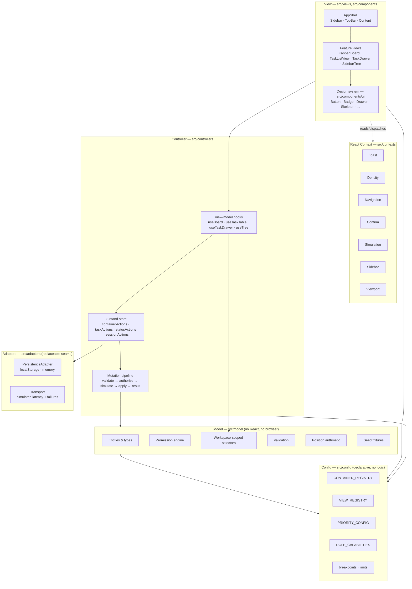
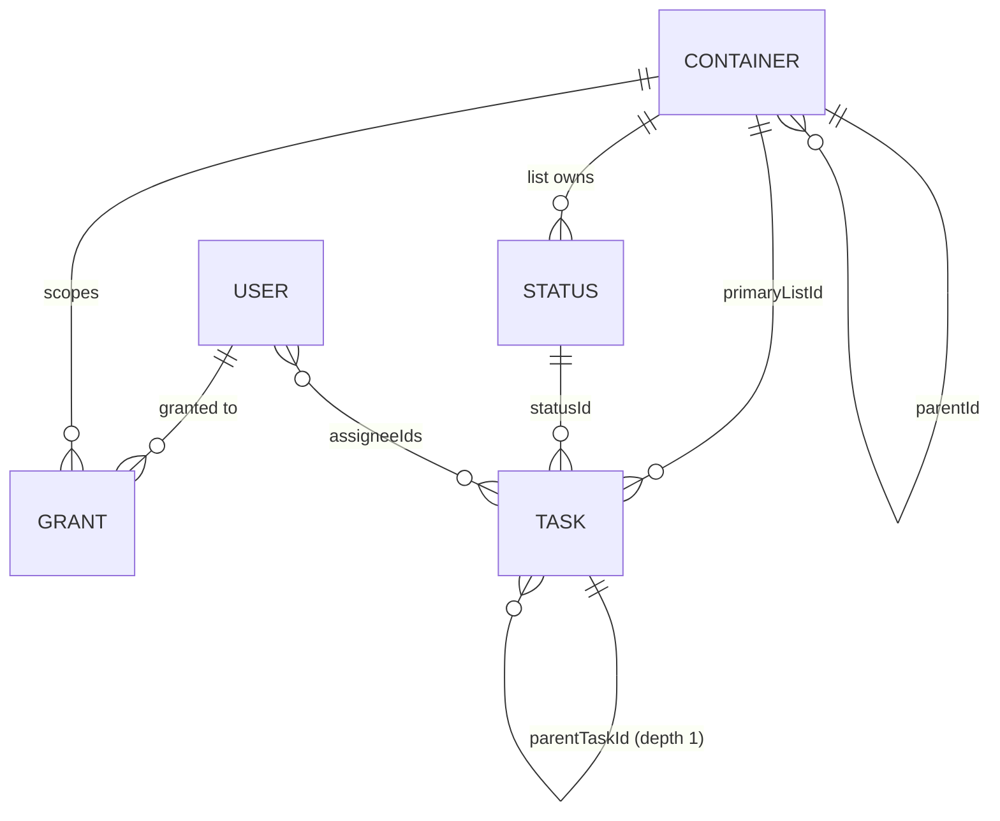

# Flowboard — Design

## Overview

Flowboard is a single-page React application with no backend. A typed, normalized in-memory store seeded from deterministic fixtures replaces the API and database, wrapped in a transport shim that adds latency and injectable failures so the UI exercises real loading, error and rollback paths.

The codebase is organized as an explicit **MVC** separation:

- **Model** — pure TypeScript. Entities, validation, permission resolution, position arithmetic, selectors, seed fixtures. No React, no Zustand.
- **Controller** — the Zustand store, mutation actions, permission enforcement, optimistic apply/rollback, latency/failure simulation, and the view-model hooks that adapt Model data into View props.
- **View** — presentational React components. Props in, callbacks out. No store imports below the view-model boundary.

React Context carries cross-cutting _presentation_ concerns (toasts, density, navigation, confirmation, simulation settings, sidebar chrome). The Zustand store remains the single source of truth for _domain_ state. This split is deliberate and enforced by lint.

### Why these choices

| Decision                                         | Rationale                                                                                                                                                                                                                                                                                                                                                    |
| ------------------------------------------------ | ------------------------------------------------------------------------------------------------------------------------------------------------------------------------------------------------------------------------------------------------------------------------------------------------------------------------------------------------------------ |
| Zustand over Redux                               | Mutations are simple and local; Zustand's single-file store keeps the Controller layer compact and avoids action/reducer ceremony. `getState()` outside React also makes Controller logic directly unit-testable without rendering.                                                                                                                          |
| dnd-kit over react-beautiful-dnd                 | Headless, actively maintained, keyboard sensor and live-region announcements built in, and it lets us render our own drag overlay so the only inline `style` is its transform.                                                                                                                                                                               |
| Headless UI                                      | Unstyled and Tailwind-native. Gives correct focus trapping, Escape handling, focus restore and ARIA wiring for Dialog/Menu/Listbox without fighting a styled component kit.                                                                                                                                                                                  |
| Tailwind v4 with `@theme`                        | v4's engine reads tokens from CSS. One token file, zero config file, and tokens become first-class utilities (`bg-priority-urgent`).                                                                                                                                                                                                                         |
| Fractional positions                             | Reordering writes one row instead of renumbering every sibling, and the arithmetic is trivial to unit test.                                                                                                                                                                                                                                                  |
| Hard delete for tasks, archive for containers    | The brief requires soft-delete/archive for containers only. Tasks get a confirm-then-delete to keep the Model from accumulating tombstones that complicate every selector. Documented as the chosen trade-off.                                                                                                                                               |
| Mobile-first                                     | Building the constrained layout first forces the information hierarchy to be decided rather than inherited from available space. Widening a working small layout is additive; narrowing a desktop layout means deciding what to delete under pressure. Tailwind's unprefixed-is-smallest model makes this the grain of the tool rather than a fight with it. |
| `rem` everywhere                                 | A user who sets a 20px root font size should get a 25% larger app, not a larger font inside fixed boxes. Tailwind's default scales are already `rem`, so the rule is mostly about refusing `px` in arbitrary values.                                                                                                                                         |
| Configuration registries over conditionals       | The hierarchy, view set, priority set and capability set are all closed enums today and all plausibly open tomorrow. Expressing each as one data structure means extending them is an edit to a single declaration instead of a hunt through `switch` statements.                                                                                            |
| Adapter interfaces for persistence and transport | These are the two seams most likely to be replaced — `localStorage` to a server, simulated latency to real HTTP. Putting an interface at each keeps the replacement a new file rather than a diff across the Controller.                                                                                                                                     |

### Scope today vs. shape for tomorrow

The brief scopes one workspace. That is a scope decision, not a modeling decision, and the two are kept separate throughout:

| Narrow today                            | Shaped for                | Mechanism                                                                                              |
| --------------------------------------- | ------------------------- | ------------------------------------------------------------------------------------------------------ |
| One workspace                           | Many                      | `workspaceId` on every entity, workspace-scoped selectors, `Membership` instead of a global role field |
| Four container levels                   | More or different levels  | `CONTAINER_REGISTRY` drives permitted children, icons, labels and capabilities                         |
| Board and list views                    | Calendar, timeline, table | `VIEW_REGISTRY` keyed by view id                                                                       |
| Five priorities, four status categories | Any set                   | One configuration map each, carrying label, token and rank                                             |
| Two roles                               | Role hierarchy            | `ROLE_CAPABILITIES: Record<Role, Set<Capability>>`                                                     |
| Per-user grants                         | Team grants               | A single `resolveGrant` seam                                                                           |
| Subtask depth 1                         | Depth N                   | `MAX_TASK_DEPTH` constant plus a depth function                                                        |
| `localStorage`                          | IndexedDB, server         | `PersistenceAdapter` interface                                                                         |
| Simulated transport                     | Real HTTP                 | `Transport` interface                                                                                  |

---

## Architecture



The two lower boxes are what the extensibility requirement adds to an otherwise conventional MVC stack. `src/config` holds every closed set in the app as a declaration, so extending the hierarchy, the view set, the priority set or the role policy is an edit to one data structure rather than a hunt through conditionals. `src/adapters` holds the two seams most likely to be replaced — persistence and transport — behind interfaces, injected into the store rather than imported inside it.

**Data flow is one-directional.** A View calls a callback from a view-model hook → the hook calls a store action → the action runs the mutation pipeline against the Model → the store publishes new state → selectors recompute → the View re-renders. Views never reach into the Model and never call `setState` on the store.

### Mutation pipeline

Every write takes the same path, which is the single place permission and validation are enforced:

```
action(input)
  ├─ 1. validate(input)            → VALIDATION error, no mutation
  ├─ 2. authorize(currentUser, …)  → FORBIDDEN error, no mutation
  ├─ 3. snapshot affected slice    (optimistic mutations only)
  ├─ 4. apply to Model             (immer draft)
  ├─ 5. await transport.simulate() → NETWORK error → restore snapshot
  └─ 6. return Result<T>
```

Non-optimistic mutations await step 5 _before_ step 4, so the UI shows a pending state and then the result. Optimistic mutations (drag and drop only) apply first and roll back on failure. That asymmetry is intentional: drags must feel instant, form submits can afford 200ms.

### Directory structure

```
src/
├── config/                       # Layer 0 — declarative registries, no logic
│   ├── containers.ts             # CONTAINER_REGISTRY: permitted children, icon, labels
│   ├── views.ts                  # VIEW_REGISTRY: id → label, icon (no component)
│   ├── priorities.ts             # PRIORITY_CONFIG: label, token, rank
│   ├── statusCategories.ts       # STATUS_CATEGORY_CONFIG: label, token, order
│   ├── capabilities.ts           # ROLE_CAPABILITIES: Record<Role, Set<Capability>>
│   ├── breakpoints.ts            # rem breakpoint tokens, shared with Storybook
│   └── limits.ts                 # MAX_TASK_DEPTH, MAX_TITLE_LEN, PAGE_SIZE, …
│
├── model/                        # Layer 1 — pure TS, no React
│   ├── types.ts                  # Entity interfaces and unions
│   ├── result.ts                 # Result, AppError, ErrorCode, ok/err/unwrap
│   ├── state.ts                  # FlowboardState shape, empty state factory
│   ├── seed.ts                   # Deterministic fixtures
│   ├── permissions.ts            # roleOf / resolveGrant / canView / can
│   ├── selectors.ts              # Pure (state, scope, args) => data
│   ├── validation.ts             # Registry-driven field, parent and depth rules
│   ├── position.ts               # Fractional index arithmetic + rebalance
│   └── hierarchy.ts              # ancestorChain, depthOf, registry lookups
│
├── adapters/                     # Replaceable seams
│   ├── persistence/
│   │   ├── types.ts              # PersistenceAdapter interface
│   │   ├── localStorage.ts       # Conformant implementation
│   │   └── memory.ts             # Used by tests
│   └── transport/
│       ├── types.ts              # Transport interface
│       └── simulated.ts          # Latency + failure injection
│
├── controllers/                  # Layer 2 — store + actions + view-models
│   ├── store.ts                  # Zustand store, slices composed, adapters injected
│   ├── pipeline.ts               # validate → authorize → apply → result
│   ├── slices/
│   │   ├── sessionSlice.ts       # currentUserId, loading flags
│   │   ├── containerSlice.ts     # container CRUD, reorder, move, archive
│   │   ├── taskSlice.ts          # task CRUD, move, status, reorder, subtasks
│   │   └── statusSlice.ts        # per-list status set operations
│   └── hooks/
│       ├── useSession.ts
│       ├── useVisibleTree.ts
│       ├── useBoard.ts
│       ├── useTaskTable.ts
│       ├── useTaskDrawer.ts
│       ├── useContainerActions.ts
│       └── usePermissions.ts
│
├── contexts/                     # Layer 2.5 — presentation concerns
│   ├── AppProviders.tsx
│   ├── ToastContext.tsx
│   ├── DensityContext.tsx
│   ├── NavigationContext.tsx
│   ├── ConfirmContext.tsx
│   ├── SimulationContext.tsx
│   └── SidebarContext.tsx
│
├── views/                        # Layer 3 — feature composition
│   ├── AppShell.tsx
│   ├── sidebar/                  # SidebarTree, TreeItem, SidebarRail, ...
│   ├── topbar/                   # TopBar, Breadcrumbs, UserSwitcher, ...
│   ├── board/                    # KanbanBoard, KanbanColumn, TaskCard, ...
│   ├── list/                     # TaskListView, TaskTable, TaskRow, ...
│   ├── drawer/                   # TaskDrawer and its field sections
│   └── states/                   # PermissionDenied, NoListSelected, ...
│
├── components/ui/                # Design system — pure primitives + stories
├── lib/                          # cn(), date utils, keyboard utils
├── test/                         # setup, fixture builders, render helpers
├── index.css                     # ONLY stylesheet: @import + @theme
└── main.tsx
```

---

## Data model



### Entities

```ts
export type ContainerType = "workspace" | "space" | "folder" | "list";
export type Visibility = "public" | "private";
export type StatusCategory = "todo" | "active" | "done";
export type Priority = "urgent" | "high" | "normal" | "low" | "none";
export type Role = "admin" | "member";

/**
 * Any node in the hierarchy, including the workspace itself.
 * Permitted parent/child pairs come from CONTAINER_REGISTRY, not from this type.
 */
export interface Container {
  id: string;
  workspaceId: string; // denormalized for O(1) scoping; self-referential on a workspace node
  name: string; // required, trimmed, <= MAX_NAME_LEN
  type: ContainerType;
  parentId: string | null; // null only for a workspace node
  position: number; // fractional, orders siblings
  visibility: Visibility;
  archivedAt: string | null; // soft delete
  createdAt: string;
  updatedAt: string;
}

export interface Status {
  id: string;
  workspaceId: string;
  listId: string; // statuses are owned per list
  name: string;
  category: StatusCategory;
  color: StatusColorToken; // token key, never a hex literal
  position: number;
}

export interface Task {
  id: string;
  workspaceId: string;
  primaryListId: string;
  parentTaskId: string | null; // depth governed by MAX_TASK_DEPTH, not by this field alone
  title: string; // required, <= MAX_TITLE_LEN
  description: string | null;
  statusId: string; // must belong to primaryListId
  priority: Priority;
  assigneeIds: string[];
  dueDate: string | null; // ISO datetime
  position: number; // fractional, order within status column
  createdAt: string;
  updatedAt: string;
}

/** Workspace-independent. Role lives on Membership, never here. */
export interface User {
  id: string;
  name: string;
  email: string;
  avatarToken: AvatarColorToken; // deterministic initials-avatar color
}

/** Role is per workspace, so one user can be admin in one and member in another. */
export interface Membership {
  workspaceId: string;
  userId: string;
  role: Role;
}

export interface Grant {
  workspaceId: string;
  resourceId: string; // a container id
  subjectId: string; // a user id today; a team id once teams exist
  subjectType: "user"; // widening this union is the team-grant extension point
  mode: "allow" | "deny";
}
```

Three details here exist purely for forward-compatibility, and each costs close to nothing today:

- **`workspaceId` on every entity.** Scope could be derived by walking `parentId` to the root, but that is O(depth) on every selector and it bakes in the assumption that there is one root worth finding. Denormalizing makes workspace scoping an O(1) filter and makes a second workspace a data change.
- **`Membership` instead of `User.role`.** A global role field is the single most common thing that blocks multi-tenancy later, because it gets read from dozens of call sites. Resolving role through `roleOf(state, workspaceId, userId)` from the start confines the multi-workspace change to the seed.
- **`subjectId` + `subjectType` on `Grant`.** Calling the field `userId` would force a rename across the resolver, seed and tests when team grants arrive. A discriminated subject means adding `'team'` is additive, and the exhaustive-switch rule (21.15) makes the compiler point at every site that must then handle it.

### Normalized state

```ts
export interface FlowboardState {
  version: 1;
  /** Which workspace the UI is currently scoped to. A list, not a constant. */
  activeWorkspaceId: string;
  /** Workspace nodes live in `containers` with type 'workspace'; this indexes them. */
  workspaceIds: string[];
  containers: Record<string, Container>;
  tasks: Record<string, Task>;
  statuses: Record<string, Status>;
  users: Record<string, User>;
  memberships: Membership[];
  grants: Grant[]; // small; indexed lazily by (workspaceId, resourceId)
}
```

Normalized maps keep every mutation an O(1) write. Ordering is never stored as an array — it is always derived by sorting on `position`, which means a reorder touches exactly one entity. Derived indexes (children by `parentId`, tasks by `primaryListId`, statuses by `listId`, grants by `resourceId`, containers by `workspaceId`) are built in memoized selectors, not persisted.

Note what the state shape deliberately does _not_ say: there is no `workspaceId: string` singleton naming "the" workspace. `activeWorkspaceId` is a cursor into a set, and every collection selector takes a workspace scope:

```ts
selectVisibleTree(state, { workspaceId, userId });
selectTasksForList(state, { workspaceId, listId });
```

Passing the scope explicitly feels mildly redundant with one workspace. It is the thing that makes the second one a seed change rather than a signature change across thirty call sites (21.1, 21.2), and 18.10 asserts it with a two-workspace fixture so the assumption cannot quietly return.

### Fractional positions

```ts
const GAP = 1024;
const MIN_GAP = 0.0001;

// Insert between two neighbours; either may be undefined at an edge.
position(prev, next) =
  prev == null && next == null
    ? GAP
    : prev == null
      ? next - GAP
      : next == null
        ? prev + GAP
        : (prev + next) / 2;
```

When `next - prev < MIN_GAP`, the affected sibling group is rebalanced to clean multiples of `GAP` in a single pass. Seed data is spaced at `GAP` intervals so rebalancing is rare in practice but still covered by tests.

### Archive semantics

Containers soft-delete via `archivedAt`. Archiving cascades down the container subtree, and the tasks of an archived list become unreachable because every task selector resolves through its list. Nothing is physically removed, so `unarchive` restores the subtree. All default selectors filter `archivedAt === null`.

Tasks hard-delete after confirmation. Deleting a parent task cascades to its subtasks, and the confirm dialog states the subtask count.

### Seed fixtures

Deterministic IDs (`u-alice`, `sp-eng`, `li-backlog`, `t-001`…) and dates derived from a fixed `SEED_NOW` reference, so snapshots and assertions are stable.

```
Workspace "Acme"                                       public
├── Space "Engineering"                                public
│   ├── Folder "Q2 Launch"                             public
│   │   ├── List "Backlog"      todo·in progress·done            6 tasks
│   │   └── List "Sprint 14"    todo·in progress·in review·done   6 tasks
│   └── Folder "Platform"                              public
│       └── List "Infra"        todo·in progress·done            5 tasks
└── Space "Marketing"                                  PRIVATE
```

17 tasks total, spread across every status, including one overdue, one due today, one with no due date, one with two assignees, one unassigned, one urgent, and one parent with two subtasks.

Memberships, which is where role lives:

| Workspace | User      | Role   |
| --------- | --------- | ------ |
| `ws-acme` | `u-alice` | admin  |
| `ws-acme` | `u-bob`   | member |
| `ws-acme` | `u-carol` | member |

The test fixtures additionally build a second workspace, `ws-other`, containing one space and two tasks that no `ws-acme` selector may ever return. It exists only in tests, never in the app seed, and it is what keeps workspace scoping honest (18.10).

Grants, chosen specifically to make the permission demo immediate:

| Resource                 | User      | Mode  | Effect                                                             |
| ------------------------ | --------- | ----- | ------------------------------------------------------------------ |
| `sp-marketing` (private) | `u-carol` | allow | Carol sees Marketing; Bob does not                                 |
| `li-infra`               | `u-bob`   | deny  | Bob cannot see the Infra list even though its ancestors are public |

Resulting visible trees — these are the exact assertions in the permission tests:

- **Alice** (admin): everything, bypassing all checks.
- **Bob**: Engineering → Q2 Launch → Backlog, Sprint 14; Platform renders with a "no visible lists" hint; Marketing absent.
- **Carol**: everything Bob sees, plus Infra, plus Marketing.

---

## Permission engine

`src/model/permissions.ts` is pure and synchronous. It is the only place visibility is decided.

### Visibility resolution

Walk the ancestor chain from the workspace down to the target node, carrying a single boolean. The **nearest grant wins** because later iterations overwrite earlier ones.

```ts
/** Role is resolved per workspace via Membership — never read off the user. */
export function roleOf(
  state: FlowboardState,
  workspaceId: string,
  userId: string,
): Role | null {
  return (
    state.memberships.find(
      (m) => m.workspaceId === workspaceId && m.userId === userId,
    )?.role ?? null
  );
}

/**
 * The single grant-resolution seam. Today it matches a user subject.
 * Team grants widen `subjectsOf` and nothing else (21.8).
 */
export function resolveGrant(
  state: FlowboardState,
  resourceId: string,
  userId: string,
): Grant | undefined {
  const subjects = subjectsOf(state, userId); // today: [userId]
  const matches = state.grants.filter(
    (g) => g.resourceId === resourceId && subjects.includes(g.subjectId),
  );
  // deny wins ties at the same node; this stays correct once a user can match
  // several subjects through team membership.
  return matches.find((g) => g.mode === "deny") ?? matches[0];
}

export function canView(
  state: FlowboardState,
  scope: { workspaceId: string; userId: string },
  nodeId: string,
): boolean {
  const role = roleOf(state, scope.workspaceId, scope.userId);
  if (role === null) return false; // not a member of this workspace
  if (ROLE_CAPABILITIES[role].has("workspace:bypass")) return true; // 8.6 admin bypass

  const chain = ancestorChain(state, nodeId); // [workspace, …, node]
  if (chain.length === 0) return false; // NOT_FOUND / orphan
  if (chain[0].workspaceId !== scope.workspaceId) return false; // cross-workspace leak guard

  let visible = true; // members see the workspace
  for (const node of chain) {
    if (node.archivedAt !== null) return false;
    if (node.visibility === "private") visible = false; // private resets to denied
    const grant = resolveGrant(state, node.id, scope.userId);
    if (grant) visible = grant.mode === "allow"; // nearest explicit grant overrides
  }
  return visible;
}
```

The admin bypass is expressed as a capability lookup rather than `role === 'admin'` so that adding an `owner` role, or demoting what admins may bypass, is a table edit (21.7). The cross-workspace guard is the kind of check that is trivial to add now and awkward to retrofit after a second workspace exists.

**Ordering matters, and getting it wrong is subtle.** An earlier draft had the admin bypass as step 1, returning `true` before any structural check. That let an admin "view" a node that did not exist, a node that was archived, and — the serious one — a node in another workspace, which would have quietly defeated the entire multi-workspace guarantee. Structural checks therefore run first, and only the _grant and visibility_ decision is bypassed.

The workspace check also has to cover every node in the chain rather than just its root. `workspaceId` is denormalized, so checking only the root lets a node whose own `workspaceId` disagrees with its parent chain slip through — precisely the corruption the denormalization risks.

Properties this gives us, each with a test:

| Scenario                                       | Result                                       |
| ---------------------------------------------- | -------------------------------------------- |
| Not a member of the workspace                  | deny                                         |
| Missing, orphaned or cyclic chain              | deny, for every role                         |
| Any chain node in another workspace            | deny, for every role                         |
| Archived anywhere in the chain                 | deny, for every role                         |
| Admin, otherwise                               | allow (grant walk skipped)                   |
| Public chain, no grants                        | allow                                        |
| `private` node, no grant                       | deny                                         |
| `private` node, `allow` grant on it            | allow, and inherited by its subtree          |
| `deny` on an ancestor                          | deny for the whole subtree                   |
| `deny` on an ancestor, `allow` on a descendant | allow at the descendant — nearest grant wins |

Tasks are not granted individually: `canViewTask(task) === canView(task.primaryListId)`.

### Capability model

```ts
export type Capability =
  | "task:create"
  | "task:update"
  | "task:delete"
  | "task:reorder"
  | "container:create"
  | "container:update"
  | "container:archive"
  | "container:reorder"
  | "status:update";

  | "status:update"
  | "workspace:bypass";

/** src/config/capabilities.ts — the whole authorization policy, as data. */
export const ROLE_CAPABILITIES: Record<Role, ReadonlySet<Capability>> = {
  admin: new Set(["workspace:bypass"]), // bypass implies everything
  member: new Set([
    "task:create",
    "task:update",
    "task:delete",
    "task:reorder",
  ]),
};

export function can(
  state: FlowboardState,
  scope: { workspaceId: string; userId: string },
  capability: Capability,
  resourceId: string,
): boolean {
  const role = roleOf(state, scope.workspaceId, scope.userId);
  if (role === null) return false;
  const granted = ROLE_CAPABILITIES[role];
  if (granted.has("workspace:bypass")) return true;
  if (!canView(state, scope, resourceId)) return false;
  return granted.has(capability);
}
```

A member can do anything to tasks in a list they can see, and nothing to the structure. This makes the Alice-vs-Bob demo crisp: Bob sees fewer lists _and_ his sidebar context menus are disabled.

The policy lives entirely in `ROLE_CAPABILITIES`, so `can()` has no role-specific branches (21.7). Adding a `guest` role that may view but not edit, or a `lead` that may create lists but not archive spaces, is one entry in that table and zero changes to control flow. Tests assert against the table rather than hard-coding "members can't archive" (18.9).

### Enforcement points

1. **Selectors** filter invisible nodes and tasks, so denied data never reaches the View.
2. **The pipeline's authorize step** blocks every mutation and returns `FORBIDDEN` before touching the Model.
3. **`usePermissions()`** exposes results to the View purely so it can disable and hide affordances — never as the only gate.

A `FORBIDDEN` result includes the capability name, producing messages like _"Bob can't archive lists — admin role required."_

### Documented extension path (README §permissions)

Every extension below is a change to data or to one function body. None of them touch a call site:

- **Team grants** — add `Team` and `TeamMembership`; widen `Grant.subjectType` to `'user' | 'team'` and `subjectsOf(state, userId)` to return `[userId, ...teamIdsOf(userId)]`. `resolveGrant` already prefers `deny` among multiple matches, which is exactly the tie-break teams need. The exhaustive-switch rule makes the compiler list anywhere `subjectType` must be handled.
- **Role hierarchy** — add entries to `ROLE_CAPABILITIES`. `guest` becomes `new Set([])`, `owner` becomes `new Set(['workspace:bypass', 'workspace:delete'])`. No new control flow, because there is none to add to.
- **Field-level permissions** — widen `Capability` to include `'task:update:assignees'` and have `can()` fall back from specific to general. The drawer already renders field by field, so it can disable individual controls without restructuring.
- **Multiple workspaces** — `canView` and `can` already take a `{ workspaceId, userId }` scope and already reject cross-workspace nodes. Adding a workspace means seeding a second workspace container, its memberships and a workspace switcher in the chrome.
- **Server parity** — the engine is pure, synchronous and free of React, Zustand, browser and storage dependencies (21.12), so the same module could run unchanged in a Node API over a real dataset. That is the real reason for keeping the Model React-free, beyond tidiness.

---

## Extensibility architecture

The requirement is that the code be extensible "at every possible hierarchy". Concretely that means no closed set in this app may be expressed as a chain of conditionals. Each one becomes a single declaration in `src/config`, and the logic that consumes it reads the declaration rather than restating it.

### Container hierarchy as configuration

The naive version of this app hard-codes `workspace → space → folder → list` into validation, the sidebar renderer, the create menu and the move handler. Four places, each of which must be found and edited to add a level.

```ts
// src/config/containers.ts
export interface ContainerTypeConfig {
  type: ContainerType;
  label: string;
  labelPlural: string;
  icon: LucideIcon;
  /** Types that may be created directly inside this one. Empty = leaf. */
  childTypes: readonly ContainerType[];
  /** Does this type hold tasks rather than containers? */
  holdsTasks: boolean;
  /** Can an explicit grant be attached here? */
  grantable: boolean;
}

export const CONTAINER_REGISTRY: Record<ContainerType, ContainerTypeConfig> = {
  workspace: {
    type: "workspace",
    label: "Workspace",
    labelPlural: "Workspaces",
    icon: Building2,
    childTypes: ["space"],
    holdsTasks: false,
    grantable: false,
  },
  space: {
    type: "space",
    label: "Space",
    labelPlural: "Spaces",
    icon: LayoutGrid,
    childTypes: ["folder"],
    holdsTasks: false,
    grantable: true,
  },
  folder: {
    type: "folder",
    label: "Folder",
    labelPlural: "Folders",
    icon: Folder,
    childTypes: ["list"],
    holdsTasks: false,
    grantable: true,
  },
  list: {
    type: "list",
    label: "List",
    labelPlural: "Lists",
    icon: List,
    childTypes: [],
    holdsTasks: true,
    grantable: true,
  },
};

export const canContain = (parent: ContainerType, child: ContainerType) =>
  CONTAINER_REGISTRY[parent].childTypes.includes(child);
```

Everything downstream reads from this: `validation.ts` calls `canContain` instead of matching on type pairs, the sidebar's create menu maps over `childTypes`, `TreeItem` takes its icon and label from the registry, and the drag-and-drop handler asks `canContain` whether a drop target is legal. Adding a `subfolder` level between folder and list is one registry entry plus two `childTypes` edits — and because 18.9 drives the validation and reorder tests through a synthetic fixture type, the claim that this works is tested rather than hoped for.

### View registry

```ts
// src/config/views.ts — description only, no component reference
export interface ViewMeta {
  id: ViewId;
  label: string;
  icon: LucideIcon;
  /** Smallest viewport at which this view is offered, in rem. */
  minViewportRem?: number;
}

export const VIEW_REGISTRY: Record<ViewId, ViewMeta> = {
  board: { id: "board", label: "Board", icon: Columns3 },
  list: { id: "list", label: "List", icon: Rows3 },
};

// src/views/viewComponents.ts — the component half, keyed by the same ViewId
export const VIEW_COMPONENTS: Record<ViewId, ComponentType<ViewProps>> = {
  board: KanbanBoard,
  list: TaskListView,
};
```

The registry is split in two on purpose. Holding the component in `src/config` would make a config module import the View layer — which the boundary lint rejects, and which would invert the dependency direction. Keeping the description in config and the component mapping in the View layer preserves both the single enumeration and the layering.

`ViewSwitcher` maps over `VIEW_REGISTRY`, `NavigationContext` stores a `ViewId`, and the content region looks up `VIEW_COMPONENTS[view]`. A calendar view is one entry in each — no switch statement anywhere gains a case.

### Enumerations as configuration

```ts
// src/config/priorities.ts
export const PRIORITY_CONFIG: Record<
  Priority,
  { label: string; token: string; icon: LucideIcon; rank: number }
> = {
  urgent: {
    label: "Urgent",
    token: "priority-urgent",
    icon: ChevronsUp,
    rank: 0,
  },
  high: { label: "High", token: "priority-high", icon: ChevronUp, rank: 1 },
  normal: { label: "Normal", token: "priority-normal", icon: Minus, rank: 2 },
  low: { label: "Low", token: "priority-low", icon: ChevronDown, rank: 3 },
  none: { label: "None", token: "priority-none", icon: CircleDashed, rank: 4 },
};
```

`rank` is what the list view's comparator sorts on, which is why 5.3's semantic ordering needs no bespoke comparator and adding a priority cannot produce an inconsistent sort. `token` is what `PriorityBadge` and `TaskRow` both read, which is how 13.6's "identical across surfaces" is guaranteed structurally instead of by review. `STATUS_CATEGORY_CONFIG` follows the same shape.

### Adapter seams

```ts
export interface PersistenceAdapter {
  load(): Promise<PersistedPayload | null>;
  save(payload: PersistedPayload): Promise<void>;
  clear(): Promise<void>;
}

export interface Transport {
  run<T>(operation: () => T): Promise<Result<T>>;
}
```

`localStorageAdapter` and `memoryAdapter` both satisfy the first; `simulatedTransport` satisfies the second. Both are injected into the store at creation rather than imported inside it, which is what lets tests construct a store with in-memory persistence and zero-latency transport (18.11) and what makes "replace `localStorage` with a real API" a new file rather than a diff through the Controller (21.10, 21.11).

The async signatures are deliberate even though `localStorage` is synchronous. An interface that returns `T` cannot later return `Promise<T>` without changing every caller.

### Depth as a constant

```ts
export const MAX_TASK_DEPTH = 1; // 0 = no subtasks, 1 = one level, n = n levels

export const taskDepth = (state: FlowboardState, taskId: string): number =>
  state.tasks[taskId]?.parentTaskId
    ? 1 + taskDepth(state, state.tasks[taskId].parentTaskId!)
    : 0;
```

Validation asks `taskDepth(parent) + 1 <= MAX_TASK_DEPTH` rather than `parent.parentTaskId === null`. Identical behaviour today, and raising the limit is a one-line change instead of rewriting a check that only ever understood two levels.

### Code conventions

These are the rules lint and review enforce, aimed at the "readable and maintainable" half of the requirement:

| Rule                                                                                | Why                                                                                                                                                     |
| ----------------------------------------------------------------------------------- | ------------------------------------------------------------------------------------------------------------------------------------------------------- |
| Named exports only, no `export default`                                             | Every symbol has one searchable name, and renames are mechanical (21.13)                                                                                |
| Early returns over nested conditionals; no nested ternaries                         | The permission walk above is the pattern — linear and readable top to bottom (21.14)                                                                    |
| Exhaustive `switch` with a `never` default                                          | Extending a union becomes a compile error at every site that must handle it, which is the mechanism most of this extensibility story depends on (21.15) |
| `strict` TypeScript, no `any`, justified assertions                                 | A type system that is lied to stops being load-bearing (21.16)                                                                                          |
| One vocabulary across layers                                                        | `container`, `space`, `folder`, `list`, `task`, `subtask`, `status`, `grant`, `capability`, `membership` mean one thing each, with no synonyms (21.17)  |
| Variants and config as data, never inline conditional strings                       | The valid set is enumerable by reading one declaration (21.18)                                                                                          |
| Doc comments on reusable boundaries; inline comments explain _why_                  | Model exports, design-system props, Context hooks and adapter interfaces carry a contract statement (21.19)                                             |
| Lint fails on circular imports, unused exports and disallowed dependency directions | Architectural drift breaks the build instead of accumulating (21.20)                                                                                    |
| Tests target public module surfaces                                                 | Refactoring internals does not mean rewriting tests (21.22)                                                                                             |

`ARCHITECTURE.md` documents each extension point with the concrete steps to extend it, including a worked example of what a second workspace and a new view type would touch, so the extensibility claim is checkable rather than asserted (21.21, 19.12).

---

## Responsive strategy

Mobile-first, and mobile-first in the strict sense: unprefixed utilities describe the phone layout and breakpoint prefixes add to it. No `max-*` variants, because a max-width utility is a desktop layout being walked backwards, which is the thing this approach is meant to avoid.

### Breakpoints

Declared once, in `rem`, matching Tailwind v4's defaults so the framework and the app agree:

| Token | Width    | Target      | Layout shape                                             |
| ----- | -------- | ----------- | -------------------------------------------------------- |
| base  | `<40rem` | Phone       | Single pane, off-canvas nav, one kanban column at a time |
| `sm`  | `40rem`  | Large phone | Same shape, roomier spacing                              |
| `md`  | `48rem`  | Tablet      | Multi-column board, real table, side drawer              |
| `lg`  | `64rem`  | Laptop      | Persistent sidebar, full top bar                         |
| `xl`  | `80rem`  | Desktop     | Wider drawer, more columns visible                       |

Because they are `rem`, a user at a 150% root font size receives the tablet layout on a desktop-width screen. That is correct behaviour, not a bug — their effective reading width genuinely is smaller (20.11, 22.6).

### Per-surface adaptation

| Surface        | Base                                                                          | `md`                                  | `lg`                                       |
| -------------- | ----------------------------------------------------------------------------- | ------------------------------------- | ------------------------------------------ |
| Sidebar        | Off-canvas slide-over via `Dialog`, closes on select/Escape/overlay           | Off-canvas                            | Persistent, collapsible to rail, resizable |
| Top bar        | Menu, list name, search icon, avatar; view switcher and dev panel in overflow | Adds inline view switcher             | Full row, `h-14`                           |
| Breadcrumbs    | Current list only                                                             | Last two segments                     | Full path                                  |
| Board          | One column at ~`min(88vw, 22rem)`, `snap-x snap-mandatory`, position dots     | `18.75rem` columns, horizontal scroll | Same                                       |
| List view      | Stacked cards, sort in a dropdown                                             | Table with sticky header              | Same                                       |
| Drawer         | Full-height bottom sheet, `max-h-[92dvh]`                                     | Right panel, `32.5rem`                | `36rem`                                    |
| Create task    | Floating action button                                                        | Inline column affordance              | Inline                                     |
| Density toggle | Hidden (touch needs the larger targets)                                       | Available                             | Available                                  |

The board's mobile form is worth noting: scroll-snap gives column-paging that feels native and costs two utility classes, where a tab bar over columns would need its own state and would fight the horizontal drag gesture.

### Touch

```ts
const sensors = useSensors(
  useSensor(PointerSensor, { activationConstraint: { distance: 8 } }),
  useSensor(TouchSensor, {
    activationConstraint: { delay: 200, tolerance: 8 },
  }),
  useSensor(KeyboardSensor, { coordinateGetter: sortableKeyboardCoordinates }),
);
```

The touch delay is what separates "long-press to drag" from "scroll the board", and without it the mobile board is unusable — a drag fires on every swipe. Those `8` values are device-pixel movement thresholds rather than rendered dimensions, which is why they are a documented `px` exception (22.4).

Touch drag is good but never the only path. Status change and reorder are both reachable from the card quick-action menu and the drawer (20.8), which also covers keyboard users and anyone for whom dragging is difficult.

### No hover dependence

```css
@custom-variant can-hover (@media (hover: hover) and (pointer: fine));
```

Card affordances use `can-hover:opacity-0 can-hover:group-hover:opacity-100` rather than `opacity-0 group-hover:opacity-100`. On a touch device the first class never applies, so the controls are simply visible — the correct behaviour, reached by not asserting a hover state that does not exist (20.10, 15.1).

### Viewport units

The shell is `h-dvh`, not `h-screen`. On mobile Safari and Chrome, `100vh` includes browser chrome that is actually covering content, so a `100vh` app with a bottom-anchored element puts that element under the URL bar. `dvh` tracks the visible viewport (20.13). Fixed bottom affordances add `pb-[env(safe-area-inset-bottom)]` for notched devices (20.12).

---

## Controller layer

### Store composition

```ts
/*
 * Action groups nest under one `actions` key. Spreading them onto the root as
 * `containers`/`tasks`/`statuses` — as an earlier draft of this design did —
 * collides head-on with the entity maps of the same name in FlowboardState.
 * Nesting keeps both, and keeps `useStore(s => s.tasks)` meaning the data.
 */
export interface StoreActions {
  session: SessionActions;
  container: ContainerActions;
  task: TaskActions;
  status: StatusActions;
}

export type StoreState = FlowboardState &
  SessionState & { actions: StoreActions };

/**
 * Adapters are injected, not imported inside the slices, so tests can build a
 * store on memory persistence and zero-latency transport (21.10, 21.11, 18.11).
 */
export const createFlowboardStore = (options: {
  persistence?: PersistenceAdapter;
  transport?: Transport;
  initialState?: FlowboardState;
  autoPersist?: boolean;
}) => {
  const deps = {
    persistence: options.persistence ?? createLocalStorageAdapter(),
    transport: options.transport ?? simulatedTransport,
  };

  const store = create<StoreState>()((set, get) => {
    const context = { deps, getState: get, setState: /* immer recipe */ ... };

    return {
      ...(options.initialState ?? createSeedState()),
      currentUserId: /* first admin member */ ...,
      isHydrating: false,
      loadingListId: null,
      actions: {
        session: createSessionSlice(context),
        container: createContainerSlice(context),
        task: createTaskSlice(context),
        status: createStatusSlice(context),
      },
    };
  });

  // Save on domain change only; a session-only change writes nothing.
  store.subscribe(/* reference-compare the top-level maps */);

  return store;
};
```

**Zustand's `persist` middleware is deliberately not used.** Its storage contract is string-shaped (`getItem`/`setItem`), whereas `PersistenceAdapter` is async and owns payload validation and version fallback. Wrapping the adapter in middleware that wants something narrower would make the middleware the seam instead of the adapter. Explicit `hydrate()` plus a save subscription keeps the interface in charge, and is what lets `persistence.test.ts` assert hydration, the stale-current-user fallback and the no-write-on-user-switch behaviour directly.

The save subscription compares the top-level maps by reference rather than deep-comparing. Immer replaces a map only when its contents change, so this skips a write for a pure session change like switching user — which is both correct and the cheapest possible check. `src/model/persistence.ts` owns serialization, shape validation and the version guard; the adapter only moves strings (9.11).

### Transport adapter

`adapters/transport/simulated.ts` implements the `Transport` interface. Controller actions call `transport.run(...)` and never reference latency or failure rates themselves, so swapping in an HTTP client is a one-line change at store construction (21.11).

```ts
export interface SimulationSettings {
  minLatencyMs: number; // default 120
  maxLatencyMs: number; // default 380
  failureRate: number; // default 0 — normal use is never randomly broken
  failNext: boolean; // one-shot trigger from the dev panel
}

export async function simulate(
  settings: SimulationSettings,
): Promise<Result<void>> {
  await delay(jitter(settings.minLatencyMs, settings.maxLatencyMs));
  if (settings.failNext || Math.random() < settings.failureRate) {
    clearFailNext();
    return err("NETWORK", "Network request failed. Please try again.");
  }
  return ok(undefined);
}
```

Tests set `minLatencyMs = maxLatencyMs = 0`, keeping the suite fast and deterministic (18.8). The dev panel in the top bar drives these settings through `SimulationContext`, which makes every error, toast and rollback path demonstrable on demand (9.8).

### Result type

```ts
export type ErrorCode =
  | "VALIDATION"
  | "FORBIDDEN"
  | "NOT_FOUND"
  | "CONFLICT"
  | "NETWORK";

export interface AppError {
  code: ErrorCode;
  message: string;
  field?: string;
}

export type Result<T> = { ok: true; data: T } | { ok: false; error: AppError };
```

One shape for every action. `field` lets the drawer attach a validation message to the exact input that caused it.

### Optimistic drag and drop

```ts
async function moveTask(
  scope: Scope,
  input: MoveTaskInput,
): Promise<Result<Task>> {
  const guard =
    validate(input) ?? authorize(get(), scope, "task:update", input.taskId);
  if (guard) return guard;

  const snapshot = snapshotTasksForLists(get(), [
    input.fromListId,
    input.toListId,
  ]);
  set((draft) => applyMove(draft, input)); // instant UI

  const net = await deps.transport.run(() => undefined); // no transport specifics here
  if (!net.ok) {
    set((draft) => restoreTasks(draft, snapshot)); // exact rollback
    return net;
  }
  return ok(get().tasks[input.taskId]);
}
```

The snapshot is a structural clone of only the affected task slices, so rollback restores byte-identical ordering (9.10, 18.6) without cloning the whole store.

### View-model hooks

Each hook is the seam between Controller and View. It selects with `useShallow`, folds in permissions and density, and returns plain data plus callbacks — no store objects leak through.

```ts
/** Resolves { workspaceId, userId } once, from the store, for every other hook. */
export function useScope(): Scope {
  // → { workspaceId: activeWorkspaceId, userId: currentUserId }
}

export function useBoard(listId: string | null): BoardViewModel {
  // → { columns: BoardColumn[], isLoading, canEdit, onMoveTask, onQuickUpdate, onCreateTask }
}
export function useTaskTable(
  listId: string | null,
  sort: SortState,
  page: number,
): TableViewModel {
  // → { rows: TaskRowVM[], total, hasMore, isLoading, onSortChange, onLoadMore }
}
export function useTaskDrawer(taskId: string | null): DrawerViewModel {
  // → { task, list, statuses, assignees, breadcrumb, fieldState, canEdit, onFieldSave, onMoveToList, onDelete }
}
export function useVisibleTree(): TreeViewModel {
  // → { nodes: TreeNodeVM[], isLoading }  — already permission-filtered
}
```

`useScope()` is the only place `activeWorkspaceId` is read. Every other hook composes it, so a workspace switcher is a single `setActiveWorkspace` action and nothing else changes (21.2).

Every hook funnels failed results into `ToastContext`, so error surfacing is consistent and no component repeats it.

### Layer enforcement

`eslint.config.js` adds `no-restricted-imports` zones (10.5):

- `src/model/**` may not import `react`, `zustand`, `src/controllers/**`, `src/views/**`, `src/components/**`.
- `src/components/ui/**` may not import `src/controllers/**` or `src/model/**` state.
- `src/views/**` and `src/components/**` may not import `controllers/store` — only `controllers/hooks/**`.

The rule turns the architecture from a convention into a build failure.

---

## Context layer

| Context             | State                                                    | Consumers                                       |
| ------------------- | -------------------------------------------------------- | ----------------------------------------------- |
| `ToastContext`      | `toasts[]`, `push`, `dismiss`                            | every view-model hook, every mutation site      |
| `DensityContext`    | `'comfortable' \| 'compact'`, `setDensity`               | TaskCard, TaskRow, TreeItem, drawer sections    |
| `NavigationContext` | `selectedListId`, `view`, `openTaskId`, setters          | AppShell, Sidebar, TopBar, board, table, drawer |
| `ConfirmContext`    | `confirm(opts): Promise<boolean>`                        | archive and delete call sites                   |
| `SimulationContext` | `SimulationSettings`, setters, `failNext()`              | DevPanel; read by `transport`                   |
| `SidebarContext`    | `collapsed`, `width`, `expandedIds`, `isModal`, togglers | Sidebar, SidebarTree, TreeItem                  |

Rules applied to all six (12.3–12.6): a typed `useX()` hook that throws outside its provider, a `useMemo`-wrapped value, composition in one `AppProviders`, and no domain entities — `NavigationContext` holds the _selected id_, never the selected list object.

### Why there is no ViewportContext

An earlier draft of this design had one, justified by three adaptations being "structural rather than cosmetic": the board swapping snap-paging for multi-column, the list view swapping cards for a table, the drawer swapping sheet for panel. Working through each, that was wrong — Tailwind handles all three:

- **Board** — both forms render the same column elements. `snap-x snap-mandatory md:snap-none` on the track, `w-column-mobile snap-center md:w-column` on each column. The position indicator needs the _active_ column, which is scroll position, not viewport width.
- **Drawer** — the same `Dialog` panel, repositioned: `inset-x-0 bottom-0 max-h-[92dvh] rounded-t-xl md:inset-y-0 md:right-0 md:w-drawer md:max-h-none md:rounded-none`.
- **List view** — a genuine DOM difference, but `hidden md:block` / `md:hidden` covers it. `display: none` removes the hidden form from the accessibility tree and the tab order, so duplicating markup costs render work and nothing else. One view-model hook feeds both presentational components, so no logic is duplicated.
- **dnd-kit sensors** — `DndContext` registers pointer, touch and keyboard sensors simultaneously and selects by event type. Touch is a pointer-capability concern, not a width one.
- **Tooltips, density toggle, hover affordances** — `can-hover`, `coarse-pointer`, `hidden md:flex`. All CSS.

Exactly one case survives: the **sidebar**. Below `lg` it is a focus-trapping, scroll-locking Headless UI `Dialog`; at `lg` it is a static `aside`. That difference is _behaviour_, and behaviour cannot be expressed in a media query. Rendering both forms would leave a mounted `Dialog` that still traps focus if a user opens the sheet at phone width and then widens the window. So `SidebarContext` owns an `isModal` flag backed by a single `matchMedia('(min-width: 64rem)')` subscription, and closes the sheet when that boundary is crossed.

That one case is the entire justification for `src/config/breakpoints.ts`. It holds the breakpoint numbers, `minWidthQuery`, and the name of that boundary — nothing else. Because those numbers duplicate the `--breakpoint-*` tokens, `scripts/check-units.mjs` parses both files and fails the lint step when they drift in either direction, or when a breakpoint is declared in `px`. Duplication with an enforced check is defensible; duplication with a comment asserting the two "cannot disagree" is not.

`ConfirmContext` exposing a promise is what keeps destructive flows readable at the call site:

```ts
if (
  !(await confirm({
    title: 'Archive "Sprint 14"?',
    body: "12 tasks will be hidden.",
    tone: "danger",
  }))
)
  return;
```

`SimulationContext` is read by the transport through a subscription rather than a hook, since the transport is not a React module.

---

## Design system

Location `src/components/ui`. Every primitive is pure, typed, accepts a last-merged `className`, and forwards refs where the DOM element needs one (11.3). Variants are typed lookup records, never inline conditionals (11.9):

```ts
const BUTTON_VARIANT: Record<ButtonVariant, string> = {
  primary: "bg-brand-600 text-white hover:bg-brand-700 active:bg-brand-800",
  secondary:
    "bg-surface-raised text-ink-900 ring-1 ring-border hover:bg-surface-hover",
  ghost: "text-ink-600 hover:bg-surface-hover hover:text-ink-900",
  danger: "bg-danger-600 text-white hover:bg-danger-700",
};
```

### Primitives and props

| Component          | Props                                                                                                                                                                                                                       |
| ------------------ | --------------------------------------------------------------------------------------------------------------------------------------------------------------------------------------------------------------------------- |
| `Button`           | `variant: 'primary'\|'secondary'\|'ghost'\|'danger'`, `size: 'sm'\|'md'`, `icon?: LucideIcon`, `iconPosition?: 'leading'\|'trailing'`, `loading?`, `disabled?`, `fullWidth?`, `type?`, `onClick?`, `children`, `className?` |
| `IconButton`       | `icon: LucideIcon`, `label: string` (required accessible name), `size: 'xs'\|'sm'\|'md'`, `variant`, `loading?`, `disabled?`, `tooltip?`, `onClick?`                                                                        |
| `Input`            | `value`, `onChange`, `label?`, `placeholder?`, `error?`, `hint?`, `maxLength?`, `leadingIcon?`, `trailingSlot?`, `size`, `disabled?`, `autoFocus?`                                                                          |
| `Textarea`         | `value`, `onChange`, `label?`, `rows?`, `autoGrow?`, `maxLength?`, `showCount?`, `error?`, `onCommit?`, `onCancel?`                                                                                                         |
| `Select`           | `options: SelectOption<T>[]`, `value: T`, `onChange`, `renderOption?`, `renderValue?`, `placeholder?`, `disabled?`, `size` — Headless UI `Listbox`                                                                          |
| `Menu`             | `trigger: ReactNode`, `items: MenuItem[]` (`{ id, label, icon?, tone?, disabled?, disabledReason?, onSelect, separatorBefore? }`), `align`, `side` — Headless UI `Menu`                                                     |
| `Dialog`           | `open`, `onClose`, `title`, `description?`, `size: 'sm'\|'md'\|'lg'`, `footer?`, `children`                                                                                                                                 |
| `ConfirmDialog`    | `open`, `title`, `body?`, `confirmLabel?`, `cancelLabel?`, `tone: 'danger'\|'default'`, `loading?`, `onConfirm`, `onCancel`                                                                                                 |
| `Drawer`           | `open`, `onClose`, `side: 'right'`, `width?`, `header?`, `footer?`, `children`, `initialFocusRef?`                                                                                                                          |
| `Tooltip`          | `content`, `side`, `delay?`, `children`                                                                                                                                                                                     |
| `Badge`            | `tone: 'neutral'\|'brand'\|'success'\|'warning'\|'danger'\|'info'`, `variant: 'solid'\|'soft'\|'outline'`, `size`, `icon?`, `children`                                                                                      |
| `StatusPill`       | `status: { name, category, color }`, `variant: 'pill'\|'dot'\|'dot-label'`, `size`                                                                                                                                          |
| `PriorityBadge`    | `priority: Priority`, `variant: 'flag'\|'pill'\|'dot'`, `size`, `showLabel?`                                                                                                                                                |
| `DueDateChip`      | `date: string \| null`, `now?: string`, `variant: 'chip'\|'inline'`, `size` — resolves overdue/today/upcoming tone internally                                                                                               |
| `Avatar`           | `user: Pick<User,'id'\|'name'\|'avatarToken'>`, `size: 'xs'\|'sm'\|'md'\|'lg'`, `showTooltip?`                                                                                                                              |
| `AvatarGroup`      | `users[]`, `max?`, `size`, `showTooltip?` — overflow renders `+n`                                                                                                                                                           |
| `Checkbox`         | `checked`, `onChange`, `label?`, `indeterminate?`, `disabled?`, `size`                                                                                                                                                      |
| `SegmentedControl` | `options: { value, label, icon? }[]`, `value`, `onChange`, `size`, `ariaLabel`                                                                                                                                              |
| `Skeleton`         | `variant: 'text'\|'card'\|'row'\|'tree'\|'column'`, `lines?`, `className?`                                                                                                                                                  |
| `EmptyState`       | `icon: LucideIcon`, `title`, `description?`, `action?: ReactNode`, `size: 'sm'\|'md'`, `isDropTarget?`                                                                                                                      |
| `Toast`            | `tone: 'success'\|'error'\|'warning'\|'info'`, `title`, `description?`, `action?: { label, onClick }`, `onDismiss`                                                                                                          |
| `Spinner`          | `size: 'xs'\|'sm'\|'md'`, `label?`                                                                                                                                                                                          |
| `Card`             | `interactive?`, `elevated?`, `selected?`, `dragging?`, `padding: 'sm'\|'md'`, `children`                                                                                                                                    |
| `Kbd`              | `keys: string[]`                                                                                                                                                                                                            |
| `Separator`        | `orientation`, `spacing`                                                                                                                                                                                                    |
| `ScrollShadow`     | `orientation`, `children` — edge fades on scrollable regions                                                                                                                                                                |

### Feature components and props

| Component               | Props                                                                                                                            |
| ----------------------- | -------------------------------------------------------------------------------------------------------------------------------- |
| `AppShell`              | `children`                                                                                                                       |
| `TopBar`                | — reads `NavigationContext`, `useSession`                                                                                        |
| `Breadcrumbs`           | `path: { id, name, type }[]`, `onNavigate`                                                                                       |
| `UserSwitcher`          | `users: UserVM[]`, `currentUserId`, `onSwitch`                                                                                   |
| `ViewSwitcher`          | `view: 'board'\|'list'`, `onChange`                                                                                              |
| `DevPanel`              | — reads `SimulationContext`                                                                                                      |
| `SearchCommand`         | `open`, `onClose`, `results`, `query`, `onQueryChange`, `onSelect`                                                               |
| `SidebarTree`           | `nodes: TreeNodeVM[]`, `selectedId`, `expandedIds`, `onSelect`, `onToggle`, `onReorder`, `onAction`                              |
| `TreeItem`              | `node`, `depth`, `isExpanded`, `isSelected`, `hasChildren`, `canEdit`, `onToggle`, `onSelect`, `onAction`                        |
| `KanbanBoard`           | `columns: BoardColumn[]`, `canEdit`, `onMoveTask`, `onOpenTask`, `onQuickUpdate`, `onCreateTask`, `isLoading`                    |
| `KanbanColumn`          | `status`, `tasks: TaskCardVM[]`, `canEdit`, `isDropTarget`, `onCreateTask`, `onOpenTask`, `onQuickUpdate`                        |
| `TaskCard`              | `task: TaskCardVM`, `canEdit`, `isDragging?`, `isOverlay?`, `density`, `onOpen`, `onQuickUpdate`, `onToggleComplete`, `onDelete` |
| `TaskTable`             | `rows: TaskRowVM[]`, `sort`, `canEdit`, `expandedIds`, `onSortChange`, `onOpenTask`, `onToggleExpand`, `isLoading`               |
| `TaskRow`               | `row`, `depth`, `canEdit`, `density`, `onOpen`, `onQuickUpdate`, `onToggleComplete`                                              |
| `TaskDrawer`            | `open`, `vm: DrawerViewModel`, `onClose`, `onPrev?`, `onNext?`                                                                   |
| `PropertyRow`           | `label`, `icon?`, `children`, `pending?`                                                                                         |
| `AssigneePicker`        | `users[]`, `selectedIds`, `onChange`, `disabled?`                                                                                |
| `PriorityPicker`        | `value`, `onChange`, `disabled?`                                                                                                 |
| `StatusPicker`          | `statuses[]`, `value`, `onChange`, `disabled?`                                                                                   |
| `DueDatePicker`         | `value`, `onChange`, `disabled?`                                                                                                 |
| `SubtaskList`           | `subtasks[]`, `canEdit`, `onToggle`, `onCreate`, `onOpen`, `onDelete`                                                            |
| `PermissionDeniedState` | `resourceName?`, `suggestions: { id, name }[]`, `onNavigate`                                                                     |

### Storybook

`storybook` + `@storybook/react-vite`, reusing the app's Vite config so the `@tailwindcss/vite` plugin and `src/index.css` are active in stories — stories render with real tokens, not approximations (11.6). Every primitive gets a story covering variants, sizes and disabled/loading/error states (11.7), plus fixture-driven stories for `TaskCard`, `KanbanColumn`, `SidebarTree`, `TaskDrawer` and `EmptyState` (11.8). Composite stories wrap in `AppProviders` with a seeded store so they work without the full shell.

---

## Visual system

### Tokens — `src/index.css`

The only stylesheet in the project. Tailwind v4 reads tokens from `@theme` and emits utilities for each one, so `--color-priority-urgent` becomes `bg-priority-urgent` / `text-priority-urgent`.

```css
@import "tailwindcss";

@theme {
  /* neutrals — surfaces and ink */
  --color-surface: #ffffff;
  --color-surface-sunken: #f7f8fa;
  --color-surface-raised: #ffffff;
  --color-surface-hover: #f1f3f7;
  --color-border: #e4e7ec;
  --color-border-strong: #cfd4dc;
  --color-ink-900: #101828;
  --color-ink-600: #475467;
  --color-ink-400: #98a2b3;

  /* brand */
  --color-brand-50: #eef4ff;
  --color-brand-600: #4f6ef7;
  --color-brand-700: #3f58d6;
  --color-brand-800: #3348b0;

  /* semantic */
  --color-success-600: #0f9d58;
  --color-warning-600: #d98a00;
  --color-danger-600: #d64545;
  --color-info-600: #2d7ff9;

  /* priority — one source of truth for cards, rows and drawer */
  --color-priority-urgent: #d64545;
  --color-priority-high: #e8820c;
  --color-priority-normal: #2d7ff9;
  --color-priority-low: #667085;
  --color-priority-none: #cfd4dc;

  /* status categories */
  --color-status-todo: #98a2b3;
  --color-status-active: #2d7ff9;
  --color-status-review: #8b5cf6;
  --color-status-done: #0f9d58;

  --font-sans: "Inter var", ui-sans-serif, system-ui, sans-serif;
  --font-mono: ui-monospace, "SF Mono", Menlo, monospace;

  --radius-sm: 0.375rem;
  --radius-md: 0.5rem;
  --radius-lg: 0.75rem;
  --radius-xl: 1rem;

  /* breakpoints in rem, so a larger root font size changes which layout you get */
  --breakpoint-sm: 40rem;
  --breakpoint-md: 48rem;
  --breakpoint-lg: 64rem;
  --breakpoint-xl: 80rem;

  /*
   * Named dimensions, so no component carries a magic arbitrary value.
   *
   * Declared in the `--spacing-*` namespace deliberately: that is the namespace
   * Tailwind v4 maps onto width, height, padding, margin and gap, so each token
   * becomes `w-*`, `h-*`, `min-h-*` and `size-*`. A `--size-*` namespace emits
   * the custom property but generates no utility — a silent failure. Verified
   * against the built CSS during Phase 0.
   */
  --spacing-sidebar: 16rem;
  --spacing-sidebar-rail: 3.5rem;
  --spacing-sidebar-min: 12rem;
  --spacing-sidebar-max: 24rem;
  --spacing-topbar: 3.5rem;
  --spacing-column: 18.75rem;
  --spacing-column-mobile: 22rem;
  --spacing-drawer: 32.5rem;
  --spacing-drawer-xl: 36rem;
  --spacing-touch: 2.75rem;
  --spacing-icon-sm: 0.875rem;
  --spacing-icon-md: 1rem;
  --spacing-icon-lg: 1.25rem;

  /* shadow offsets stay in px — cosmetic depth, not layout; see 22.4 */
  --shadow-card: 0 1px 2px rgb(16 24 40 / 0.06), 0 1px 3px rgb(16 24 40 / 0.1);
  --shadow-card-hover:
    0 4px 8px rgb(16 24 40 / 0.08), 0 2px 4px rgb(16 24 40 / 0.06);
  --shadow-drag: 0 12px 24px rgb(16 24 40 / 0.18);
  --shadow-overlay: 0 24px 48px rgb(16 24 40 / 0.22);
}

@custom-variant density-compact (:where([data-density="compact"]) &);
@custom-variant can-hover (@media (hover: hover) and (pointer: fine));
```

`src/App.css` is deleted and the boilerplate in `index.css` replaced (13.3). No other stylesheet exists (13.2).

Two things in this block are deliberate. **Every dimension is `rem`** — the named group exists so that no component ships an arbitrary value like `w-[300px]`; they become `w-column`, `h-topbar`, `w-drawer`, `min-h-touch` utilities, which is both the `rem` rule (22.1) and the "no magic numbers" half of maintainability (21.18). **Breakpoints are `rem`** so the responsive system participates in root-font-size scaling (22.6). `src/config/breakpoints.ts` mirrors these values for the sidebar's single `matchMedia` subscription, and `scripts/check-units.mjs` fails the lint step if the two ever disagree.

The only `px` here is in `box-shadow` offsets, which is one of the four exceptions in 22.4. A shadow is cosmetic depth; growing its blur radius with the user's font size would look wrong, not accessible.

### Spacing contract

A single `0.25rem` scale — Tailwind's default, where `p-3` is `0.75rem` and `h-11` is `2.75rem` — with padding fixed **per surface type** and applied through the primitives rather than per instance. That is what keeps spacing consistent instead of merely intending to be (13.8).

| Surface        | Mobile base                    | Comfortable (`md`+)                                    | Compact                     |
| -------------- | ------------------------------ | ------------------------------------------------------ | --------------------------- |
| Page region    | `p-3`                          | `p-6`                                                  | `p-4`                       |
| Top bar        | `h-topbar px-3`                | `h-topbar px-4`                                        | `h-topbar px-4`             |
| Card           | `p-3`, `gap-2`                 | `p-3`, `gap-2`                                         | `p-2`, `gap-1.5`            |
| Table row      | n/a — stacked cards below `md` | `h-11 px-3`                                            | `h-9 px-2`                  |
| Tree item      | `h-11 px-3` (touch target)     | `h-8 px-2`                                             | `h-7 px-2`                  |
| Drawer section | `px-4 py-3`, `gap-3`           | `px-5 py-4`, `gap-3`                                   | `px-4 py-3`, `gap-2`        |
| Menu item      | `h-11 px-3` (touch target)     | `h-8 px-2.5`                                           | `h-8 px-2.5`                |
| Column gutter  | `gap-3`                        | `gap-4`                                                | `gap-3`                     |
| Stack rhythm   | `space-y-2` / `space-y-4`      | `space-y-2` within a group, `space-y-6` between groups | `space-y-1.5` / `space-y-4` |

Note the mobile column: tree items and menu items grow to `h-11`, which is `2.75rem` — exactly the minimum touch target from 20.9. Density is clamped to comfortable below `md` for the same reason, which is why the toggle is hidden there rather than available and harmful (16.3).

Density flips via `data-density` on the shell, read through the `density-compact` variant, so a single attribute retunes the whole app (16.3).

### Typography roles

Five roles only (13.9), each a fixed triple:

| Role          | Classes                                             |
| ------------- | --------------------------------------------------- |
| Page title    | `text-lg font-semibold text-ink-900 tracking-tight` |
| Section title | `text-sm font-semibold text-ink-900`                |
| Body          | `text-sm text-ink-900`                              |
| Secondary     | `text-sm text-ink-600`                              |
| Caption       | `text-xs font-medium text-ink-400`                  |

### Icons

`lucide-react` at stroke width 1.75 and three sizes only — `0.875rem`, `1rem`, `1.25rem`, exposed as the `--spacing-icon-*` tokens (13.11, 22.1). `aria-hidden` when decorative; `IconButton` requires a `label`, making an unlabeled icon-only control a type error.

### Layout — mobile base (`<40rem`)

Designed first, which is what forces the hierarchy decisions that the desktop layout then inherits.

```
┌──────────────────────────────────┐
│ ☰  Sprint 14        ⌕   (AB)    │  h-topbar, overflow menu holds
├──────────────────────────────────┤  view switcher + dev panel
│ ● ○ ○ ○     In progress (4)      │  column pager + current column
├──────────────────────────────────┤
│ ┌──────────────────────────────┐ │
│ │ ☑ Wire up auth guard     ⋯  │ │  affordances always visible —
│ │   ▌Urgent   ⚑2              │ │  no hover to reveal them
│ │   ◷ Oct 12        (AB)(CD)  │ │
│ └──────────────────────────────┘ │
│ ┌──────────────────────────────┐ │
│ │ ☐ Add redirect handling  ⋯  │ │
│ └──────────────────────────────┘ │
│        ↕ scroll                  │
│   ←  snap-x column paging  →     │
│                          ┌─────┐ │
│                          │  +  │ │  FAB, above safe-area inset
└──────────────────────────┴─────┴─┘
   Sidebar = off-canvas slide-over
   Drawer  = bottom sheet, max-h-[92dvh]
```

### Layout — `lg` and above (`≥64rem`)

```
┌──────────────────────────────────────────────────────────────────────────┐
│ TopBar h-topbar Breadcrumbs │ Board/List │ Search │ DevPanel │ UserSwitch│
├────────────┬─────────────────────────────────────────────────────────────┤
│ Sidebar    │ Content                                                     │
│ w-sidebar  │ ┌─────────┬─────────┬─────────┐    ┌──────── Drawer ──────┐ │
│ resizable  │ │ To do   │ In prog │ Done    │    │ Title                │ │
│ collapsible│ │ ┌─────┐ │ ┌─────┐ │ ┌─────┐ │    │ Status   · Priority  │ │
│ ▸ Space    │ │ │Card │ │ │Card │ │ │Card │ │    │ Assignees· Due       │ │
│   ▾ Folder │ │ └─────┘ │ └─────┘ │ └─────┘ │    │ Description          │ │
│     • List │ │  scroll │  scroll │  scroll │    │ Subtasks             │ │
│ ─────────  │ └─────────┴─────────┴─────────┘    └──────────────────────┘ │
│ Density    │          ← horizontal scroll →          w-drawer            │
└────────────┴─────────────────────────────────────────────────────────────┘
```

`h-dvh` shell with `overflow-hidden`; three independent `overflow-y-auto` regions. The page never scrolls (16.1). Columns are `w-column-mobile snap-center shrink-0 md:w-column` — `22rem` paged on mobile, `18.75rem` multi-column from `md` (16.5, 20.5). Truncation everywhere a name can be long, with tooltips carrying the full value on fine pointers and the drawer carrying it everywhere (16.6). The table gives flexible width to the title column and content width to the rest (16.7).

---

## Interaction design

### Card interactions

The card is a `group` whose secondary affordances are revealed by hover or focus-within **where a hover state exists**, so the resting state stays scannable on a desktop without hiding functionality on a phone (15.1, 20.10):

```
┌─────────────────────────────────────┐
│ ☑  Wire up auth guard          ⋯   │   can-hover:opacity-0
│    ▌urgent   ⚑ 2 subtasks           │   can-hover:group-hover:opacity-100
│    ◷ Oct 12 (overdue)      (AB)(CD) │   can-hover:group-focus-within:opacity-100
└─────────────────────────────────────┘   coarse pointer → always opacity-100
```

- Body click opens the drawer; interactive children call `stopPropagation` so they do not double-fire (15.4).
- Overflow menu carries the full quick-action set — open, status, priority, assign, due date, move, duplicate, delete — all applied inline without the drawer, all permission-checked identically (15.2, 15.3).
- Keyboard reachable: `tabIndex=0`, Enter opens, the menu is in the tab order (15.5).
- Drag: `DragOverlay` renders a `rotate-2 shadow-drag` clone while the source slot keeps a `opacity-40 border-dashed` placeholder of identical dimensions, so column height never jumps (15.6).
- Checkbox moves the task to its list's `done`-category status (15.7).
- `DueDateChip` resolves overdue → `danger`, today → `warning`, else neutral (15.8).
- Title clamps with `line-clamp-2` plus a tooltip (15.9).
- Every hover-revealed action also exists in the drawer — no hover-only functionality (15.10).

### Drag and drop

`DndContext` with `PointerSensor` (8px activation distance, so clicks are not swallowed), `TouchSensor` (200ms press delay, so swipes scroll rather than drag) and `KeyboardSensor`. `SortableContext` per column for intra-column sorting; `useDroppable` on each column for cross-column moves. `onDragEnd` computes the target status and a fractional position from the neighbours at the drop index, then calls the optimistic `moveTask`.

Two documented exception lists intersect here:

- **Inline `style`** (13.4, 19.9) — dnd-kit's `transform`/`transition` on sortable items, and the sidebar resizer's live width. Both annotated in code.
- **`px` units** (22.4) — the sensor activation distance and touch tolerance. These are pointer-movement thresholds in device pixels, not rendered dimensions; expressing a drag threshold in `rem` would make it change with font size, which is meaningless.

The sidebar resizer writes its live width in `rem` (`${px / 16}rem`) rather than `px`, clamped between `--spacing-sidebar-min` and `--spacing-sidebar-max`, so even the one dynamic dimension in the app obeys the unit rule.

### Loading and feedback

| Trigger                   | Treatment                                                                |
| ------------------------- | ------------------------------------------------------------------------ |
| First load                | Tree skeleton + board column skeletons sized to the real layout (14.1)   |
| List switch               | Content-region skeleton, chrome stays put (14.2)                         |
| Button-triggered mutation | Spinner inside that button, button disabled (14.7)                       |
| Inline field save         | Subtle pending indicator on the `PropertyRow` (7.7)                      |
| Drag drop                 | Optimistic, with visible revert on failure (14.12)                       |
| Any failure               | Toast with the Controller's message, retry action when safe (14.4, 14.6) |
| Permission denied         | Distinct tone and wording from network errors (14.5)                     |
| Destructive action        | `ConfirmContext` dialog naming target and cascade (14.9)                 |

Transitions run 120–200ms via Tailwind utilities, wrapped in `motion-safe:` so `prefers-reduced-motion` suppresses them (14.11).

### Task drawer

```
┌──── Drawer — w-full md:w-drawer xl:w-drawer-xl ────────────┐
│ Engineering / Q2 Launch / Sprint 14      ↑ ↓   ⋯   ✕       │  header
├────────────────────────────────────────────────────────────┤
│ Wire up the auth guard                                     │  title, inline edit
│                                                            │
│ Status      [ ● In progress  ▾ ]                           │  label/value grid
│ Priority    [ ▌Urgent        ▾ ]                           │  uniform row height
│ Assignees   [ (AB) (CD)  + ]                               │
│ Due date    [ Oct 12, 2026  ✕ ]                            │
│ List        [ Sprint 14      ▾ ]                           │
├────────────────────────────────────────────────────────────┤
│ Description                                                │
│ ┌────────────────────────────────────────────────────────┐ │
│ │ markdown source, autogrow, ⌘↵ to save                  │ │
│ └────────────────────────────────────────────────────────┘ │
├────────────────────────────────────────────────────────────┤
│ Subtasks (2)                                      + Add    │
│ ☑ Define guard contract                                    │
│ ☐ Add redirect handling                                    │
├────────────────────────────────────────────────────────────┤
│ Created Oct 2 · Updated 4m ago              [Delete task]  │  footer
└────────────────────────────────────────────────────────────┘
```

Headless UI `Dialog` gives focus trap, Escape and focus restore for free (7.1–7.3, 17.2). Fields save on blur and ⌘/Ctrl+Enter; Escape reverts the focused field instead of closing the drawer, since losing a long description to a stray Escape is the obvious failure mode (7.5). The `PropertyRow` grid keeps every label/value pair on one rhythm (7.6). When the user lacks `task:update`, the whole drawer renders read-only with an explanatory note rather than failing on submit (7.10). `↑`/`↓` move to the previous/next task in the current view for triage without closing (7.11).

---

## Testing strategy

Vitest + jsdom + Testing Library, single-run via `npm run test`. `src/test/setup.ts` registers jest-dom matchers and pins simulated latency to zero.

**Model tests** (pure, no rendering — the bulk of the value):

- `permissions.test.ts` — the seven-row resolution table above, one case each, plus exact visible-node-set assertions for Alice, Bob and Carol against the seed fixtures (18.2, 18.3).
- `selectors.test.ts` — tree filtering, task access, sort orderings including priority ranking and null-due-date-last.
- `validation.test.ts` — title bounds, parent-type matrix, cyclic move rejection, subtask depth, status-set enforcement.
- `position.test.ts` — insert at head/middle/tail, and rebalance when the gap collapses.

**Extensibility tests** — these are what make the forward-compatibility claims verifiable rather than aspirational (18.9–18.11):

- `registry.test.ts` — validation, reorder and move logic driven through a **synthetic container type** injected into a test registry. If any of that logic secretly hard-codes `space`/`folder`/`list`, this test fails. This is the single most valuable test in the extensibility set, because it is the one that catches a conditional someone added in a hurry.
- `capabilities.test.ts` — asserts permission outcomes from `ROLE_CAPABILITIES` rather than restating "members can't archive", so adding a role does not require editing assertions.
- `workspaceScope.test.ts` — a two-workspace fixture asserting that no `ws-acme` selector returns a `ws-other` container, task or status, and that `canView` rejects a cross-workspace node.
- `persistence.test.ts` — the store built on `memoryAdapter`, proving no coupling to `localStorage`.

**Controller tests:**

- `pipeline.test.ts` — denied mutations return `FORBIDDEN` and leave state deep-equal to the snapshot (18.4).
- `taskSlice.test.ts` — cross-list move with status remapping, subtask cascade on delete, `updatedAt` bumping.
- `rollback.test.ts` — `failNext` on a drag restores pre-drag state exactly (18.6).

**Component test** (18.7) — render `AppShell` inside `AppProviders` with a seeded store, then assert:

1. As Alice the tree shows Marketing; switching to Bob removes Marketing and Infra from the tree.
2. Clicking a task card opens the drawer with that task's title; Escape closes it and returns focus to the card.

**Responsive verification** — Storybook viewport stories at each breakpoint token (20.14) plus manual checks at `20rem`, `40rem`, `48rem`, `64rem` and `120rem`, and one pass at a 150% root font size to confirm the `rem` rule holds (20.11). This is manual by choice: visual regression tooling is more setup than the time budget allows, and the README states plainly what was and was not automated.

---

## Performance notes

Normalized maps plus `position` sorting keep mutations O(1) and renders scoped. Selectors use `useShallow` so a card re-renders only when its own task changes. Derived indexes are memoized per state version. `DragOverlay` keeps the dragged node out of the sortable list's reflow path. At seed scale (17 tasks) none of this is load-bearing, but it is the structure that holds at a few thousand.

---

## Known trade-offs

| Trade-off                                         | Reasoning                                                                                                                                                                                                                                       |
| ------------------------------------------------- | ----------------------------------------------------------------------------------------------------------------------------------------------------------------------------------------------------------------------------------------------- |
| Tokens live in `index.css`                        | Tailwind v4 has no JS theme config. The file contains only `@import`, `@theme` and variant declarations — no authored rules. Documented in the README as the framework's config mechanism.                                                      |
| Tasks hard-delete, containers archive             | The brief requires soft-delete for containers. Tombstoned tasks would complicate every selector for little demo value.                                                                                                                          |
| No router                                         | Navigation state lives in `NavigationContext`. Deep links are a week-2 item; adding React Router later touches only that provider.                                                                                                              |
| Markdown stored, not rendered                     | The description field keeps markdown source and renders as pre-wrapped text. A renderer is one dependency away but adds XSS surface for no evaluation gain.                                                                                     |
| Status set is seeded, not editable in the UI      | Per-list status sets are modeled, persisted and enforced, but a status-editor UI is out of the time budget. The `statusSlice` actions exist and are tested.                                                                                     |
| Only two stretch goals                            | Search and optimistic DnD rollback, per the brief's "at most two" and "ship a working MVP over half-finished stretch goals".                                                                                                                    |
| Scope plumbing with one workspace                 | `{ workspaceId, userId }` threaded through selectors and guards is mild ceremony for a single-workspace app. It is the price of making the second workspace a seed change instead of a cross-cutting refactor, and 18.10 keeps it honest.       |
| No workspace switcher UI                          | The model, scoping and tests support many workspaces; the chrome shows one. Building the switcher without a second real workspace would be UI for its own sake. Named as a day-4 item.                                                          |
| Breakpoint values duplicated in CSS and TS        | Tailwind cannot hand its theme to JavaScript, and the sidebar's modal/static switch is a behavioural decision a media query cannot make. Confined to that one case, and `scripts/check-units.mjs` fails the build on any drift between the two. |
| `px` retained for borders and shadows             | Scaling a hairline border with root font size produces blurred sub-pixel edges, and shadows are cosmetic depth rather than layout. Four narrow exceptions, listed in 22.4 and the README, verified by the grep in 22.7.                         |
| Mobile verified manually, not by screenshot tests | Visual regression setup exceeds the time budget. Storybook viewport stories give per-component review; the README states which widths were checked by hand.                                                                                     |
