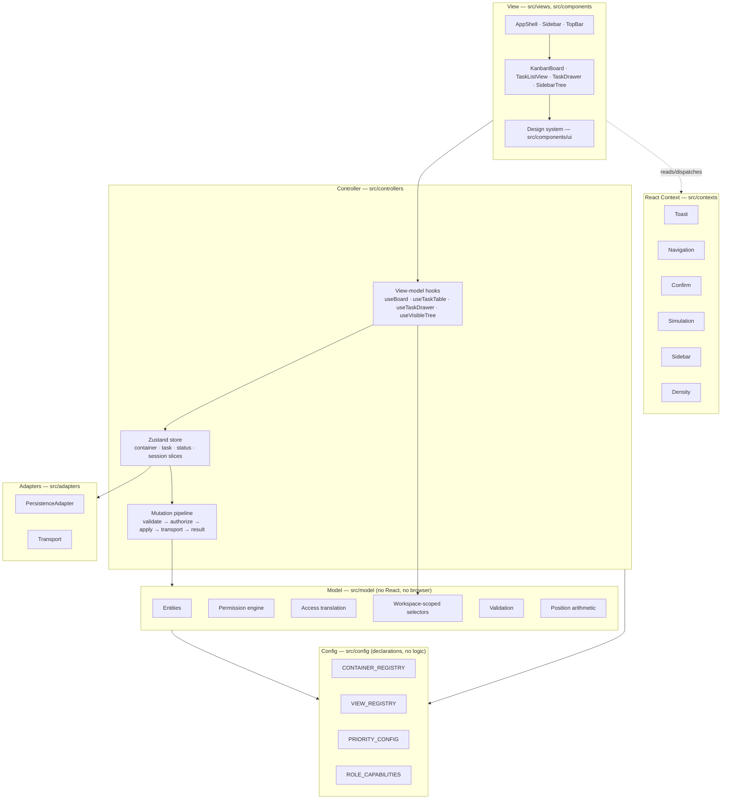
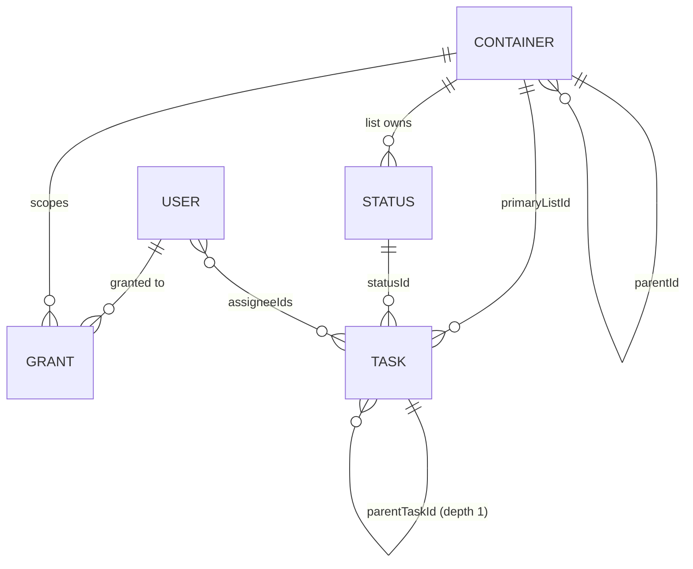

# Flowboard

A frontend-only project-management app for a single team — `workspace → space → folder → list → task`, on a kanban board and in a list view, with container-level permissions and an in-app user switcher.

There is no backend. A typed, normalized in-memory store seeded from deterministic fixtures stands in for the API and database, wrapped in a transport shim that adds latency and injectable failures — so the loading, error and rollback paths in the UI are real rather than theoretical.

**Stack:** React 19 · TypeScript (strict) · Vite · Zustand · dnd-kit (`@dnd-kit/react`) · Headless UI · Tailwind CSS v4 · Lucide · Vitest + Testing Library · Playwright · Storybook

---

## Running it

```bash
npm install
npm run dev              # Vite dev server
```

| Script                    | What it does                                                             |
| ------------------------- | ------------------------------------------------------------------------ |
| `npm run dev`             | Dev server with HMR                                                      |
| `npm run build`           | `tsc -b` then `vite build`                                               |
| `npm run preview`         | Serve the production build                                               |
| `npm run test`            | Vitest, single run, `TZ=Asia/Kolkata`                                    |
| `npm run test:watch`      | Vitest in watch mode                                                     |
| `npm run coverage`        | Coverage over the Model, Controller and config layers                    |
| `npm run test:e2e`        | Playwright against the production build (`chromium` + a Pixel 7 profile) |
| `npm run test:e2e:ui`     | Playwright's interactive runner                                          |
| `npm run lint`            | `lint:units` (the `px` guard) then `lint:code` (ESLint)                  |
| `npm run typecheck`       | `tsc -b` across all four TS projects                                     |
| `npm run storybook`       | Storybook on :6006                                                       |
| `npm run build-storybook` | Static Storybook build                                                   |
| `npm run verify`          | lint + typecheck + test                                                  |
| `npm run verify:e2e`      | the above, then the Playwright suite                                     |

The timezone on the test scripts is deliberate: a half-hour offset catches the calendar-day conversions in `src/lib/date.ts` that a UTC-only runner would let pass vacuously.

### The 30-second tour

1. The sidebar is the workspace tree. Pick **Sprint 14** — it is the one seeded list with four statuses.
2. Drag a card between columns. Open one with a click, or with Enter when it has focus.
3. Open the dev panel (the flask icon in the top bar), hit **Fail next operation**, then drag a card. It moves, snaps back, and offers a retry.
4. Switch user (top right) from Alice to Bob. The Marketing space disappears, the Infra list disappears, and the Platform folder explains that it has nothing Bob can open. Switch to Carol and both come back.

Step 4 is the permission model; step 3 is the transport shim. Neither needs setup.

---

## Architecture

An explicit MVC separation, enforced by lint rather than by convention.



| Layer          | Lives in                      | Owns                                                                                                                                                  |
| -------------- | ----------------------------- | ----------------------------------------------------------------------------------------------------------------------------------------------------- |
| **Model**      | `src/model`                   | Entities, validation, the permission engine, access translation, position arithmetic, selectors, seed fixtures. No React, no Zustand, no browser.     |
| **Controller** | `src/controllers`             | The Zustand store, every mutation, permission enforcement, optimistic apply/rollback, and the view-model hooks that adapt Model data into View props. |
| **View**       | `src/views`, `src/components` | Presentational components. Props in, callbacks out. Never imports the store.                                                                          |
| _Config_       | `src/config`                  | Every closed set in the app, as data. Imports nothing from the layers above it.                                                                       |
| _Adapters_     | `src/adapters`                | Persistence and transport, behind interfaces, injected into the store rather than imported in it.                                                     |

**Data flow is one-directional.** A View calls a callback from a view-model hook → the hook calls a store action → the action runs the mutation pipeline against the Model → the store publishes → selectors recompute → the View re-renders.

React Context carries cross-cutting _presentation_ concerns (toasts, navigation, confirmation, simulation settings, sidebar chrome, density). The store stays the single source of truth for _domain_ state. `ToastContext` is outermost, since every view-model hook surfaces failures through it.

### Every mutation takes one path

```
action(input)
  ├─ 1. validate(input)            → VALIDATION, no mutation
  ├─ 2. authorize(scope, …)        → FORBIDDEN, no mutation
  ├─ 3. snapshot affected slice    (optimistic mutations only)
  ├─ 4. apply to Model             (immer draft)
  ├─ 5. await transport.run()      → NETWORK → restore snapshot
  └─ 6. return Result<T>
```

Non-optimistic mutations await step 5 _before_ applying, so the UI shows pending and then the result. Drag-and-drop applies first and rolls back on failure. That asymmetry is intentional: a drag must feel instant, a form submit can afford 200ms.

Every action returns `Result<T>` — `{ ok: true, data }` or `{ ok: false, error: { code, message, field? } }` — with `code` from `VALIDATION | FORBIDDEN | NOT_FOUND | CONFLICT | NETWORK`.

### The boundaries are lint rules

`eslint.config.js` carries `no-restricted-imports` zones, so architectural drift breaks the build instead of accumulating:

- `src/model/**` may not import React, Zustand, the browser, the Controller or the View.
- `src/config/**` may not import any other layer.
- `src/components/ui/**` may not import the Controller or Model state.
- `src/views/**` may import `controllers/hooks/**`, never `controllers/store`.

Also enforced: no `export default` (21.13), no nested ternaries (21.14), exhaustive `switch` over unions (21.15), no `any` (21.16), no circular imports (21.20).

---

## Data model



One `Container` type covers every level of the hierarchy, including the workspace node. Which parent may hold which child is **not** in the type — it comes from `CONTAINER_REGISTRY`, so adding a level is a registry entry rather than a hunt through `switch` statements.

State is normalized `Record<id, entity>` maps, so every mutation is an O(1) write:

```ts
interface FlowboardState {
  version: 1;
  activeWorkspaceId: string; // a cursor into a set, not "the" workspace
  workspaceIds: string[];
  containers: Record<string, Container>;
  tasks: Record<string, Task>;
  statuses: Record<string, Status>;
  users: Record<string, User>;
  memberships: Membership[];
  grants: Grant[];
}
```

Three details exist for forward-compatibility and cost nothing today: `workspaceId` on every entity (O(1) scoping instead of walking to a root), `Membership` rather than `User.role` (a global role field is what blocks multi-tenancy later), and `Grant.subjectId` + `subjectType` rather than `userId` (team grants become a union widening, not a rename).

### Ordering is derived, never stored

Siblings carry a fractional `position`. Inserting between two neighbours takes their midpoint, so a reorder writes **one** entity rather than renumbering the group:

```
GAP = 1024
position(prev, next) = midpoint, or prev + GAP / next − GAP at an edge
```

When the gap between neighbours falls below `0.0001` the sibling group is respaced to clean multiples of `GAP` in a single pass. Seed data is spaced at `GAP`, so rebalancing is rare in practice and covered by tests anyway (`src/model/position.test.ts`).

### Archive for containers, delete for tasks

Containers soft-delete through `archivedAt`, cascading down the subtree; the tasks of an archived list become unreachable because every task selector resolves through its list. Nothing is physically removed, so `unarchive` restores the subtree exactly. All default selectors filter `archivedAt === null`.

Tasks **hard-delete** after confirmation, and deleting a parent cascades to its subtasks with the count stated in the dialog. This is a deliberate asymmetry: the brief asks for soft-delete on containers, and tombstoned tasks would complicate every selector for little demo value.

### Seed fixtures

Deterministic ids (`u-alice`, `li-backlog`, `t-001`) and dates derived from a fixed `SEED_NOW`, so assertions and snapshots are stable across runs.

```
Workspace "Acme"                                    public
├── Space "Engineering"                             public
│   ├── Folder "Q2 Launch"                          public
│   │   ├── List "Backlog"    to do·in progress·done              6 tasks
│   │   └── List "Sprint 14"  to do·in progress·in review·done    6 tasks
│   └── Folder "Platform"                           public
│       └── List "Infra"      to do·in progress·done              5 tasks
└── Space "Marketing"                               PRIVATE
```

19 tasks (17 top-level plus 2 subtasks) across every status, including one overdue, one with no due date, one with two assignees, one unassigned, one urgent, and one parent with subtasks. Grants: Carol is allowed on the private Marketing space, Bob is denied on the public Infra list — which is what makes the Alice-vs-Bob difference visible in one click, in both directions.

---

## Permissions

`src/model/permissions.ts` is pure and synchronous, and is the only place visibility is decided.

### How it resolves

Walk the ancestor chain from the workspace down to the node, carrying one boolean. **The nearest grant wins**, because later iterations overwrite earlier ones.

```
role = roleOf(state, workspaceId, userId)        // from Membership, never from User
  → not a member                                 → deny
  → structural checks (below)                    → deny
  → role holds workspace:bypass                  → ALLOW, grant walk skipped
  → for each node in chain:
       archived                                  → deny
       visibility === "private"                  → visible = false
       explicit grant                            → visible = (grant.mode === "allow")
```

**Structural checks run before the admin bypass**, and that ordering is load-bearing. An earlier draft bypassed first, which let an admin "view" a node that did not exist, one that was archived, and — the serious one — one in another workspace, quietly defeating the whole multi-workspace guarantee. So a node is denied to every role, admins included, when it is missing, when its chain is broken or cyclic, when any node in the chain belongs to a different workspace, or when any node in the chain is archived. Archive is state rather than access; workspace membership is not transitive.

The workspace check covers **every** node in the chain rather than only the root, because `workspaceId` is denormalized — checking the root alone would let a node whose own `workspaceId` disagrees with its parent chain inherit into the wrong workspace.

Tasks are not granted individually: `canViewTask(task) === canView(task.primaryListId)`.

### Viewing is not the same as reaching

`canView` answers "may this user see this node". `selectVisibleTree` builds each level from the one above. Those do not compose the way they look like they should, and the gap follows directly from nearest-grant-wins: an `allow` on a list overrides a denied ancestor **for that list**, so `canView(list)` is `true` while the tree still stops at the ancestor and the list is never built.

So `canReach` exists alongside it — every node in the chain viewable, not just the target. Nothing _enforces_ with it; enforcement stays on `canView`, because a node someone holds an explicit grant on is a node they were deliberately given. What needs it is the access dialog, which would otherwise tell an admin that Bob has access to a list Bob cannot find. The dialog says so per member and leaves the fix to the admin, because which of the two is wrong is not something the Controller can know.

### View versus edit

Capabilities are a table, not a chain of role comparisons:

```ts
ROLE_CAPABILITIES: Record<Role, ReadonlySet<Capability>> = {
  admin: new Set(["workspace:bypass"]), // bypass implies everything
  member: new Set([
    "task:create",
    "task:update",
    "task:delete",
    "task:reorder",
  ]),
};
```

A member may do anything to tasks in a list they can see, and nothing to the structure. `can()` has no role-specific branches — adding a `guest` that may view but not edit, or a `lead` that may create lists but not archive spaces, is one entry in that table and no change to control flow. Tests assert against the table rather than restating "members can't archive".

`container:share` is deliberately its own capability rather than folded into `container:update`: renaming a list and deciding who can see it are different powers, and the second is the one that can hand someone the contents of another person's space.

### Access is a decision, and it is made once

Storage says `visibility` plus a flat `Grant[]`. That is right for the walk above and wrong to put in front of a person — nobody wants to reason about "public with a deny row" when the question is "can Bob see this". `src/model/access.ts` is the translation, and it is deliberately **one** translation used in both directions:

```
state  →  accessForContainer  →  ContainerAccess   (what the dialog shows)
          grantRowsForAccess  →  Grant[]           (what a save stores)
```

Both read one rule table, which is why they cannot drift: `private` grants access explicitly, so carrying a grant row _means_ access; `public` grants it by default, so a row means the opposite. One boolean drives the read and the write. The test asserts the **round trip** over every mode and selection rather than the two mappings separately — two mappings asserted independently both pass while disagreeing with each other, which for a permissions mapping is the one failure that matters.

A created container is **restricted by default**: `defaultAccessFor` reads the registry's `grantable` flag and fails closed for anything that can carry a grant. Before this, every space, folder and list arrived visible to the whole workspace — "who can see this" was a question the product never asked. The access rows are written in the _same mutation_ as the container and its statuses, because a follow-up write that fails leaves a container whose access nobody chose, with no error state and no symptom until someone sees something they should not.

### Extending it

Each of these is a change to data or to one function body. None touches a call site. [`ARCHITECTURE.md`](./ARCHITECTURE.md) has the step-by-step.

- **Team grants** — add `Team`/`TeamMembership`, widen `Grant.subjectType` to `'user' | 'team'` and `subjectsOf` to return `[userId, ...teamIdsOf(userId)]`. `resolveGrant` already prefers `deny` among multiple matches, which is exactly the tie-break teams need. Two things in `access.ts` are already waiting: a save only ever replaces user-subject rows, so team rows survive it, and `isUserSubject` is a `Record<GrantSubjectType, boolean>` lookup — so widening the union is a **compile error** there rather than a filter that silently starts deleting team grants.
- **Role hierarchy** — entries in `ROLE_CAPABILITIES`. `guest` is `new Set([])`; `owner` is `new Set(['workspace:bypass', 'workspace:delete'])`.
- **Field-level permissions** — widen `Capability` to `'task:update:assignees'` and have `can()` fall back from specific to general. The drawer already renders field by field, so it can disable individual controls without restructuring.
- **Multiple workspaces** — `canView` and `can` already take a `{ workspaceId, userId }` scope and already reject cross-workspace nodes. Adding one means seeding a second workspace container, its memberships, and a switcher in the chrome.
- **Server parity** — the engine is pure, synchronous, and free of React, Zustand, browser and storage dependencies, so the same module could run unchanged in a Node API. That is the real reason the Model is React-free.

---

## The simulated data layer

### Latency and injectable failures

`src/adapters/transport/simulated.ts` implements a `Transport` interface. Controller actions call `transport.run(...)` and never reference latency or failure rates themselves, so swapping in an HTTP client is a one-line change at store construction.

```ts
interface SimulationSettings {
  minLatencyMs: number; // default 120
  maxLatencyMs: number; // default 380
  failureRate: number; // default 0 — normal use is never randomly broken
  failNext: boolean; // one-shot, from the dev panel
}
```

### Demonstrating the error and rollback paths

The **dev panel** — the flask icon in the top bar — drives these settings through `SimulationContext`:

- **Fail next operation** arms a one-shot `NETWORK` failure. Drag a card: it moves immediately, then returns to its exact pre-drag position and a toast offers a retry. The retry succeeds, because the trigger is one-shot and a mutation is a closure over its inputs rather than something the first attempt consumed.
- **Failure probability** makes it continuous rather than one-shot.
- **Latency range** widens the window where pending states are visible — spinners inside the button that was pressed, subdued cards and rows, `aria-busy` on each.
- **Reset to seed** clears persisted state and rehydrates from fixtures.

Rollback snapshots only the affected task slices and restores them byte-identically, so the **fractional positions** come back too — not just the visible order. Restoring the order while leaving the numbers changed would look correct and then misorder the next insert, which is the failure a visual check cannot see. Covered at three levels: `src/controllers/rollback.test.ts` (the Model), `src/views/rollback.test.tsx` (through the dev panel's own control), and `e2e/failure-rollback.spec.ts` (through a real drag, including that the rollback writes again to undo what the optimistic apply had already persisted).

### Persistence

State persists to `localStorage` under the versioned key **`flowboard:v1`**, behind a `PersistenceAdapter` interface with `load`/`save`/`clear`. The signatures are async even though `localStorage` is not — an interface returning `T` cannot later return `Promise<T>` without changing every caller.

Hydration falls back to the seed fixtures when the stored version does not match or the payload fails shape validation. `src/model/persistence.ts` owns serialization, validation and the version guard; the adapter only moves strings.

Zustand's `persist` middleware is deliberately **not** used: its storage contract is string-shaped (`getItem`/`setItem`), whereas the adapter is async and owns payload validation. Wrapping the adapter in middleware that wants something narrower would make the middleware the seam instead of the adapter. Explicit `hydrate()` plus a save subscription keeps the interface in charge.

The save subscription reference-compares the top-level maps rather than deep-comparing. Immer replaces a map only when its contents change, so a pure session change — switching user — writes nothing.

**Reset path:** the dev panel's "Reset to seed", or clear the `flowboard:v1` key. `src/controllers/persistence.test.ts` builds the store on an in-memory adapter and proves there is no coupling to `localStorage`.

---

## Design system

35 primitives in `src/components/ui`, each pure, typed, accepting a last-merged `className`, and forwarding refs where the DOM element needs one. Variants are typed lookup records, never inline conditional strings.

`AssigneePicker` · `Avatar` · `AvatarGroup` · `Badge` · `Button` · `Card` · `Checkbox` · `CommandPalette` · `ConfirmDialog` · `DatePicker` · `Dialog` · `Drawer` · `DueDateChip` · `DueDatePicker` · `EmptyState` · `Highlight` · `IconButton` · `InlinePicker` · `InlineTextField` · `Input` · `Kbd` · `Menu` · `PriorityBadge` · `PriorityPicker` · `ScrollShadow` · `SegmentedControl` · `Select` · `Separator` · `Skeleton` · `Spinner` · `StatusPicker` · `StatusPill` · `Textarea` · `Toast` · `Tooltip`

```bash
npm run storybook        # :6006
```

Storybook reuses the app's Vite config, so `@tailwindcss/vite` and `src/index.css` are active and stories render with **real tokens** rather than approximations. Seven story files: five for the primitives by family, plus `Composites.stories.tsx` (fixture-driven `TaskCard`, `KanbanColumn`, `SidebarTree`, `TaskDrawer`, `EmptyState`) and `Responsive.stories.tsx` (the surfaces that change shape, at each breakpoint).

Composite stories build their view-models with the real `buildTaskCard` and the real `useVisibleTree` against `createSeedState()`, so a change to a selector shows up in the workbench rather than only in the assembled app. `src/views/stories.test.tsx` renders every exported story — `build-storybook` only proves a story _bundles_, and one that throws on render still builds and then silently misrepresents the component it documents.

### One class-ordering rule worth knowing

`cn()` resolves conflicts through tailwind-merge, which keeps the **last** of two conflicting classes — and a broad class deletes a narrower one it supersedes:

```ts
cn("pl-8", "px-3"); // → "px-3"       the pl-8 is gone
cn("px-3", "pl-9"); // → "px-3 pl-9"  both kept
```

`Input` shipped with the first form — its size record contributed `px-3` _after_ a conditional `pl-8` for a leading icon, so the icon padding never reached the DOM and the icon overlapped the text. No error, no type failure, just a silently dropped class. So: a conditional override must appear **after** the base class it overrides, and a size record must not mix a broad property with a directional override of the same property. `Input.test.tsx` asserts the resolved `className` so a reordering cannot regress it unnoticed.

### A scroll region is sized by its container, never by a percentage

This one caused a real bug, and it is worth understanding because the rule is not obvious and the failure is silent.

In CSS, `height: 100%` means "100% of my parent's height". That only works if the parent actually _has_ a height to measure. If the parent's height is decided by its own content instead, the browser cannot resolve the percentage, so it quietly ignores it — and the element falls back to being **as tall as its own content**.

For a scrolling panel, that is fatal in a way that is easy to miss:

> A box that is exactly as tall as its content has nothing sticking out of it. So there is no overflow, and `overflow-y: auto` has nothing to scroll. The content does not become scrollable-but-stuck — it becomes genuinely unreachable, clipped by whatever is around it.

`ScrollShadow` used `h-full` (`height: 100%`), and whether that worked depended on **who was using it**, which is why only one surface broke:

| Drawer form                | How the panel is positioned                      | Did `h-full` work?                     |
| -------------------------- | ------------------------------------------------ | -------------------------------------- |
| Side panel (tablet and up) | Pinned to both the top and bottom of the screen  | Yes — its height is a known number     |
| Bottom sheet (phone)       | Pinned to the bottom only, with a maximum height | No — its height comes from its content |

So on a phone the drawer's body grew to fit its content, ran off the bottom of the sheet, hid the overflow behind the footer, and could not be scrolled. Measured at 360×560: a 365px slot holding a 666px body, with `scrollTop` stuck at 0.

The fix is to let the layout hand the region its size rather than asking for a percentage. The wrapper is a flex column and the scroller is `flex-1 min-h-0`:

- `flex-1` means "take the leftover space in this column" — the space between the fixed header and the fixed footer.
- `min-h-0` is the part people forget. By default a flex item refuses to shrink below its content, which would reproduce the original bug. This permits it, and shrinking the box below its content is precisely what _creates_ the overflow there is then something to scroll.

No percentage, so there is nothing for the browser to drop, and the component no longer depends on an ancestor it cannot see. Held by `e2e/drawer-scroll.spec.ts`.

### Token classes are written out in full

Never `bg-${status.color}`. Tailwind resolves classes by scanning source text, so an interpolated name is never seen and the utility is never emitted — no build error, no type error, just unstyled badges at runtime. Complete class strings live in the config beside the token (`PRIORITY_CONFIG[p].classes`, `STATUS_TOKEN_CLASSES[token]`, `AVATAR_TOKEN_CLASSES[token]`), which is also how "identical across kanban cards, list rows and the drawer" is structural rather than a convention.

---

## Mobile-first

Mobile-first in the strict sense: unprefixed utilities describe the phone layout and breakpoint prefixes add to it. No `max-*` variants, because a max-width utility is a desktop layout being walked backwards.

### Breakpoints

Declared once, in `rem`, matching Tailwind v4's defaults:

| Token | Width    | Target      | Layout                                                   |
| ----- | -------- | ----------- | -------------------------------------------------------- |
| base  | `<40rem` | Phone       | Single pane, off-canvas nav, one kanban column at a time |
| `sm`  | `40rem`  | Large phone | Same shape, roomier spacing                              |
| `md`  | `48rem`  | Tablet      | Multi-column board, real table, side drawer              |
| `lg`  | `64rem`  | Laptop      | Persistent sidebar, full top bar                         |
| `xl`  | `80rem`  | Desktop     | Wider drawer, more columns visible                       |

Because they are `rem`, a user at a 150% root font size receives the tablet layout on a desktop-width screen. That is correct — their effective reading width genuinely is smaller.

### Per-surface adaptation

| Surface     | Base                                                                     | `md`                                  | `lg`                            |
| ----------- | ------------------------------------------------------------------------ | ------------------------------------- | ------------------------------- |
| Sidebar     | Off-canvas slide-over; closes on select, Escape and overlay tap          | Off-canvas                            | Persistent, collapsible to rail |
| Top bar     | Menu, list name, search, avatar; view switcher and dev panel in overflow | Adds inline view switcher             | Full row                        |
| Breadcrumbs | Current list only                                                        | Last two segments                     | Full path                       |
| Board       | One column at `22rem`, `snap-x snap-mandatory`, position dots            | `18.75rem` columns, horizontal scroll | Same                            |
| List view   | Stacked cards, sort in a dropdown                                        | Table with sticky header              | Same                            |
| Drawer      | Full-height bottom sheet, `max-h-[92dvh]`                                | Right panel, `32.5rem`                | `36rem` at `xl`                 |

Only **one** of these is a JavaScript breakpoint check. The board, list view and drawer all render the same elements in both forms and differ by Tailwind variants alone. The sidebar is the exception, and it is an exception about _behaviour_ rather than appearance: below `lg` it is a focus-trapping, scroll-locking Headless UI `Dialog`, and at `lg` it is a static `aside`. A media query cannot express that, and rendering both forms would leave a mounted `Dialog` still trapping focus if a user opened the sheet at phone width and then widened the window. So `SidebarContext` owns an `isModal` flag from a single `matchMedia` subscription and closes the sheet when the boundary is crossed.

That one case is the entire reason `src/config/breakpoints.ts` exists. Because its numbers duplicate the `--breakpoint-*` tokens, `scripts/check-units.mjs` parses both files and fails the lint step when they drift in either direction. Duplication with an enforced check is defensible; duplication with a comment asserting the two "cannot disagree" is not.

### Touch

One `PointerSensor` serves mouse, pen and touch — there is no separate `TouchSensor` in the current dnd-kit packages — but not with the same threshold, which is why the constraint is resolved **per event** from `event.pointerType` rather than configured once:

- A fine pointer waits for 8px of movement, so a click still opens a card rather than nudging it.
- A touch waits for a 200ms press with 10px of tolerance. Without the delay every swipe starts a drag and the board cannot be scrolled at all; the tolerance is what lets a swipe abort the press instead of dragging the card along with it.

Resolved from the pointer type rather than from viewport width, deliberately — a tablet is wide and still coarse.

Touch drag is never the only path. Status change and reorder are both reachable from the card quick-action menu and the drawer, which also covers keyboard users and anyone for whom dragging is difficult.

Other touch rules: no interaction depends on hover (affordances are gated behind a `can-hover` variant, so a coarse pointer gets them persistently visible rather than unreachable); every interactive target is at least `2.75rem` on a coarse pointer; the shell is `h-dvh` rather than `h-screen`, because `100vh` includes browser chrome that is actually covering content; and bottom-anchored affordances carry `pb-[env(safe-area-inset-bottom)]`.

### Which widths were verified, and how

**Automated:** Storybook viewport stories at each breakpoint token, plus `src/views/stories.test.tsx` smoke-rendering every one. The Playwright suite runs two projects — `chromium` at desktop width and a Pixel 7 profile — so the phone sidebar's DOM difference and the touch activation thresholds are both under test.

**By hand:** `20rem`, `40rem`, `48rem`, `64rem` and `120rem`, plus one pass at a 150% root font size.

**Not automated:** visual regression. There are no screenshot comparisons, so "nothing is clipped or overlapping at any width" rests on the manual walk rather than on CI. Setting up visual regression exceeded the time budget, and saying so is more useful than implying it was covered.

---

## Dimension units

`rem` is the project's dimension unit. All spacing, padding, margin, width, height, min/max, font size, line height, border radius, gap, icon size and breakpoint values are `rem` — drawn from Tailwind's default scales, or from the named `--spacing-*` tokens in `src/index.css` so no component ships an arbitrary value like `w-[300px]`.

### The exceptions, and where they are

| Exception                          | Why                                                                                                                                                                           | Where                                                                                                                         |
| ---------------------------------- | ----------------------------------------------------------------------------------------------------------------------------------------------------------------------------- | ----------------------------------------------------------------------------------------------------------------------------- |
| Hairline borders, rings, dividers  | A border is a rendering detail, not a layout dimension. Scaling a hairline with root font size produces blurred sub-pixel edges, and Tailwind's defaults are `1px` by design. | `border`, `ring-1`, `divide-y`; three `h-px`/`w-px` uses (`Menu`, `Separator`)                                                |
| `box-shadow` offsets, blur, spread | Cosmetic depth, not layout. A shadow should not grow with the user's font size.                                                                                               | `--shadow-*` tokens in `src/index.css`                                                                                        |
| Pointer-travel thresholds          | Compared against `clientX`/`clientY`, which the browser reports in CSS pixels. A threshold is not a rendered dimension, so there is no `rem` equivalent to express it in.     | dnd-kit sensors in `KanbanBoard.tsx` and `SidebarTree.tsx` (8 / 200 / 10); the bottom sheet's drag-to-dismiss in `Drawer.tsx` |
| Raster asset intrinsic sizes       | A pixel count is the correct unit for a pixel buffer.                                                                                                                         | None taken — no raster assets in the project                                                                                  |

Each is annotated in code with a `px-exception` marker. The root font size is **not** overridden anywhere, since doing so would defeat the point of using `rem`.

### Verifying it

```bash
npm run lint:units     # scripts/check-units.mjs — also runs as part of `npm run lint`
```

The guard fails on `px` in a Tailwind arbitrary value, in a dimensional `@theme` token, or in an inline `style` layout computation, and allows it only on a line carrying the `px-exception` marker or matching one of the structural exemptions above. It also checks `src/config/breakpoints.ts` against the `--breakpoint-*` tokens.

For a manual pass, note that the obvious grep is too loose — `\bpx\b` matches Tailwind's `px-3` padding utility, which is not a unit at all. The precise checks are:

```bash
grep -rn '[0-9]px' src --include='*.ts' --include='*.tsx' --include='*.css'   # real px lengths
grep -rn '\[[^]]*[0-9]px[^]]*\]' src --include='*.ts' --include='*.tsx'       # px in arbitrary values
```

At the time of writing the first returns only `box-shadow` tokens and prose in comments; the second returns nothing.

### Inline `style=` exceptions

Inline `style` is not used for layout or theming. There are exactly two uses, both because the value is produced per pointer event and no static class can express it:

| Location                                       | Why                                                                                                                                                                                                                                                                                                     |
| ---------------------------------------------- | ------------------------------------------------------------------------------------------------------------------------------------------------------------------------------------------------------------------------------------------------------------------------------------------------------- |
| `src/components/ui/Tooltip.tsx` (`top`/`left`) | A viewport position from `getBoundingClientRect`. An absolutely positioned overlay is clipped by any ancestor with `overflow` set, and `z-index` cannot escape an overflow clip — so the tooltip is portalled to `document.body` and positioned `fixed`, which means the coordinates have to be inline. |
| `src/components/ui/Drawer.tsx` (drag offset)   | The bottom sheet's live drag-to-dismiss translation, converted from the pointer's `clientY` travel into `rem` before it is written.                                                                                                                                                                     |

Two others existed and were retired, which is worth recording so neither comes back silently: dnd-kit's per-frame `transform` (gone once `@dnd-kit/dom` began writing it to the element directly, which is also why a drag no longer re-renders the board), and the sidebar's drag-resized width (gone with the resize handle). Reintroducing either should be treated as reintroducing the exception.

---

## Testing

```bash
npm run test        # 666 unit tests, 35 files
npm run test:e2e    # 94 cases across 12 spec files, 2 browser projects
npm run coverage    # Model + Controller + config
```

Coverage over the three layers that hold logic — **91.91% statements, 82.53% branches**:

| Area                    | Statements | Branches |
| ----------------------- | ---------- | -------- |
| `src/config`            | 95.50%     | 92.10%   |
| `src/controllers`       | 91.42%     | 91.30%   |
| `src/controllers/hooks` | 92.04%     | 70.00%   |
| `src/model`             | 88.60%     | 82.26%   |

The View is **excluded from the measurement on purpose.** Its tests assert behaviour through the real shell, and counting their lines would measure how much JSX a test happened to render rather than what it proved.

### What is tested where

- **Model** (pure, no rendering — the bulk of the value): the permission resolution table one case each, exact visible-node-sets for Alice/Bob/Carol against the fixtures, selector filtering and sort orderings, validation, fractional positions including rebalancing, the access round trip, and the tooltip collision geometry.
- **Extensibility seams**, which is what makes the forward-compatibility claims checkable rather than aspirational: `registry.test.ts` drives validation, reorder and move through a **synthetic container type**, so logic that secretly hard-codes `space`/`folder`/`list` fails; `capabilities.test.ts` asserts outcomes from the table rather than restating policy; `workspaceScope.test.ts` uses a two-workspace fixture to prove no `ws-acme` selector returns a `ws-other` entity; `persistence.test.ts` builds the store on an in-memory adapter.
- **Controller**: denied mutations return `FORBIDDEN` and leave state deep-equal to the snapshot; cross-list move with status remapping and subtask co-move; every slice's stale-id path returning `NOT_FOUND` with the snapshot unchanged; optimistic rollback restoring exactly.
- **Component**: `AppShell` and the views rendered in `AppProviders` against the real store — user switching changing the tree, the drawer opening and closing on Escape with focus restored, subtask disclosure and editing on all three surfaces, access decided through the real dialog and asserted by switching user and reading the tree.
- **End-to-end**: the things jsdom structurally cannot do.

### What jsdom cannot test, and why the E2E layer exists

jsdom loads no CSS and lays nothing out — **every rect is zero**. That is not a gap to work around; it is a hard limit that decides which layer a test belongs in.

Four separate cross-column drag faults reached a green 516-test suite because of it. So collision detection, the `matchMedia`-driven sidebar form, focus trapping, a real `localStorage` round-trip, touch activation thresholds, focus-ring clearance and the no-horizontal-page-scroll invariant all live in `e2e/`, running against `vite preview` on the production build with the clock pinned to `SEED_NOW`.

The three geometry invariants — `focus-ring.spec.ts`, `responsive.spec.ts` and `drawer-scroll.spec.ts` — are worth singling out, because each asserts a _measured_ relationship rather than a literal number, so changing either side of it keeps the test meaningful instead of needing an edit. Each was also verified by reverting its fix rather than trusted on a green run: a regression test nobody has seen fail is a regression test nobody has tested.

`drawer-scroll.spec.ts` adds one wrinkle worth copying. The bug it guards against is an _absence_ of overflow — a scroll region that had nothing to scroll — so the test also asserts its own precondition, that the drawer's content really does overflow at the test viewport. Without that, a later change to the seed or the viewport would leave the spec passing while proving nothing at all, which is the one way a regression test can stop working without ever going red.

The split is by what each layer can state exactly. `dragDrop.test.ts` owns the drop arithmetic, where an index can be asserted as a number; the browser specs own the gesture, and assert arrival, departure, order preservation and survival across a reload. Asserting the exact landing index in a browser would be asserting geometry, since it depends on which side of a card's centre the pointer was released.

Two deliberate skips, each so a behaviour is covered properly on one project rather than fudged on both: pointer drag does not run on the mobile project (a phone user long-presses, and the board is snap-scrolled one column at a time), and two dialog-driven access specs do not either — Chromium's mobile emulation reports `innerWidth` 788 against a `visualViewport.width` of 412, so a `fixed inset-0` dialog lays out against a box roughly 1.9× the visible viewport. Media queries read the real width, so the app's phone layout is correct; the emulated containing block is not. Established as emulation rather than a bug by counting one wrapper and one button with the dialog open, and by both flows passing on chromium.

### Still manual

The feel of a drag, the 150% root-font-size pass, and the visual half of the responsive walk — "nothing is clipped or overlapping" is a judgement, and no test here makes it.

The _measurable_ half is not manual any more: `responsive.spec.ts` asserts no horizontal page scroll at eight widths from 320px up, with each overlay open, which is the part of that walk a machine can hold. It exists because the manual walk found a real violation at every phone width — the chrome could be scrolled sideways out of view entirely — and a finding that only a person can make is a finding that regresses.

---

## Accessibility

Keyboard operation, focus management and ARIA semantics are built in: tree semantics with expanded/selected state in the sidebar, real table semantics with `aria-sort` in the list view, focus trap and focus restore on the drawer and dialogs through Headless UI, dnd-kit live-region announcements that name the task and destination column rather than entity ids, a polite live region for toasts, and `2.75rem` minimum targets on coarse pointers.

Contrast is a **test**, not a glance. `src/config/contrast.test.ts` parses `src/index.css`, computes WCAG relative luminance and asserts the ratios for the pairings the app actually renders — including each token as _text on its own tint_, which is the pairing a palette review does not look at. It found six failures when introduced, and one more when the kanban columns gained a status-coloured background; all were fixed by computing new values rather than re-picking by eye. Status and priority never rely on colour alone — each pairs its token with a label or an icon, asserted structurally.

**No WCAG conformance is claimed.** What was done: automated contrast checks in CI, manual keyboard testing of every surface, and role-first component queries throughout the test suite (which tends to surface missing accessible names as test friction). What was **not** done: testing with a screen reader or any other assistive technology, and expert accessibility review. Those are the two things that find the problems automation does not, and neither happened here.

---

## Trade-offs and what was cut

| Decision                                     | Reasoning                                                                                                                                                                                                                                                            |
| -------------------------------------------- | -------------------------------------------------------------------------------------------------------------------------------------------------------------------------------------------------------------------------------------------------------------------- |
| Tokens live in `index.css`                   | Tailwind v4 has no JS theme config. The file contains only `@import`, `@theme` and variant declarations — no authored rules. This is the framework's config mechanism, not a styling exception.                                                                      |
| Tasks hard-delete, containers archive        | The brief requires soft-delete for containers. Tombstoned tasks would complicate every selector for little demo value.                                                                                                                                               |
| No router                                    | Navigation lives in `NavigationContext`. Deep links are a week-2 item; adding React Router later touches only that provider.                                                                                                                                         |
| Markdown stored, not rendered                | The description field keeps markdown source and renders as pre-wrapped text. A renderer is one dependency away but adds XSS surface for no evaluation gain.                                                                                                          |
| No status editor                             | Per-list status sets are modeled, persisted and enforced, and a created list gets the default three automatically — but there is no UI to rename, add or remove them. `statusSlice` carries `rename` and `reorder` for when it lands.                                |
| Access is per user, not per team             | `Grant.subjectType` is a one-member union. Shaped so teams are additive rather than a rewrite — see the permissions section.                                                                                                                                         |
| No bulk or inherited access editing          | Access is set per container. There is no "apply to everything inside" and no audit view of who can see what across the tree. Both are real gaps at any real scale; neither changes the model.                                                                        |
| Seeded containers stay mostly `public`       | The creation default changed; the fixtures did not. The seed's public/private/deny arrangement _is_ the Alice-vs-Bob demo and ~8 tests assert the node sets it produces, so re-cutting it would trade a working demo for consistency nobody can see.                 |
| No workspace switcher UI                     | The model, scoping and tests support many workspaces; the chrome shows one. Building the switcher without a second real workspace would be UI for its own sake.                                                                                                      |
| Scope plumbing with one workspace            | `{ workspaceId, userId }` threaded through every selector is mild ceremony today. It is the price of making the second workspace a seed change rather than a cross-cutting refactor.                                                                                 |
| Breakpoints duplicated in CSS and TS         | Tailwind cannot hand its theme to JavaScript, and the sidebar's modal/static switch is a behavioural decision. Confined to that one case, with a build-time check on any drift.                                                                                      |
| dnd-kit is pre-1.0 (0.5.1)                   | The alternative was staying on `@dnd-kit/core` 6, which cost a React render per pointer event. The 0.x risk is an API that may shift; the 6.x cost was paid every frame.                                                                                             |
| Visual regression not automated              | Screenshot tooling exceeded the time budget. Storybook viewport stories give per-component review; the widths checked by hand are listed above.                                                                                                                      |
| The seed's "due today" task is not due today | Seed dates derive from a fixed `SEED_NOW` while the app reads wall-clock time, so that task renders as overdue and drifts further each day. **Neither suite can see it, because both pin the clock** — the determinism that makes them trustworthy is what hides it. |

### Known open items

- **`localStorage` is not a security boundary.** Permissions here are a UI model, not authentication. Everything is client-side and editable by anyone with devtools; a real deployment needs the same engine enforcing server-side, which is why the Model is written to run there unchanged.
- **Thirteen unused Model exports** (`depthOf`, `siblingsOf`, `canMoveUnder`, `grantsForResource`, and others) should be deleted or used. Two are worse than merely unused: `canMoveUnder` re-implements a rule `validateContainerMove` already owns, which is a second source of truth for "can this move". Requirement 21.20 says lint should fail on unused exports — **that rule is not configured**, which is why this accumulated silently.
- The list view's row model carries subtask nesting twice (`TaskRowViewModel.subtasks` alongside `task.subtasks`). Redundancy rather than a bug.
- The seed reference date, above — a product decision between deriving the seed from `Date.now()` and pinning the app's reference time.

### If there were a week two

1. **Wire the unused-export lint rule and delete the thirteen.** Smallest change with the clearest payoff, and it closes a stated requirement that is currently unmet.
2. **Resolve the seed date.** It is the first thing a reviewer sees and it is currently wrong on screen.
3. **A status editor.** The slice, the capability and the minimum-per-category invariant all exist; only the UI is missing, which makes per-list status sets look seeded rather than modeled.
4. **Routing and deep links.** `NavigationContext` is already the only thing that would change.
5. **Visual regression on the Storybook viewport stories**, which would convert the manual responsive walk into something CI can hold.
6. **A second workspace plus the switcher**, which is the one extensibility claim the app does not currently demonstrate even though the tests prove the scoping.

---

## Stretch goals

Two attempted, per the brief's cap of two, both finished:

1. **Client-side search** (⌘K) — debounced matching over title and description, scoped in the **Model** to the current user's visible tasks, grouped by list with the full ancestor path as the label, matches highlighted. Scoping belongs in the Model rather than the view: a search box matching on titles is the easiest way to leak the name of something a user cannot open, and no amount of UI care fixes an unscoped query. Tested from both directions — Bob gets nothing for a task on his denied list, and nothing for the private space.
2. **Optimistic drag-and-drop with rollback** — demonstrable through the dev panel's forced-failure trigger, as described above.

Nothing else was added.

---

## Further reading

- [`ARCHITECTURE.md`](./ARCHITECTURE.md) — every extension point, with the concrete steps and the files each would touch.
- [`AI_USAGE.md`](./AI_USAGE.md) — which tools were used, where they helped, and where their output was corrected or rejected.
- [`.kiro/specs/flowboard/`](./.kiro/specs/flowboard/) — the requirements, design and task history this was built against. The design document carries the long-form reasoning for most decisions summarised here, including the faults that were found and corrected along the way.
